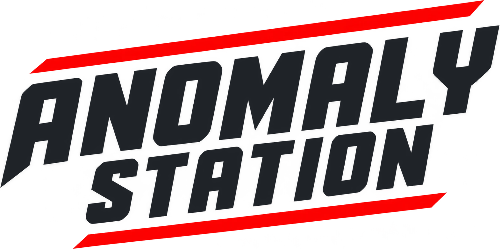
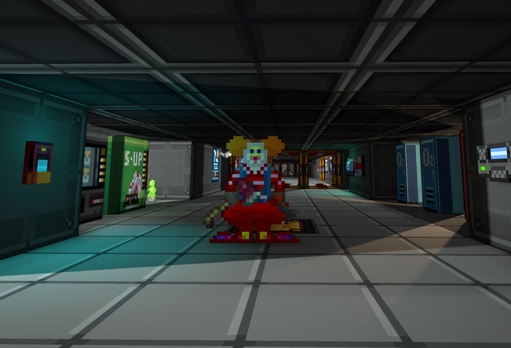

<p align="center">
  <picture>
    <source media="(prefers-color-scheme: dark)" srcset="docs/logo/logo-dark-theme.webp">
    
  </picture>
</p>

<p align="center">
  <a href="https://discord.com/invite/3QYKDaWVX3"></a>
  <a href="LICENSE"></a>
  <a href="LICENSE-ASSETS"></a>
  
  
</p>

## About

**Anomaly Station** is a first-person 3D remake of Space Station 13, built on the
[/tg/station](https://github.com/tgstation/tgstation) codebase.

**Status: pre-alpha.** You can start a server, join a round from the lobby, pick a job and play on converted ss13 map or in new 3d multilevel maps with much of
tg's station working: atmospherics and power, medicine and surgery, chemistry, botany, cargo, research, weapons and mechs.
Some jobs, Lavaland and most antagonists are still being ported, many objects still wait for their 3D models, and you
will find bugs. See the [roadmap](docs/ROADMAP.md) and the [changelog](CHANGELOG.md).

## Mission

- **Keep the soul, add a dimension.** Bring the game so many people love into a full 3D world you can move through
  freely, while keeping its original design and atmosphere.
- **Open the door for newcomers.** SS13 is famous for its deep, tangled mechanics. Better UI and UX, in-game tutorials and
  more comfortable controls should lower the barrier to entry and make them easier to learn.
- **A modern engine.** Move the game off BYOND to Godot and .NET for better performance and simpler development.
- **Better tools.** Give the people who make the game friendlier tools for mapping, content and debugging.

## Documentation

<div align="center">

| Getting started | Development | Project |
|---|---|---|
| [Building](docs/building.md) | [Contributing](CONTRIBUTING.md) | [Roadmap](docs/ROADMAP.md) |
| [Running and controls](docs/running.md) | [Testing](docs/testing.md) | [Changelog](CHANGELOG.md) |
| [Hosting a server](docs/hosting.md) | [Mapping guide](docs/mapping-guide.md) | [Credits](CREDITS.md) |
| [Release builds](docs/building.md#release-builds) | [Architecture](docs/architecture.md) | [License](#license) |
| | [Versions and releases](docs/versioning.md) | [Security](SECURITY.md) |

</div>

## Build

You need Git with [Git LFS](https://git-lfs.com/), the [.NET 10 SDK](https://dotnet.microsoft.com/download),
[Godot 4.7.2](https://godotengine.org/) in its **.NET** build, about 15 GB of disk and 16 GB of memory. On Windows, run
the scripts in Git Bash.

The tools read tg's code and assets from a tgstation clone at commit `1d99bd7f`, placed next to this repository. Only
that one commit is needed (about 600 MB):

```bash
git init ../tgstation
git -C ../tgstation fetch --depth 1 https://github.com/tgstation/tgstation.git 1d99bd7f599fcd687fd563cbe01370d0b020e46f
git -C ../tgstation checkout FETCH_HEAD
```

Then build:

```bash
tools/convert-tg.sh                           # tg's icons, sounds and maps for the client, and the Godot import
dotnet build AnomalyStation.sln -c Release    # the core, the server, the tools and the tests
dotnet build godot/Anomaly.Client.csproj      # the client
```

Optionally, `godot/tools/smoke.sh` then checks automatically that the client works: it runs it headless on a scripted
world and on MetaStation and fails on any error.

Setting up Godot on each OS, hardware, tests, release builds and every script: [docs/building.md](docs/building.md).

## Run

Start a server on MetaStation, then connect a client to it from a second terminal:

```bash
dotnet run -c Release --project src/Server -- --realtime --map metastation
godot-mono --path godot -- --connect=127.0.0.1:7777 --name=YourName
```

`godot-mono` is the Godot .NET binary; on Windows use the path to your `Godot_v4.7.2-stable_mono_win64_console.exe`
([docs/building.md](docs/building.md#godot-on-each-os)).

Other maps, LAN play, controls and the dev commands: [docs/running.md](docs/running.md).

## Contributing

Contributions are welcome! Start with [CONTRIBUTING.md](CONTRIBUTING.md). Small fixes can go straight to a pull request;
for bigger changes, talk to us on [Discord](https://discord.com/invite/3QYKDaWVX3) first. Questions, ideas and playtests
live there too. Please follow our [code of conduct](CODE_OF_CONDUCT.md), and report security problems privately
([SECURITY.md](SECURITY.md)).

## License

- **Code:** [GNU AGPL v3](LICENSE). It includes code translated from /tg/station, which is AGPL too. Anyone who runs a
  modified server must offer its players that version's source.
- **Art and media** in this repository (3D models, textures, interface images): [CC BY-SA 3.0](LICENSE-ASSETS).
- **Third-party work** (tg's icons, sounds and fonts, which the build copies from a tgstation clone, plus the engine,
  libraries and speech models): see [CREDITS.md](CREDITS.md).

##

<p align="center">
  
</p>
