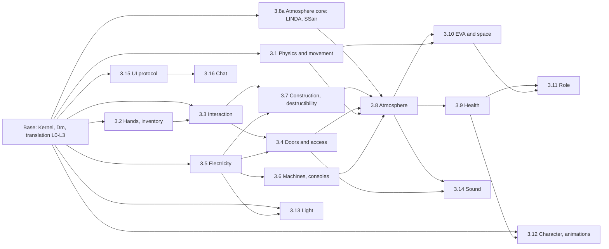
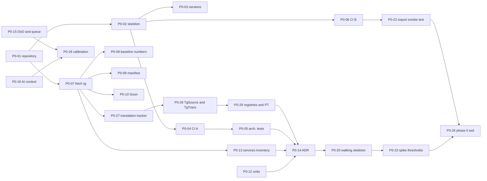

# Plan for Porting Space Station 13 to 3D (SpaceStation3D)

Status: final port plan, first edition, revision 1 (based on comments from four reviewers; the list of changes is in the "Revision log" section at the end of the document). Basis: the decision log `docs/ai/DECISIONS.md` (D1-D83 and "Project mission", source of truth), the synthesis `docs/ai/research/00-SYNTHESIS.md` and reports `docs/ai/research/01`-`10`. Reference: tgstation, snapshot `1d99bd7f`, read-only, no merges from upstream [D2, D30].

**Mission [D81].** SpaceStation3D is NOT a remake and NOT an "inspired-by game"; it is a PORT of SS13 to first-person 3D with the highest achievable fidelity in reproducing the mechanics, systems, numbers and behavior of the original. The source of truth for gameplay is the tg code. Only forced deviations caused by 3D and first person, and explicit owner decisions, are allowed; every deviation is recorded in the deviation registry. The research conclusion "parity is not a goal" does not apply to the project. The plan is built around this mission and the porting method of D82 and D83 (fidelity everywhere, faithful translation of tg code to C#).

> **Status note (2026-10-05).** This plan predates D86-D93. Where it prescribes strict fidelity ("exact", "identical result", "bug for bug"), mandatory verification tooling (TgTrace fidelity checker, mutation tests of the translation, mandatory S9 oracle and golden traces, strict mechanics registry), early infrastructure (CI from day one, license manifests, formal spikes with thresholds, heavy ADRs) or its phase order and estimates for the start of work, `docs/ai/DECISIONS.md` (D86-D88) and `docs/ROADMAP.md` take priority. The reference-first principle of D86 replaces the strict reading of D81-D83 and D74. Architecture (section 2) and system descriptions (section 3) remain a valid reference. The text below is kept unchanged for traceability.

## How to read this document

- References `[D38]` point to an owner decision, `[06 F2]` to report 06, section F2, `[00 §3 R2]` to the synthesis. The reader does not need to open the 83 decisions: each constraint is restated in section 1, and the full table mapping decisions to plan sections is given in Appendix A. Owner questions from section 11 are numbered OQ-1, OQ-2 and so on, so as not to confuse them with the synthesis questions Q1-Q37 [00 §6]; the mapping is in Appendix C.
- Tags in the text:
  - **[Assumption]** a number or statement by the plan's author that is not confirmed by a source; collected for verification in sections 4.1 and 11.
  - **[Proposal]** a choice by the plan's author within the freedom that the decisions leave; the owner may change it without revisiting any decisions.
  - **[Owner question]** a decision the plan is not entitled to make. All such questions are collected in section 11.
- Decisions D1-D83 are not disputed. The plan clarifies their consequences and risks. Where decisions are in tension with each other, this is stated explicitly in section 1.9. Decisions D81-D83 take priority over D18, D30, D74 where they conflict, as recorded by the owner.
- Unit of work: **PW** (person-week) in the sense of report 09: one week of work by a senior C#/Godot engineer, including tests and review [09, effort estimate]. For "human plus AI", the PW is a unit of work volume, not a calendar week. Conversion to a calendar is possible only after speed is calibrated at gate G1 (section 4.7) [D26, D27]. The plan contains no calendar schedule or dates: per D27, the calendar plan is built only after speed calibration at G1; the estimates in months in section 4.8 are arithmetic on assumptions, not a forecast.
- Terms for the owner are collected in Appendix B.
- Numbers for tgstation and Godot are taken from the reports; anything marked as unconfirmed in Appendix A of the synthesis is not included in the plan as fact. Numbers I measured myself in the tg clone while preparing the plan are marked "measured during plan preparation".

---

## 0. One-page summary

**What we are building.** An open-source (AGPLv3) **port** of Space Station 13 to 3D: first person, low-poly in the spirit of Lethal Company, multiplayer for 30-100+ players on dedicated servers, rounds as in SS13 [D3, D4, D6, D7, D15, D81]. The client is built on Godot 4.7.2 mono and C# (.NET 10); the authoritative server is a separate console .NET process on a shared core library without Godot [D1, D37]. **Method:** tg data (maps, types with default values, reagents, recipes, strings, behavior trees, icons) is converted automatically [D30]; logic is ported by **faithful translation** of tg code to C#, preserving structure, formulas, numbers and order of events, with a "file:line" reference to the source [D83]; DM semantics (float32, 1-based indexing, null, lists, deciseconds, implicit engine services) are provided by a shim library; tg numbers and units are preserved inside the core [D82]. All deviations (3D, first person, replacement of tgui, lighting, admin tools) are recorded in the deviation registry [D81]. There are no pre-agreed cuts: if a gate fails, the owner is asked a question [D29].

**Main risks** (detailed in section 8):
1. **The volume of faithful translation and the owner's review time.** The translation covers on the order of 1.08 million lines of DM (core and T2 about 899 thousand, plus a long tail of T3 of about 180 thousand [09 F1]). The D12 vertical slice, taking into account D20-D22, D38, D41, D51, D52 and D81-D83, is estimated at **425-845 PW** (report 09 gave 160-290 PW without these decisions); the path to the G2 alpha is about **590-1,140 PW**, to parity about **1,210-2,830 PW** (section 4). The limiting factor is not code but the owner's hours: at 10-20 h/week (of which about 85% goes to review, the rest to standing duties [Assumption]) and 3-6 hours of review per PW, speed will be about 1.4-5.7 PW/week (section 4.8).
2. **Compatibility of faithful translation with rewind and with subroutines that wait** [D31, D38, D83]: tg code keeps state in an object graph and waits via `sleep` and `do_after`; rollback and restore require a snapshot and journal of this graph, and waits require "continuations" as data. Resolution: adapted translation following fixed patterns, recorded in the deviation registry.
3. Networking and full rollback [D37, D38]: SS14 arrived at prediction about 3 years after its restart [02 F9].
4. First person, character and art [D4, D7, D25]: there is no precedent for live first-person multiplayer [01 F8, 00 §3 R6].
5. Atmosphere, wind, zero gravity and EVA as a coupled system; atmosphere fidelity to tg everywhere [D22, D52, D82].
6. Licensing: importing assets "as is" with NC sounds and unknown provenance [D35]; translating tg code is permissible under path A, Goon-derived files are not carried over [D34, D80].
7. Newcomer learning cliff: there is no tutorial [D63].

**Main plan decisions** (within the freedom the decisions leave):
- Core: `Anomaly.Core.Kernel` (world, 20 TPS tick = tg `world.fps`, int64 ticks, state snapshot and journal), `Anomaly.Core.Dm` (DM semantics shim), `Anomaly.Core.Tg` (translated tg code, mirroring the `code/` tree), `Anomaly.Core.Adapt` (3D adaptations); not a single reference to Godot [D1, D82, D83].
- The object model follows tg: datum, atom, components, elements, COMSIG signals; an Entity is an instance of a datum or atom, a Prototype is a DM type with default values generated by the converter [D83, D45].
- Fidelity verification: a fidelity checker (comparing the translation against the source by numbers, calls and control-flow shape), porting tg unit tests (453 classes), golden traces, an oracle (S9 becomes recommended) [D81, D83].
- Physics in the core: kinematic controller, a bounded set of bodies, 6DoF zero gravity, a bridge to the tg chains `Move`, `throw_at`, `newtonian_move`; wind is a translation of tg `high_pressure_movements` (a discrete step through the `Move` chain; the physics-impulse variant is for the owner to decide, K22, OQ-39) [D22, D32, D52].
- Replication: LiteNetLib, snapshots and deltas, interest management by rooms and chunks with LOS, multiple "eyes" [D23, D37, D54].
- Ten spikes S1-S10 (S5 expanded, S10 a new pilot for faithful translation) with numeric thresholds; none requires money beyond the budget (section 5).
- Process: docs-first, ADR, mechanics and deviation registries, three review levels (RV0, RV1, RV2) instead of reading all the code, independent tests for critical systems (section 6).

**Path.**

| Stage | Contents | What the owner gets |
|---|---|---|
| Ph0 | Repository skeleton, CI, ADR, license manifest, registries, translation tracker | Green CI on three OSes, working rules |
| Ph1 | Spikes S1-S10, calibration of translation and review speed | **Gate G1**; milestone V0: a first-person walk through a gray-box Meta; translation pilot |
| Ph2-Ph3 | Core, shim, base of translated code, converters, Meta with placeholders | Core tests, converted station; milestone V0.5: first end-to-end mechanic on translated code in a networked client |
| Ph4 | Single-player vertical slice (client and server as processes) | Milestone V1: engineering bay; milestone V2: slice (breach, wind, repair, EVA) |
| Ph5 | Multiplayer, prediction, bots for 100-150 | Milestone V3: slice with 2-16 humans and bots |
| Ph6 | Round, roles, antagonist, director, closed playtests | **Gate G2** (recognizability test of 8 items) |
| Ph7 | Voice, TTS, Russian localization | A game with voice |
| Ph8 | Parity by tier: translation of the rest of the tg code | Main direction after G2 |
| Ph9 | Open release, license audit, host operator documentation | First public build (timing of the first public build release: owner question OQ-38) |

**What the owner can expect.**
- Load on the owner: the path to G2 with tiered review needs about 1,800-6,000 hours, the path to parity about 3,200-12,900 hours (section 4.8). If all the code were read in full, the figures would grow roughly 2.5-3 times: this is why review is organized in tiers with automatic fidelity gates.
- The 24-36 month horizon [D27] and the expectation of a "finished port noticeably sooner than several years" [D26] are neither confirmed nor refuted by the plan: speed has not been measured. Arithmetic on assumptions (section 4.8, not a forecast): to fit within 36 months to G2, at the midpoint of the estimates you need at least about 5.5 PW/week (about 25 h/week on review, about 29 h/week of the full budget with a 15% reserve, i.e. above the stated 10-20); parity within 36 months would require about 13 PW/week (about 52 h/week on review); in the central scenario (15 h/week, 4.5 h of review per PW) it is about 70 months to G2. The decision on which boundary the horizon refers to, G2 or parity, belongs to the owner (**[Owner question]** OQ-1, priority P0, an answer is needed before leaving phase 0): until the answer, two traffic lights are computed at G1, one for the G2 boundary and one for the parity boundary, and the owner sees both. Speed will be measured by the phase 1 calibration and the translation pilot S10; at G1 the owner will receive a recalculated timeline and (if the traffic light is red for the chosen boundary) a D29 question with ready-made options. The estimate of the volume of faithful translation under D83 is recomputed at G1 from the measured translation speed.
- The first end-to-end mechanic on translated code (milestone V0.5: pick up a crowbar, open an airlock, see depressurization, two processes over the network) is planned for the end of phase 2, so that the integration of translation, network and client is verified before large investments. The first **playable** thing with a set of mechanics (not a walk) appears in phase 4; until then the owner accepts tests, spike reports and renders. The plan deliberately sets an early milestone V0 (a walk through a gray box) so that feedback on first person comes before large investments.
- The budget of 50 dollars per month does not break the plan: CI is free on a public repository, load tests are local, a VPS is needed only briefly (section 10). The unknown quantity is the cost of the AI work itself [D61]; with faithful translation of 1 million lines of code it may be the main expense item, it is measured from the first week (section 4.7) and enters the S10 criteria and the traffic light as the threshold "dollars per 1,000 lines of translation" (OQ-2).

---

## 1. Principles and fixed constraints

Below, all 83 decisions are grouped by area. Format: the decision and its main consequence for the plan.

### 1.1 Product

- **D81** Mission: a PORT, not a remake; maximum fidelity of mechanics, systems, numbers, behavior; the source of truth is tg code; only forced deviations (3D, first person) and explicit owner decisions are allowed; a mechanics registry and a deviation registry; the research conclusion "parity is not a goal" does not apply. Takes priority over D18, D30, D74.
- **D3** Open project: sources under AGPLv3, non-commercial. Goonstation code must not be used.
- **D5** Vertical slice first, then growth. The architecture must allow adding systems without rewriting the core. The slice and the alpha are stages toward the full port, not ends in themselves [D81].
- **D12** Slice: electricity, machines, construction and deconstruction, atmosphere, health and medicine; ONE role; the world is destructible (every object on the map has health); no antagonist and no radio channels. The included mechanics are translated faithfully; the rest is not translated, rather than "simplified".
- **D15** Rounds as in SS13: lobby, role selection, 1-2 hours, results, clean restart. No world persistence.
- **D28** v1 composition: the slice (D12 tech demo), then the alpha: 3-5 roles, one antagonist with progression and traces, a minimal director (2-3 events with counterplay), closed playtests with 8-16 players. Criterion: the recognizability test.
- **D29** There are no pre-agreed cuts. The order of work is determined by dependencies. If a gate fails, the owner is asked a question rather than a silent cut.
- **D63** Main goal: reproduce SS13 in 3D (parity by tier, phase 8). Mixed audience. **No tutorial**; the phase 6 tutorial was removed from the plan.
- **D78** G2 criterion: a recognizability test of 8 items at a closed alpha playtest.

### 1.2 Stack, core, porting method

- **D1** Godot 4.7.2 mono, C#, .NET 10. The simulation core is a separate library without Godot; Godot is only the client. The core is tested with `dotnet test` without the engine.
- **D77** Versions are pinned: Godot 4.7.2 mono, `net10.0` (in the versions file and CI). Engine upgrades only at phase boundaries, with a test run and an ADR entry. In 4.8 the minimum TFM is `net10.0`.
- **D9** Client: Windows, Linux, macOS; server: Linux and Windows, headless. Client export for three OSes in CI; the server binaries win-x64 and linux-x64 are published by CI; macOS without Vulkan specifics (Metal/MoltenVK).
- **D83** Logic is ported by FAITHFUL TRANSLATION of tg code to C#, preserving structure, formulas, numbers and order of events, with a "file:line" reference, rather than by rewriting from understanding. Replaces the D30 wording "rewritten by algorithm". DM semantics via a shim library. The translation is performed by AI; verification: tg unit tests (453 classes), scenario tests, golden traces, an oracle (S9 recommended). Path A permits translation; copyrights and headers are preserved; Goon files are not carried over. The core's object model follows tg (datum/atom, components, elements, signals).
- **D82** Fidelity everywhere, including the atmosphere (LINDA, gases, reactions, fire, pipes). The "simplified" atmosphere of D18 means only a single layer without vertical diffusion and optimization of the implementation without changing results. Balance is not "raised by playtests": playtests check agreement with tg. The unit conversion table remains only at the boundary with 3D; inside the core, tg numbers and units (deciseconds, etc.) are preserved; the core tick is aligned with `world.fps` 20.
- **D30** Variant V2: the tg data converter (maps, types into prototypes, reagents, gases, recipes, strings, behavior trees, icons) stays; the part "behavior is rewritten by algorithm" is replaced by D83. tg snapshot `1d99bd7f`, no merges. V5 ("inspired-by game") only by the owner's decision at a gate and contradicts the D81 mission; it remains a formal fallback.
- **D45** Entity + Prototype + Components + EventBus; prototypes in YAML or JSON with validation in CI; interpreted per D83: an Entity is an instance of a datum or atom, a Prototype is a DM type with default values (converter), Components are tg components, the EventBus is tg COMSIG signals (cancellable, ordered); entities as handles (int and generation); a ready-made ECS library is not used.
- **D19** No code mods. Only data and content packs (prototypes, maps, textures, sounds, strings). All executable code lives only in the main build.
- **D31** Actions (`do_after`) and dialogs are serializable data with continuations in a deterministic tick with int64 time. No `Task` and no threads in gameplay. RNG from the tick seed. When translating tg code, this requires an adapted translation of subroutines with waits (K16).
- **D64** Core numbers: `float` (`System.Numerics`), which matches DM float32. Prediction divergences between ARM64 and x64 are fixed by the server through correction; golden tests on a single platform.
- **D17** English is the base, i18n from day one, Russian second; strings only through translation tables (keys, not literals). With faithful translation, text literals of tg code are automatically extracted into keys.
- **D75** System messages are localized on the client (the server sends keys and parameters); player speech stays in the author's language; TTS speaks in the language of the text; Cyrillic and Latin are mandatory, CJK and RTL later.

### 1.3 World

- **D14** A strict tile grid plus free items. Direct conversion of tg maps, atmosphere by cell, pathfinding on the grid.
- **D33** Tile 2 m, ceiling about 3 m, items 1x1 slightly smaller than a tile. The exact door and character height dimensions are confirmed by S5 before art production; after that, a freeze.
- **D46** A converter from `.dmm` to our own diff-friendly text format (sparse, chunked, stable order); we start with MetaStation; an in-game map editor after the slice.
- **D18** Atmosphere: a simplified tile simulation (1 cell = 1 tile, a single layer, no vertical diffusion); under D82 this means only single-floor maps and optimization without changing results. Visual beauty as a separate layer: volumetric visual effects for gas, smoke, fire; the simulation and visualization are separated by an interface.
- **D20** Minimal life support in the slice: pipes, vents, scrubbers, canisters, a simple pump (without heat exchangers, mixers, filters, reactors, engines). A pipenet model separate from the tile model is needed (in tg this is `datum_pipeline`, translated).
- **D21** Gases and reactions: O2, N2, CO2, plasma, water vapor; combustion (plasma and ordinary fire). The other tg gases come after the slice. The gas and reaction registry is data.
- **D22** "Space wind" in full: pull toward a breach for players and light items, pressure damage, muffled sound in vacuum (in tg this is `high_pressure_movements`).
- **D32** Simple physics in the core: a kinematic player controller on tile collisions plus a limited number of bodies; the client interpolates. Bepu later and only if necessary; Godot physics is not used on the server.
- **D52** EVA and zero gravity right in the slice: real space around the station, movement in zero gravity from first person, items and bodies live under zero-gravity physics.
- **D74** A table of tg coefficients into our units: under D82 only for the boundary with 3D (distances, speeds, radii for rendering and input); inside the core, tg units. Strict compatibility now applies everywhere, not only to the atmosphere.

### 1.4 Player

- **D4** First person. Click interaction, visibility and social mechanics need to be rethought; sprites as billboards do not fit. The corresponding deviations from tg are recorded in the registry [D81].
- **D41** Hands and items (view-model) for oneself, the full body (clothing, wounds, blood) for others; ghosts and observers can switch the view; visibility and LOS computation lives in the core; the camera is a replaceable layer.
- **D11** Hybrid physics: discrete hands, slots and inventory plus physical throws, items falling, dragging bodies; limits on the number of physical objects.
- **D49** Interaction: a ray from the camera against simplified colliders, candidate highlighting; the primary action on a key, holding the right button gives a radial context menu; two hands and an active hand; six archetypes (button, lever, container, door, item, machine with UI). The tg pipeline is carried over almost one-to-one as an event pipeline.
- **D50** Health: per-body-part hitboxes plus a subset of the tg health system. In the slice: brute, burn, toxin, oxygen; 6 zones; lungs and heart; bleeding; basic wounds and treatment. Combat and dismemberment are built up after the slice (but the character model is ready for dismemberment from day one).
- **D51** Players are physical and solid. Exception: a knocked-down player has collision with others disabled. A body can block a door, but not a path forever: an opponent can be knocked down and passed.
- **D53** Equipment slots and quick slots in the HUD, an inventory window with a "paper doll" and a container window; two hands; push-to-talk, chat and radio on separate keys; remapping is mandatory.
- **D54** In the alpha: ghost/observer and tracking cameras/consoles (several sources of interest). AI, cyborgs, mechs: phase 8.
- **D55** Role-filler bots on behavior trees and simple fauna; pathfinding on the grid taking into account doors, access, destructible walls and vacuum. Bots are clients of the protocol and are used for load tests. Grid pathfinding and simple fauna are part of phase 6 (section 4.4).
- **D56** No nameplates: recognition by appearance, clothing, the ID card on the chest; the name in chat only if the player has recognized the person; a mask hides the face, the voice is "Unknown". Requires a server-side "known names" mechanic per player and an entry in the deviation registry (section 2.5, PT-15; recognition rules: OQ-40).
- **D13** Speech: text plus spatial voice plus a TTS option that reads out all text.
- **D16** TTS locally on the client: a lightweight local model, the character's voice set by parameters in the pack.
- **D69** Voice follows the world's rules (masks, languages, whisper and shout range, headsets, muteness); mute and report; a server buffer of the last N seconds is a host operator option (off by default). Phase 7; codec and jitter buffer in S7.
- **D68** The profile (characters, appearance, layout, settings) is stored as a file on the client; the server validates the description on join.
- **D70** Accessibility by the first playtests: FOV, disabling head bob and camera shake, colorblind modes, sound subtitles and visual cues, flash limiting, full remapping. The colors of health indicators are not the only carrier of information. The plan reads "by the first playtests" as "before the first session with other people" (milestone V3, phase 5): the criterion is placed in phase 5 (section 4.4).

### 1.5 Network, security, operations

- **D6** Multiplayer is mandatory, target 30-100+ players, dedicated servers. Authoritative server, headless from day one.
- **D37** LiteNetLib plus our own snapshots, deltas and interest management by rooms and chunks with LOS; 20 TPS tick (under D81 and D82 aligned with the original's `world.fps` 20; the 30 TPS variant is not used without an owner decision); the server is pure .NET without Godot. Godot's built-in multiplayer is not used.
- **D23** Chunks for REPLICATION (not for simulation): the client receives the dynamics of the area of interest with a radius margin and hysteresis. The simulation is global and is not unloaded. The static map is loaded whole, once. Sources of interest are multiple (body, cameras, ghost, consoles); audibility and radio do not depend on visibility; chunk sizes and radii are determined by S1.
- **D38** Prediction: an owner decision, FULL simulation rollback, in stages: (1) movement, hands, doors in phase 5; (2) extending rollback as systems appear; (3) atmosphere and pipes are probably impractical to roll back: a decision based on S1 data at G1. Stated risk: SS14 arrived at this after about 3 years.
- **D39** Design load of 100 players, validation with bots up to 150; public playtests small at first (8-16).
- **D40** Server authority only: typed commands, validation, per-type rate limit, the server does not send hidden information, protocol fuzzing. No client-side anti-cheat and no asset encryption.
- **D65** The server is untrusted by the client: content packs are data only (glTF, PNG, OGG, YAML/JSON), hashes, limits on size and mesh complexity, validation at load, no executable code from the server.
- **D10** Self-hosting for anyone: a headless binary and Docker, own configs; documentation for host operators.
- **D66** A Docker image and a Linux binary with a public UDP port, no relay and no NAT punch-through; watchdog and auto-restart.
- **D57** Identity is verified by the server itself; local names and bans; external ID, a shared ban list, a hub later.
- **D67** IP and HWID are not stored by default (the host operator may enable it with a retention period); voice recordings are not stored. Host operator option: a config for storing IP and HWID with a mandatory retention period and automatic cleanup (section 2.14).
- **D71** A periodic world-state snapshot (the same mechanism as for rollback) and recovery after a crash; replays later.
- **D72** Telemetry: only voluntary crash reports; server metrics go to the host operator's local log.
- **D76** SQLite for admin notes, bans, statistics; migrations; the round world is not stored in the DB; recovery snapshots as separate files.
- **D60** Distribution: GitHub Releases and itch.io; Steam later; version and content hash check on join; signing and notarization once an audience appears.

### 1.6 Art, rendering, sound, UI

- **D7** Low-poly in the spirit of Lethal Company, graphics as simple as possible but readable. Particular emphasis on character readability: clothing, dismemberment, blood, health indicators are visible.
- **D25** A three-level art pipeline: (1) auto-placeholders from tg sprites (box or extrusion), the game is playable from day one; (2) procedural modular kits (headless Blender scripts, glTF); (3) key objects and a modular character (AI plus Blender/Blockbench edits plus CC0). External assets are checked for compatibility (NC and "no derivatives" are not allowed).
- **D24** Lighting without baked GI: the client computes base lighting over the tile grid with local recomputation (a light grid texture); real dynamic sources with shadows only near the player; the server replicates only the state of the sources. Replaces the tg lighting system (deviation in the registry).
- **D42** Target hardware: a mid-range PC and an M-series Mac; Forward+, a budget of shadow-casting sources near the camera, no LightmapGI; minimum hardware to be refined by S2.
- **D43** Audio: occlusion and muffling from core data (station graph: walls, doors, pressure); import of tg `.ogg` (3,793 files) within D35; muffling in vacuum from replicated pressure.
- **D44** Native Godot UI (Control); windows are thin views over a "state plus action" protocol (an analog of `ui_data`/`ui_act`, whose procedures are translated); about 20-25 windows for the slice; WebView and tgui are not used (replacing tgui is a deviation in the registry).

### 1.7 Legal and community

- **D2** Reference: tgstation (code AGPLv3, assets mostly CC BY-SA 3.0).
- **D34** Path A: an open AGPLv3 port; translation and adaptation of tg code are permitted, derivative works are open, DCO, we do not take Goonstation code, we preserve copyrights and headers, a source offer for AGPL §13. Switching paths is impossible without a rewrite from scratch.
- **D35** tg assets are imported "as is" with a STATED RISK: >=28 NC sounds, 1,291 `vox_fem` files and 880 instrument files without a source, someone else's IP. Conditions: (1) a manifest with a license label for every file (a label, not a block); (2) NC and unknown assets in a separate directory with their own notice; (3) an audit and a question about replacement before the first public build (phase 9).
- **D36** The content policy (ERP, 18+, age) has not been adopted yet; to be revisited before the first public build (G2): a policy and moderation tools are needed, especially for voice.
- **D58** Working name SpaceStation3D; the real name before the public build with a collision check; lore based on CC0 `common_core` and our own; we do not use the tgstation, Goonstation, BYOND brands.
- **D59** No external contributions (code is open, forks and servers are free, we do not accept pull requests until G2). DCO and CODEOWNERS are left for the future; a public policy on AI code is needed as disclosure.
- **D80** We do not engage with upstreams; we do not take Goonstation code; CI checks for Goon-derived files by markers; disputed Goon-derived tg files (for example `wrestling.dm`) are not carried into the port; the project is announced to the community at G2.

### 1.8 Process and resources

- **D8** One person plus AI, no team and no outsourcing: maximum automation; the architecture is simple to enter for future contributors.
- **D26** Owner time of 10-20 h/week; almost all implementation is delegated to AI; the owner does review, decisions, playtests, art edits. The owner's expectation (a finished port noticeably sooner than "several years") is an assumption; speed has not been measured and is calibrated in phase 1.
- **D27** Upper bound of 24-36 months with gates G1 (after spikes) and G2 (after the alpha); at each gate a recorded decision "continue, narrow, or stop".
- **D47** docs-first, an ADR for every significant decision, CI from day one: two pipelines (dotnet build/test; Godot headless import and export in Docker with a pinned version), integration tests in separate processes, golden and replay, limits on scene and class size, a license report without blocking.
- **D48** Behavior reference: spike S9 (1-2 weeks): tg on OpenDream or in Docker as an oracle for golden traces; under D81 and D83 recommended; if it fails, scenario tests based on tg unit tests.
- **D61** A budget of up to $50 per month for everything (AI subscription, hosting, CI, domain). A public repository from day one; load tests locally; the VPS for S1 is the cheapest and short-lived; no paid AI 3D/audio generators; Apple Developer ID deferred.
- **D62** The owner reads the code themselves and understands SS13 game design and balance. Does NOT cover 3D/rig/animation or sound/music: AI, automation and CC0 cover them. Checkpoints: ADR, the core at its boundaries, game design and balance; art and sound via renders, previews, automated checks.
- **D73** Dev and admin tools (console, entity inspector, profiler, free camera, invisible observer, spawn, teleport, state editing, log search) are built together with the core in phase 2. They replace the tg admin panel (a deviation in the registry).
- **D79** Main development on an M-series Mac (arm64); periodic tests on Windows; very rare ones on Linux. Linux and Windows mostly through CI runners and headless; a manual Windows checklist is needed before each gate.

### 1.9 Contradictions and tensions between decisions

Owner decisions are not disputed; this lists the places where they are in tension and proposes a resolution. "Owner question" means the plan is not entitled to choose by itself. Rows K4 and K5 are closed by decision D82.

| # | Decisions | Essence of the tension | Proposed resolution | Status |
|---|---|---|---|---|
| K1 | D26, D27, D29, D63, D8, D81-D83 | A 24-36 month horizon, parity as the main goal, faithful translation of 1.08 million lines, no pre-agreed cuts, and one person at 10-20 h/week. Arithmetic on assumptions (section 4.8, not a forecast): about 590-1,140 PW to G2, about 1,210-2,830 PW to parity; parity does not fit in 36 months with tiered review, and G2 fits only at a speed of at least about 5.5 PW/week. The wording of D27 ("upper bound") and the expectation of D26 ("a finished port noticeably sooner than several years") refer to the port as a whole | The plan does not adopt a default interpretation: which boundary the horizon refers to (G2 or parity) is for the owner to decide. Until the answer, two traffic lights are shown at G1, for the G2 boundary and for the parity boundary (section 4.5); if the traffic light is red for the chosen boundary, the owner is asked a question with options (extend, explicitly narrow, speed up, V5) | **Owner question** OQ-1 (P0): answer before leaving phase 0 |
| K2 | D38 with D18, D20, D22, D52, D64, D83 | A "full rollback" versus atmosphere, pipes, wind, 6DoF physics, the non-guaranteed cross-platform determinism of float, and the object graph of translated code that runs on the client over an incomplete replica of the world. SS14 does not predict atmosphere and power [02 F9] | Stage 1 of D38 (movement, hands, doors, phase 5) predicts a limited subset (section 2.9); stage 2 is defined by an explicit list of slice systems with the criterion "all slice systems are rewind-safe and roll back, except the listed exceptions"; atmosphere: a decision at G1 from S1 data (as stated in D38, stage 3). Any other exclusion from rollback (power, other people's throws, explosions, wind, etc.) is an owner decision at G1, not a plan choice | **Owner question** OQ-43 (rollback exceptions, G1) and the atmosphere decision at G1 (OQ-9) |
| K3 | D35 with D3, D34, D61; synthesis R5 and the phase 0 criterion | D35: labels, not a block; the synthesis proposed a CI block on NC and "zero unknown assets in the build" | The linter fails only on a file with no manifest entry; NC and unknown are acceptable with a label; the phase criteria were rewritten (section 4.4). The catalog of NC and unknown assets is NOT committed to the public git and does NOT end up in public CI artifacts and releases: it is assembled from the pinned tg clone only locally or in a private channel for closed playtests (section 9.2) | My choice; **owner question** OQ-3 about "do not commit" and about public artifacts |
| K4 | D18, D74 with D33 | tg atmosphere constants (`CELL_VOLUME` 2,500 L, measured during plan preparation) versus the 2x2x3 m (12 m3) tile geometry | Closed by D82: inside the core, tg numbers and units; 3D geometry is not relevant to the simulation | Closed by D82 |
| K5 | D18 and D74 | "We optimize the algorithm" versus strict compatibility of the atmosphere | Closed by D82: optimization is allowed only without changing results; there is no tolerance, differential tests require equality | Closed by D82 |
| K6 | D11, D22, D52 | Wind and zero gravity can simultaneously move all free items in a depressurized room; the budget of physical bodies is limited | Items are discrete until there is an impulse (in tg, a throw and drift are `throw_at` and `newtonian_move`); upon an impulse they "wake up" as bodies in order of proximity to players up to the budget; the rest get a deterministic simplified slide (a deviation in the registry); the budget is determined by S1 | My choice |
| K7 | D63 with D78 (items 1, 7) and D70 | There is no tutorial, yet the G2 test requires that a newcomer within 10 minutes pick up an item, break a door and see depressurization, and that a newcomer's mistake not be fatal | The G2 test is measured on newcomers without hints; the plan does not add a tutorial; if item 1 fails at G2, the owner is asked a question about hints (D63 permits this) | **Owner question** at G2 |
| K8 | D31 with D6, D39 | "No threads in gameplay" versus the performance of 100 players at 20 TPS | State is mutated only in the main simulation thread; there is no parallelism by default in gameplay computations (tg systems, pathfinding, atmosphere) [D31]. Parallel operations outside gameplay are allowed: snapshot serialization and network I/O. Any exception for gameplay computations is possible only through an ADR with the owner's approval (recorded in ADR-0002) | Closed per D31; exceptions only by owner decision |
| K9 | D57, D67, D69 with D36 | Local bans, no IP and HWID, no voice recording: moderating proximity voice and ban evasion is very hard. D36 asks for a policy and moderation tools "especially for proximity voice" by the first public build (G2), while voice under D69 is built after the network is stable (phase 7, after G2) | Text moderation tools (ahelp, notes, bans, text mute, appeals, chat filter) and the content policy are prepared before G2. Voice moderation tools (mute, report, optional buffer) are created together with voice in phase 7; until then voice is not enabled in any public build. The decision "voice on by default on public servers" is made at the end of phase 7, not at G2. If the first public build comes before the end of phase 7, voice is disabled in it (K21, OQ-38) | **Owner question** OQ-15 (end of phase 7) and OQ-38 |
| K10 | D44 with D63, D81 | About 20-25 windows in the slice versus 352 tgui windows at parity; tgui is replaced by native UI (a deviation) | Windows are built from a set of widgets and declarative state descriptions; the `ui_data` and `ui_act` procedures are translated faithfully, the presentation is new; the phase 8 budget is a separate line | My choice |
| K11 | D18 with D63 | Flat single-floor maps versus parity with multi-floor maps (IceBox 3 z, Tram, Nebula, Catwalk 2 z) [10 F5] | The data model stores a level index; multi-floor support and auxiliary z-levels (CentCom, shuttle transit, mines, moving shuttle platforms on which players stand under the kinematic controller) are not implemented until a decision and a small spike at the start of phase 8 | **Owner question** at the start of phase 8 |
| K12 | D56 with D63, D70, D41 | No nameplates: it is hard for a newcomer to tell who is who, especially among 30-100 players | S5 and G2 check character distinguishability with automated checks and with people using the methodology of sections 4.6 and 7.8; the D56 decision does not change; the "known names" mechanic is described in 2.5 (PT-15); if the check fails, a question to the owner | **Owner question** if the check fails |
| K13 | D12 (Meta in the slice) with D20 (subset of machines) and D81 | Meta's atmospheric loops use mixers, filters, heat exchangers outside the slice; fidelity requires translating them | In the slice, untranslated machines remain passive placeholders with specified starting gases. A placeholder's behavior differs from tg (the loop does not work), so each placeholder has a temporary DEV entry in the deviation registry with a removal deadline (phase 8) and a reference to D20; in the mechanics registry the status is "not translated". Scenario tests on mini-maps, plus a breach-and-repair scenario on full Meta with placeholders and a list of non-working loops; full Meta without placeholders in phase 8 | My choice |
| K14 | D61 with D26, D6, D83 | A $50 budget for everything, including the AI subscription, with many hours of autonomous agent work, now on a translation of about a million lines; the cost of AI work is unknown | Measure cost (tokens, subscription) per work package from the first week; the owner reports the share of the budget for AI and hosting; from this share a threshold of "dollars per 1,000 lines of translation" is derived, which enters the S10 criteria and the traffic light (section 4.5) | **Owner question**: allocation of the $50 |
| K15 | D48 with D79, D81, D83 | The S9 oracle requires running tg on OpenDream or in Docker, while the main machine is a Mac on Apple silicon; running tg on macOS is not confirmed [03 §10]; meanwhile the oracle is now recommended as the basis of fidelity verification | S9 is time-limited to 1-2 weeks but gets high priority. The oracle is a second opinion, not the truth: OpenDream is not equal to BYOND (UTF-16 text instead of UTF-8, 64-bit, external DLLs must be rebuilt, initialization-order problems are open), and running tg on it is confirmed only by screenshots [03 §10, 04 F7]; therefore S9 includes cross-checking OpenDream against real DreamDaemon on 2-3 traces (on the owner's Windows PC) and marking the provenance of the reference in the registry. If it fails, verification rests on tg unit tests (they check, for example, only the tolerances of `pump_gas_to` and the pipe topology, but not LINDA, fire and wind), manual calculations and conservation laws; the reduced confidence level under D48 is recorded in the registry and reported to the owner at G1 (OQ-42) | My choice; **owner question** OQ-42 on S9 FAIL |
| K16 | D83, D81 with D31, D4 | A faithful translation of `sleep`, `spawn`, `do_after`, `tgui_alert`, `usr`, `icon` and other DM constructs is impossible "line for line" given the requirements of D31 (continuations as data, no Task) and D4 (camera, interface) | A finite set of adapted-translation patterns is fixed (a subroutine with waits is cut into segments with a continuation as data; `usr` is replaced by an explicit actor; output to `icon`, sound, chat goes through boundary interfaces); each pattern is a single "pattern deviation" entry in the registry approved once by the owner; instances are logged automatically | **Owner question**: approve the set of patterns (section 2.5) |
| K17 | D83 with D38, D71 | Rewind and a state snapshot require serializable state, while translated tg code keeps state in an object graph with strong references, global variables and lists | Generated serialization of the fields of translated classes and an undo log for the predicted subset; references as handles; global variables in `World.Glob`; S10 and S1 measure the cost; risk R33 | My choice; the format decision at G1 |
| K18 | D82, D83 with D31, D32, D33 | tg numbers and units (deciseconds, tiles) inside the core versus int64 ticks and continuous 3D physics in meters | Time is stored as int64 ticks, 1 tick equals exactly 0.5 ds; the shim returns `world.time` in deciseconds; 3D physics sits at the boundary (`Adapt`) with the D74 table only there; crossing a tile boundary invokes the translated `Move` chain; the deviation is recorded | My choice |
| K19 | D81, D82 with D37 | The original's `world.fps` 20 versus "20 TPS with the possibility of 30" in D37 | 20 TPS tick; 30 TPS is not used without an owner decision (it would change all periods and behavior) | My choice |
| K20 | D81, D83 with D24, D43, D44, D68, D73 | Maximum fidelity versus replacing parts of tg: lighting, tgui, admin tools, client settings, the sound engine, the host (about 87 thousand lines of "replaceable" code [09 F1]) | These parts are not translated but replaced; the entire list is recorded in the deviation registry and confirmed by the owner once | **Owner question**: confirm the list of replaced parts |
| K21 | D36, D59, D80 with D34, D35, D58, D60, D69 | The moment of the first public build is set differently by the decisions: D36, D59, D80 tie the content policy, the decision on contributions and the project announcement to G2, while D35, D34 tie the license audit and the question of replacing assets to phase 9; D58 requires a name before the public build; D69 puts voice after G2. The plan places the first public build in phase 9 (after phase 8) | Not resolved silently. Options for the owner: (a) a public alpha right after G2: a "mini-phase 9" (D35 audit, D58 name, host operator documentation, moderation policy; without voice), phase 8 runs in parallel; (b) the first public build after phase 8: then the D36, D59, D80 decisions at G2 do not require a public build. Until an answer, the plan follows (b) and marks the G2 decisions as not requiring a public build [Assumption] | **Owner question** OQ-38 |
| K22 | D22, D11, D32, D52 with D81, D82 | D22 and D11 describe "space wind" as deterministic physics of bodies under pressure; in tg code wind is a probabilistic discrete `step()` no more than once per `SSair` cycle, and the "force" (`max_force`) is merely a threshold (`LINDA_turf_tile.dm`, `experience_pressure_difference`, measured during editing); continued drift in vacuum is `newtonian_move` and `drift_handler` | Under D81 and D82, by default it is precisely `step()` that is translated (exact, cheap, requires no body budget, rewind-safe); the client interpolates the step. Mapping wind to impulses of physical bodies would be a deviation from tg and a waste of the body budget [K6]. Drift after being blown into space: `drift_handler`, in 3D as 6DoF (adaptation) | **Owner question** OQ-39 (G1; default: discrete `step()`) |
| K23 | D21 with D19, D83 | D21 requires a gas and reaction registry as data "so that gases can be added without editing core code"; under D83, reactions are translated as code (`reactions.dm`: conditions and the `react` body) | Gases (`gas_types.dm`), reaction conditions (`min_requirements`), priority and factors are pack data; the `react` body is translated code. A new gas without a new reaction is added as data; a new reaction with new logic requires a code edit (a deviation from the wording of the D21 consequence, recorded in the registry) | **Owner question** OQ-47 (confirm the interpretation, G1) |

Adjustments to the synthesis by decisions D26-D83 (the synthesis was written at D1-D22): the phase 6 tutorial is removed [D63]; the CI block on NC is replaced by a report [D35]; the "cut first" list [00 Q3] does not apply, replaced by options at gates [D29]; prediction of movement only [00 Q12] is replaced by staged full rollback [D38]; the WebView UI option is dropped [D44]; DLL mods are dropped [D19]; the V2 recommendation "behavior is written anew by algorithm" is replaced by faithful translation [D83]; the thesis "parity is not a goal" is withdrawn [D81]; S9 went from optional to recommended [D81, D83]; S7 (TTS) gets an early desk stage with a practical prototype (section 5.8) without changing the decision about phase 7. Synthesis recommendations accepted with a changed timing: appeals and chat filter are part of the admin minimum (phase 6), a code of conduct and several administrators of the organization, domain and keys (phase 9, OQ-45), a server policy config (phase 6), mentors, ghost roles and safe starting roles (after G2, D63 permits), a design document "social mechanics in first person" (phase 4), a license policy for AI generation (section 9.8).

---

## 2. Architecture

Principle: simulation (the core) and presentation (Godot) are strictly separated; the server and client run the same rules code; the game's behavior is translated tg code, not a new design, and every deliberate difference from tg is recorded in the deviation registry [D1, D81-D83, A1-A14 in 00 §5.4].

### 2.1 Repository modules

```
SpaceStation3D/
├─ src/Core/            Anomaly.Core.Kernel, .Dm, .Tg, .Adapt, .Protocol, .Net   (net10.0, no Godot)
├─ src/Server/          Anomaly.Server (console .NET process), Anomaly.Server.Storage (SQLite), Dockerfile
├─ godot/               Anomaly.Client (Godot 4.7.2 mono project; presentation, input, UI, audio only)
├─ tools/               Anomaly.Tools.* (converters, TgTrace: tracker and fidelity checker, license linter, golden), Anomaly.Bots, blender/, ci/
├─ content/             base-pack: prototypes, maps, strings, asset manifest, 3D boundary table; hand-made assets
├─ tests/               Anomaly.*.Tests, Anomaly.Tg.Tests (ports of tg unit tests), Anomaly.Integration, Anomaly.Golden, Anomaly.Fuzz, Anomaly.Architecture.Tests
└─ docs/                DECISIONS.md, PLAN.md, adr/, specs/, process/, registry/ (mechanics, deviations, translation status), metrics/, gates/, queue/, research/
```

| Module | Composition and purpose | Rules |
|---|---|---|
| **Core.Kernel** | `World`, handle references, scheduler and timer wheel, time (int64 ticks), RNG without hidden state, state snapshot and journal, grid and spatial queries, physics, visibility and LOS, commands, content pack loader | BCL and `System.Numerics` only; no Godot |
| **Core.Dm** | The DM semantics shim: `DmList` (1-based indexing, associative lists), null, float32 numbers, deciseconds, `prob` and `rand`, text, `get_turf`, `locate`, `view`, `range`, `orange`, `hearers`, `get_dist`, `get_step`, `loc` and `contents`, the `Move` chain, COMSIG signals, continuation patterns; boundary interfaces to 3D (`IAppearanceSink`, `ISoundSink`, `IMessageSink`, `IPhysicsBridge`, `IUiBridge`, `IClock`) | Depends on Kernel; all DM semantics live only here |
| **Core.Tg** | Translated tg code: a mirror of the `code/` tree (one C# file per `.dm` file, paths preserved), generated prototypes, constants generated from `#define` | Depends on Dm and Kernel; knows nothing about Adapt, Net, Godot; every translated member carries `[TgSource]` (section 2.5) |
| **Core.Adapt** | Adaptations for 3D and first person (the deviation registry): interaction ray, the movement and physics bridge (throw, drift; wind is by default the discrete tg step, K22), appearance descriptors, sound events, the UI bridge, commands instead of verbs | Implements the Dm boundary interfaces, calls Tg; every adaptation has a registry entry |
| **Core.Protocol, Core.Net** | Types of commands, snapshots, deltas, versions; the LiteNetLib transport, replication, the client prediction driver | Net knows the replicated fields through a generated metadata registry |
| **Server** | A console process: sessions, round, admin commands, SQLite, config, metrics to the local log, a watchdog-compatible exit. Docker image [D10, D66] | Does not depend on Godot; runs without a display |
| **Client** | A Godot project: rendering (chunks, `MultiMesh`, `RenderingServer`), lighting, volumetric effects, the character, audio, native UI, input, camera | Holds no authoritative state; one script class per responsibility, size limits (section 6.6) |
| **Tools** | Converters for `.dmm`, types, strings, reagents, gases, recipes, behavior trees, DMI, sound; **TgTrace** (translation tracker, fidelity checker, drift); the license linter; the Goon check; golden trace recording; `Anomaly.Bots`; Blender scripts; CI scripts | Restartable, deterministic; input pinned by the snapshot `1d99bd7f` |
| **Content** | Data of the base pack: prototypes (YAML), maps (text), strings (keys and translations), gas and reaction registries, an asset manifest with license labels, the 3D boundary table (D74), hand-made assets | Data only [D19]; every file in the manifest |
| **Docs** | Decisions, ADRs, specifications, process, registries, calibration metrics, gate protocols, the decision queue | Docs-first [D47] |
| **Tests** | Unit, system, ports of tg unit tests, golden, integration in separate processes, fuzz, architecture tests | Section 7 |

Translation size: on the order of 1.08 million lines of DM will yield on the order of a million lines of C#. To avoid losing build speed and AI context handling, `Core.Tg` is split along tg folders into several assemblies only after phase 2, based on build-time data [Proposal, ADR]; until then, a single assembly with namespaces per folder and partial compilation (untranslated procedures are represented by generated `NotTranslated` stubs, section 2.11.2).

### 2.2 Layers and dependency rules

```
            ┌───────────────────────────────┐   ┌───────────────────────────────┐
            │ godot/Anomaly.Client  (Godot)    │   │ src/Server/Anomaly.Server        │
            │ render/light/audio/UI/input   │   │ sessions/round/admin/SQLite   │
            └───────────────┬───────────────┘   └───────────────┬───────────────┘
                            │ references                       │ references
            ┌───────────────▼──────────────────────────────────▼───────────────┐
            │ Core.Net        transport, replication, prediction driver          │
            │ Core.Protocol   commands, snapshots, deltas, versions              │
            ├───────────────────────────────────────────────────────────────────┤
            │ Core.Adapt      3D adaptations (deviation registry)                │
            ├───────────────────────────────────────────────────────────────────┤
            │ Core.Tg         translated tg code (mirror of code/), prototypes   │
            ├───────────────────────────────────────────────────────────────────┤
            │ Core.Dm         DM semantics shim, boundary interfaces             │
            ├───────────────────────────────────────────────────────────────────┤
            │ Core.Kernel     World, tick, handle, snapshot, grid, physics, LOS  │
            └───────────────────────────────▲───────────────────────────────────┘
                                            │ data (YAML, maps, strings)
                                 content/ (base-pack) ◄── tools/ (converters from tg)
```

Rules checked by `Anomaly.Architecture.Tests` against the `.csproj` files and assemblies (a violation fails CI):
1. `Kernel` references nothing except the BCL and `System.Numerics`. `Dm` references only `Kernel`. `Tg` references only `Dm` and `Kernel` (not `Adapt`, `Net`, Godot). `Adapt` references `Tg`, `Dm`, `Kernel`. `Protocol` references `Kernel`. `Net` references `Kernel`, `Dm`, `Tg`, `Adapt`, `Protocol`, LiteNetLib.
2. `Server` and `Client` reference `Core.*`; there are no back references from `Core`. `Client` is the only one that references GodotSharp.
3. In `Kernel`, `Dm`, `Tg`, `Adapt`, mutable `static` state, `DateTime.Now`, `Random`, `Task`, `Thread`, `async`, `Stopwatch`, `Environment.TickCount` and other sources of real time are forbidden: an analyzer rule and a grep check [D31, T7-T9 in 00 §2]. Real time is available only through the injectable interface `IClock` (implementations in `Server`, `Client`, `Tools`): through it the shim provides `REALTIMEOFDAY`, `world.realtime`, `world.timeofday` and `TICK_USAGE` (about 125 and 96 uses in tg, measured during plan editing) and the metrics of step 8 of the cycle; in golden and replay modes the clock is deterministic, and its values are written to the journal and snapshot. All of tg's mutable global state (`GLOB.*`) lives in `World.Glob`.
4. In `Tg`, all lists and associative lists of state are `DmList`, numbers are `float`, references to objects are `Ref<T>`; ordinary .NET collections are allowed only as local variables inside a method (an analyzer rule).
5. Data is not stored in Godot nodes; nodes are projections (`View`) of core objects [03 Implications 2].

### 2.3 Data flow

```
Client                                             Server (authoritative)
──────                                             ──────────────────────
input (keys, mouse)  ─┐
                      ▼
 InputCommand(seq, tick) ──(UDP, reliable/unreliable)──►  command validation (type, permissions, rate limit)
 │                                                        │
 ├─► predicted subset (Tg+Adapt)                          ▼ call of translated procedure
 │   local, instant response                         tick: order of steps (2.4)
 │                                                        │ COMSIG signals, tg chains
 │                                                        ▼
 │                                                  changes to object fields (dirty, journal)
 │                                                        │
 │                                                        ▼
 │   ◄──── Snapshot/Delta(tick, ack) ─────────────  interest management (rooms, chunks, LOS, eyes)
 ▼
 reconciliation: if divergence > tolerance ─► roll back the subset to the server tick,
                 replay of unacknowledged commands (D38)
 ▼
 appearance descriptors + events (sound, effects, messages) ─► Client: meshes, light, audio, UI
```

Key properties: (1) the same translated code on the client (for prediction) and the server; (2) only data permitted by visibility and field privacy reaches the client [D40]; (3) the visual and sound presentation is a function of state and events through boundary interfaces, not a separate state [10 Implications 1].

### 2.4 Simulation loop

- **Tick.** 20 TPS (50 ms), same as the original's `world.fps` 20 (`TICK_LAG` 0.5 ds) [D37, D81, D82]. Time `SimTick : long` (int64). 1 tick is exactly 0.5 ds, so tg periods translate without loss: `wait = 0.5 SECONDS` for `SSair` is 10 ticks, and 2 seconds for `SSmachines` and `SSmobs` is 40 ticks [09 F2]. The shim exposes `world.time` in deciseconds (`tick * 0.5`) and `world.tick_lag`; inside translated code the tg units do not change [D82]. `DateTime`, `Stopwatch` and `Random` are forbidden.
- **RNG.** No hidden state: `Rng(worldSeed, tick, streamId, counter)` on a counter-based generator (candidate: SplitMix64 or Philox, ADR-0002); the shim's `prob(p)`, `rand(a, b)`, `pick` read from it. Rolling back and replaying a tick yields the same random numbers. BYOND sequences cannot be reproduced, so accuracy tests use fixed seeds and distribution properties, and golden traces are built on scenarios without randomness or with value substitution [Assumption].
- **Tick step order.** Fixed, resolved at startup and checked against the golden file `docs/ai/specs/system-order.md`:

| Step | What it does | tg counterpart |
|---|---|---|
| 1 | Receiving and validating commands, rate limit; calling translated procedures (`ClickOn`, walking, actions), which may start `DoAfter` | client verbs after the engine [04 F1] |
| 2 | Scheduler: continuations (formerly `sleep`, `do_after`, `spawn`) and timers (`addtimer`) | `SStimer`, waking of sleeping procedures |
| 3 | Core physics: player capsules, bodies, zero gravity and drift; crossing a tile boundary invokes the translated `Move` chain (wind is a discrete `step()` of the `SSair` subsystem, step 4, K22) | `SSmovement`, `SSthrowing` (adaptation) |
| 4 | tg subsystems that fire in this tick, in the original queue order: classes `SS_TICKER`, regular, `SS_BACKGROUND`, and within a class by `priority` (`code/controllers/subsystem.dm`, lines 203-232) | `Master` (`fire`) |
| 5 | Visibility and hearing graph (by dirty) | BYOND engine `view`, `hearers` |
| 6 | Object deletion (handle invalidation), cleanup | `SSgarbage` (replaced) |
| 7 | Replication: building snapshots and deltas | `SendMaps` (replaced) |
| 8 | Metrics: subsystem time, overrun, allocations | `time_track` |

Step 4 uses the periods and priorities recorded in the tg subsystems themselves (`SSair` 10 ticks, `SSmachines`, `SSmobs`, `SSobj` 40 ticks, `SSfastprocess` 4 ticks, ticker subsystems every tick [09 F2, Appendix B]). `init_order` determines only the order of `Initialize` (`master.dm`, line 439) and is not part of the launch queue. The periods of `SSmachines`, `SSmobs`, `SSobj` are identical in tg (2 seconds, 40 ticks), so they coincide in one tick: the budget is determined by peak ticks, not by averages. Pattern PT-09 (behavioral accuracy): preemption by real time (`CHECK_TICK`, `MC_TICK_CHECK`, 318 places in tg, measured while editing the plan) is replaced with a deterministic work budget: subsystems that resume traversal in tg (`currentrun`, `SSair` stages) resume it here too, by a work-unit counter rather than by time; tg order and periods are kept. Which option to adopt (resumable subsystems by work counter, or deterministic phase offsets of subsystems) is decided by ADR-0002 based on measuring peak ticks in S1 and S10; the deviation is recorded (DEV-P09).

- **Tick budget for 100 players** [Assumption, refined by S1 and S10]: target p99 of a full tick of at most 30 ms (60% of 50 ms), max at most 50 ms in 99.9% of ticks. The p99 breakdown is a sum of peak components, not of averages: commands and physics at most 4 ms, replication at most 16 ms (that is, at most 160 µs per player per tick at 100 players), tg subsystems in a peak tick together with the atmosphere step at most 10 ms; total 30 ms; average values are noticeably lower. Headroom at p99 of at least 40% at 100 players (for 150 bots the limit without headroom is checked, D39 validation) [Assumption: the breakdown is recomputed from S1 and S10 measurements on peak ticks]. When 50 ms is exceeded: an overrun counter, bounded catch-up (at most 3 ticks in a row), then explicit time slowdown (time dilation) as a deliberate policy [04 Implications 1].
- **Actions as data** [D31]. `DoAfter` maps to `/datum/timed_action` (`code/datums/timed_actions.dm`, `code/controllers/subsystem/processing/timed_actions.dm`) and the `IGNORE_*` flags from `code/__DEFINES/do_afters.dm`; the result is delivered by a continuation, not by a procedure return. `Prompt` replaces `tgui_alert/input/list` and `input()`. `ScheduledEvent { Tick, HandlerId, Args }` in the timer wheel replaces `addtimer`. Everything goes into the snapshot. Patterns PT-01...PT-05 in 2.5.
- **Concurrency.** State mutation happens only in the main simulation thread. There is no concurrency in gameplay computations (tg systems, pathfinding, atmosphere) [D31]; parallel operations outside gameplay are allowed: snapshot serialization and network I/O. Any exception for gameplay computations is possible only through an ADR with owner approval (tension K8, ADR-0002).
- **Temporal model of the first-person controller** [ADR-0011, provisional until S5; needed for S5a]. The simulation tick is 20 TPS, while the player's local response must run per frame. Candidates: (a) one capsule step per tick with visual interpolation (latency of up to one tick); (b) deterministic capsule substeps within a tick (for example three of 16.7 ms) with re-running of unconfirmed commands; (c) an input command with duration (usercmd with dt), as in Source. To be determined: input polling rate, number of substeps, interpolation of other players' bodies, decoupling of camera and body, the "input to screen" latency budget in ms. S5a makes the choice from data (section 5.6); the 30 TPS option remains solely an owner decision at G1 [K19].
- **Rewind-safe contract.** An object is considered rewind-safe if all of its mutable state goes into the generated field serialization; there is no `static`, no clocks, no `Random`, no `Task`; side effects of UI, sound and messages are marked "only on the first execution of the tick" (analogous to `IsFirstTimePredicted` in SS14 [02 F9]). The check is part of the DoD (section 6.2).

### 2.5 Object model, translation and registries

**The model follows tg** [D83, D45]. The hierarchy `datum`, `atom`, `atom/movable`, `area`, `turf`, `obj`, `mob`, components, elements and signals is ported as is. A DM type with procedures becomes a C# class (`partial`, because DM allows defining a type in several files), and a DM type without procedures becomes a prototype.

| tg concept | In the core |
|---|---|
| DM type (path `/obj/machinery/door/airlock`) | If it has procedures, a C# class named from a deterministic table (attribute `[DmType("/obj/machinery/door/airlock")]`) in a file mirroring the source; otherwise a prototype |
| Default values of type variables (`initial(var)`) | Prototype: a record `{ typePath, parent, values }`, generated by the `types` converter |
| `new /obj/…` (`New`, `Initialize(mapload)`) | `World.Create(prototype, loc)`: creates an instance of the nearest ancestor class, applies the prototype values along the chain, calls `New` and `Initialize` in tg order |
| Object variable | C# field of the same name, `float` for numbers, `DmList` for lists, `Ref<T>` for object references; the dirty flag and the undo log are provided by generated properties or shadow copies (ADR-0009 chooses the mechanism based on S10: plain C# fields do not provide dirty flags on their own) |
| `qdel`, `Destroy`, `QDELETED`, `weakref` | `World.Delete`, virtual `Destroy`, a deletion flag, `Ref<T>` as a handle (index and generation) [D45]; `SSgarbage` is not ported (PT-10) |
| `/datum/component` (427) and `/datum/element` (244) | `Component` and `Element` classes as in tg: a component holds state and logic, an element is a singleton per set of arguments |
| `COMSIG_*`, `SEND_SIGNAL`, `RegisterSignal`, `SIGNAL_HANDLER` | Signal shim with the same handler order and return flags |
| `trait` (`ADD_TRAIT`, `HAS_TRAIT`), `status_effect` | Translated tg structures on top of the shim |
| `GLOB.*`, `GLOBAL_*` | `World.Glob` fields (generated from macros) |
| `world.time`, `world.fps`, `TICK_LAG` | Shim, tg units |
| `loc`, `contents`, `forceMove`, `Move`, `Entered`, `Exited`, `Bump`, `Cross` | `Kernel` containers plus the translated chain (`code/game/atoms_movable.dm`, 2,088 lines) |
| `#define` | Constants generated by the converter; macros with logic are translated as functions, and macros that assign to the caller's variable (`QDEL_NULL`) follow pattern PT-16 |
| `/datum/controller/subsystem` | Subsystem class with `Fire`, period and priority from tg; an executor instead of `Master` |

**References and lifecycle.** Reference fields hold `Ref<T>` (index and generation; a dead reference is detected safely). The tg `QDELETED(x)` checks continue to work. Leaks through strong references in tg (the `Destroy` routines null out references manually [04 F9]) are preserved as in the original and caught by the leak detector in CI.

**Adapted translation patterns** (K16, approved by the owner once; each gets a `DEV-Pnn` entry in the deviation registry; accuracy "behavioral" or "adapted"). The upper bound of the frequencies is taken from [09 F7, F9, F12, 04 F17]:

| Pattern | DM constructs (frequency in tg) | Translation |
|---|---|---|
| PT-01 | `sleep` (344), `stoplag` (66-69), `spawn` (12), `set waitfor = FALSE` (125) | A procedure with waiting is cut into segments; a continuation is a registered handler plus a serializable context (local variables); the original order of events is preserved. Waiting propagates up the call chain: any caller of `do_after`, `sleep` or `tgui_*` also becomes a procedure with waiting and is cut up to the detachment point (potentially blocking procedures in tg up to 43% [09 F7], an upper estimate); the call graph is built in S8, and the mechanism (generated state machines with a serializable frame or manual cutting) is chosen based on S10 |
| PT-02 | `do_after` (800), `/datum/timed_action` | `DoAfter` in tg's form; waiting for the result turns into a continuation; the progress bar is replicated |
| PT-03 | `tgui_alert/input/list/color` (1,114), `input()`, `alert()` (269) | `Prompt` with a continuation; the interface is on native UI |
| PT-04 | `usr` (3,115), player `ckey` and `key` (about 2,060 lines in 287 files, measured while editing the plan) | An explicit `Actor` parameter in the command context; the player key is read from the actor context (section 2.13) |
| PT-05 | `INVOKE_ASYNC` (942-945), `addtimer` (1,612), `CALLBACK` (2,285) | `ScheduledEvent` with a named handler and arguments |
| PT-06 | `icon`, `icon_state`, `overlays` (821), `vis_contents` (275), `filters`, `particles`, `animate` | Boundary interface of appearance descriptors (`IAppearanceSink`); state selection logic is translated, rendering is replaced |
| PT-07 | `playsound` (3,725), `sound()` | `ISoundSink` events |
| PT-08 | `to_chat` (9,816), `span_*` (20,855), `visible_message` (3,959), `balloon_alert` (4,519) | Message key plus parameters (`IMessageSink`); literals are extracted automatically [D17, D75] only after an ADR on the message format (grammatical cases, gender and number in Russian, extraction pilot in S10); name parameters are resolved separately for each recipient (PT-15) |
| PT-09 | `CHECK_TICK` (235), `MC_TICK_CHECK`, Failsafe, preemptible Master Controller | Deterministic subsystem executor: tg order and periods, time-based preemption replaced by a work budget (section 2.4); the option is chosen by ADR-0002 based on peak ticks |
| PT-10 | `qdel` GC mechanics (`SSgarbage`, `HARDDEL`, `REFERENCE_TRACKING`) | `World.Delete` and handle invalidation |
| PT-11 | verbs (`GAME_VERB` about 150), `Topic` (45), `href` (460) | Typed commands [D40] |
| PT-12 | `/atom/movable/screen` (522 HUD types), `client`, `winset` (70) | Client HUD and windows in Godot [D44, D53] |
| PT-13 | SQL, rust-g (76 functions) | SQLite and the .NET standard library [D76] |
| PT-14 | `ADMIN_VERB` (340), admin panels | D73 tools |
| PT-15 | `get_visible_name`, `GetVoice`, `say`, `examine`, `visible_message`, records and logs: everything where tg shows a name | A recipient name-resolution layer on top of PT-08: the server stores a per-player private list of "known names" [D56, D40] and resolves name parameters in the message key separately for each recipient; a recipient who does not recognize the person sees a description by appearance and "Unknown" when the face is hidden; administrators and moderation logs see real names. The deviation from tg is recorded (DEV-P15); recognition rules [Owner question, OQ-40] |
| PT-16 | Macros that assign to the caller's variable (`QDEL_NULL(item)` is `qdel(item); item = null`; 638 functional macros in `code/__DEFINES`, measured while editing the plan) | Macro expansion in place during translation (generating equivalent statements) or an extension method with a `ref` parameter if the field has not become a property; the choice is coordinated with the dirty flag and undo log mechanism (ADR-0009) |

Not translated but replaced (K20, about 87k lines of "replaceable" code [09 F1]): `code/modules/admin` (30.9k lines, measured while preparing the plan), `code/modules/lighting` (1.7k), `code/modules/tgui` (1.8k lines of DM plus all the TypeScript), `code/modules/client` (9.4k), `code/modules/tgs` (2.2k), `code/modules/unit_tests` (16.2k) as test source, and the mapper tools. Owner decision: confirm the list (OQ-35).

**Accuracy levels** [D82]: **exact** (line-by-line translation, the same formulas, numbers and order), **behavioral** (the same observable behavior with a different structure, for example PT-01, PT-09, PT-10), **adapted** (a deliberate difference due to 3D and first person: PT-06, PT-07, PT-11, PT-12, the interaction ray, the physics bridge, sound, light). Each "behavioral" and "adapted" item has an entry in the deviation registry with a rationale and a reference to the owner decision.

**Registries** [D81].
- `docs/registry/mechanics.csv`: the mechanic (for example "Airlock: opening and closing", "LINDA: gas exchange"), tg source files, status (not translated, partial, translated), accuracy level, tests (tg unit tests, scenarios, golden), links to deviations. Generated and updated by TgTrace from `[TgSource]` tags and tests.
- `docs/registry/deviations.md`: an entry `DEV-nnn` or `DEV-Pnn`: what differs, why (forced by 3D and first person, or an owner decision), the impact on accuracy, a link to the owner decision or approval, the point of revisit (phase or gate). No entry means no deviation: CI checks that every adapted member references an entry. The registry also includes deviations that stem from owner decisions: antagonist progression and traces and the director with counterplay [D28] (everything that does not exist in tg is marked DEV with a reference to D28), Goon-derived files excluded under D80, the reagents of the "Goon Chems" block and `hulk swing`, the known-names mechanic [D56], machine placeholders (K13), the presentation of light, sound and interface.
- `docs/registry/translation-status.csv`: each of the 7,476 `.dm` files in `code/` with its line count, tier, translation status and a link to the C# file; generated from the tg clone.

**Traceability.** Each translated type, procedure and significant variable carries `[TgSource("code/game/machinery/doors/airlock.dm", line, "source body hash")]`. TgTrace checks: (1) that the specified lines exist in the pinned snapshot and the hash matches (drift); (2) **fidelity**: the set and order of numeric literals, string literals, names of called procedures and macros, and the control-flow shape (the number of `if`, loops, branches) in the translated method match the source, taking into account the pattern table (PT) and the shim; a mismatch blocks the merge or raises the review level to RV2.

**Data and instances.** An example prototype (YAML; values are illustrative, not from tg):

```yaml
- type: dm_type
  path: /obj/machinery/door/airlock/engineering
  parent: /obj/machinery/door/airlock
  vars:
    name: "Engineering Airlock"          # literal is extracted into a localization key [D17]
    req_access: [ACCESS_ENGINEERING]     # constant from #define
    max_integrity: 450                   # value from tg without unit conversion [D82]
```

The format (YAML or JSON) is fixed in ADR-0003; YAML is proposed [Proposal]; parsing speed is checked in S8 on the full set of 41k types.

**Commands.** Everything that comes from the client is a typed command with a type identifier and a payload structure; the handler receives the actor context (`Actor`, session, tick), checks permissions, range, state, rate limit (a token bucket per type) and size [D40], and then calls the translated procedure. Admin and dev commands go the same way, with authorization [D73].

### 2.6 World

- **Grid.** One level of 255x255 tiles (the tg map; Meta is about 75% empty space and is stored sparsely) [D14, D46, 10 F5]. In 3D a tile is 2 m [D33]; in the core, coordinates are tile-based, as in tg. A coordinate contains a level index (always 0 until decision K11). `turf` and `area` objects are tg objects; tile layers: floor, structures on the grid (wall, window, door), hidden infrastructure (pipes, cables, disposals: not rendered by default, T-ray mode later [10 Implications 5]).
- **Loose items.** The position of an item: tile plus offset within the tile (float) plus support (floor, table surface, container). The tg `pixel_x/pixel_y` offsets (about 1,745 on Meta) are converted into subtile offsets (the 3D boundary).
- **Chunks.** For replication (D23), a chunk is a square of N x N tiles; N is determined by S1 (candidates 8, 16, 32 [Assumption]). For map storage, an independent "storage chunk" of 16x16 tiles is used (256 chunks on Meta). The simulation is global.
- **Rooms.** A room is a computed connected component of space divided by airtight obstacles; it is updated on dirty events; it is used for interest, audibility and atmosphere hints. `area` is a tg object (APC power, ambient, name).
- **Map format** [D46]. Text, line-by-line, sparse, stable order: chunks by `(cy, cx)`, tiles by `(y, x)`, entities on a tile by `(layer, type, dir, offset, parameters)`; type identifiers are readable (DM paths), not the single-letter keys of tg (those change on edits and add noise to diffs [10 F5]). One record per line; a merge driver by analogy with tg's `tools/mapmerge2/merge_driver.py`.

```
# anomaly-map 1
name: MetaStation
source: tg@1d99bd7f _maps/map_files/MetaStation/MetaStation.dmm
grid: 255x255  levels: 1
chunk 6,7
  t 96,112 /turf/open/floor/plating
  a 96,112 /area/station/engineering/main
  e 96,112 /turf/closed/wall/r_wall
  e 97,112 /obj/machinery/door/airlock/engineering dir=4
  e 98,113 /obj/structure/table offset=0.25,-0.10
```

- **Space and boundary.** Empty tiles (about 75%) are tg space: vacuum and zero gravity under the `has_gravity` and `newtonian_move` rules; one can move through them in EVA [D52]. What happens at the grid boundary (soft wall, return, loss into the void) and what the vertical movement boundary outside the station is (the station ceiling is about 3 m, with open space without a ceiling around it; `newtonian_move` and `drift_handler` in tg are two-dimensional, so the vertical axis is a new adaptation with a registry entry) is decided by the owner before phase 4 [Owner question, OQ-6]. The decision is verified in S5b by long-range drift (for example 5 km) for float32 precision (from the first person, on the order of 2-4 thousand units [04 F18]) and, if needed, by shifting the client's coordinate origin.
- **Destructibility** [D12]. Object integrity is tg's `atom_integrity`, `max_integrity`, `armor`, `take_damage`, `atom_destruction` (code in `code/game/atom/atom_defense.dm`); destroying walls and windows changes airtightness and passability according to tg logic.

### 2.7 Physics in the core

[D11, D22, D32, D51, D52, D81, D82]

- **Player.** A kinematic capsule. Static rigid bodies: tiles with an impassability flag (by tg `density` and `CanPass`) and structures with a collider. Dynamic ones: other standing players (capsules; solid), item bodies. Space partitioning: a uniform grid on tiles. The capsule dimensions are determined by S5.
- **Bridge to tg chains** (`Core.Adapt`, a deviation registry entry). Continuous capsule motion is an adaptation. When the capsule crosses a tile boundary, the bridge calls the translated `Move` chain (`Enter`, `Exit`, `Cross`, `Bump`, `Moved`) with the same `density` and `CanPass` checks, so tg logic (doors, collisions, `Entered`, `connect_loc` subscriptions) executes as in the original; `glide_size` and movement animation are not ported. Throwing (`throw_at`, `thrownthing`) and drift (`newtonian_move`, `drift_handler`) are mapped onto physics bodies through `IPhysicsBridge`; wind is not mapped onto impulses by default (K22).
- **Movement modes.** `Grounded`, `Prone` (lying down: collisions with players are disabled [D51]; in tg these are the `body_position` states and stuns), `ZeroG` (6DoF with momentum conservation: an adaptation of `newtonian_move` and `drift_handler`, `code/datums/drift_handler.dm`; tg has no vertical axis, OQ-6), `MagBoots` (attraction to a surface; in tg `magboots`). Gravity is tg's `has_gravity()`.
- **Bodies.** A limited number of active physics bodies. An item is discrete until an impulse acts on it; then it "wakes up" into a body, and when it stops it "falls asleep" back into a tile position. The budget is determined by S1; the starting hypothesis is 256-512 active bodies and 2,048 sleeping ones [Assumption]. The "wake-up" priority is by proximity to players; on overflow, deterministic simplified sliding to the expected stopping point (a deviation registry entry) [K6]. Bepu is attached only if rigid bodies with rotation turn out to be needed [D32].
- **Body dragging.** In tg this is `pull` and `grab` (`pulling`, `start_pulling`); in 3D it is a tether with a speed limit (a deviation).
- **Wind** [D22, K22]. This is a translation of `consider_pressure_difference`, `high_pressure_movements`, `experience_pressure_difference` from `code/modules/atmospherics/environmental/LINDA_turf_tile.dm` (lines 364-411, measured while editing the plan) and `mob/living/experience_pressure_difference` (`living.dm`, line 1111): the same conditions and formulas, including the probability `prob(move_prob)`. The movement result is a discrete `step(src, direction)` through the translated `Move` chain, not an impulse: tg's `max_force` is only compared against the `move_resist` thresholds. Therefore wind is discrete, needs no body budget, is rewind-safe, and the client interpolates the step. An item or body carried out into a vacuum continues moving by `drift_handler` (in 3D this is 6DoF, an adaptation). If the owner chooses to map wind onto physics body impulses (OQ-39), this is a DEV deviation with a rationale and with consumption of the body budget. There is no physics feedback onto the atmosphere, so a physics rollback does not require an atmosphere rollback [K2].
- **Prone player and shove** [D51]. The states `Standing -> KnockedDown -> GettingUp -> Standing` and the shove cooldown are new code (a deviation registry entry): in tg the analogs are `Knockdown`, `Paralyze`, `disarm`. A prone player is excluded from collisions with other players (visually, others step over them); a body in a doorway blocks the door from closing, but not permanently (it can be knocked down and walked past). Scenario SC-13 checks physical griefing (section 7.3).
- **Numbers.** `float` [D64]; ARM64 and x64 discrepancies are corrected by the server; golden hashes are compared on one platform, and cross-platform divergence is measured with a separate tolerance (section 7.2). The 3D physics constants (capsule radius, body mass) live in the D74 boundary table; tg constants (`MOVE_FORCE_*`, `pressure_resistance`) do not change.

### 2.8 Atmosphere and links to physics, health, sound

[D18, D20, D21, D22, D81, D82; 09 F10; 04 F11]

**Source.** `code/modules/atmospherics/` (20,553 lines of DM, measured while preparing the plan): mixtures and reactions (`gasmixtures/gas_mixture.dm`, `gas_types.dm`, `reactions.dm`), the LINDA tile model (`environmental/LINDA_*`), pipe networks (`machinery/datum_pipeline.dm`), machines, plus the subsystem `code/controllers/subsystem/air.dm` (938 lines; `wait = 0.5 SECONDS`, `SS_BACKGROUND`) and the specification `Atmospherics.md` next to the code. Everything is ported by faithful translation [D82, D83]; tg constants do not change (`CELL_VOLUME` 2,500 L, `ONE_ATMOSPHERE` 101.325 kPa, `T20C` 293.15 K, the thresholds `HAZARD_HIGH_PRESSURE` 550 and `HAZARD_LOW_PRESSURE` 20 kPa from `code/__DEFINES/atmospherics/`).

**Implementation.** There is one: translated `Core.Tg` code with the same LINDA algorithm (active tiles, exchange with four neighbors, excited groups, sleep, hotspot), the same reactions and the same pipe networks, executed by the `SSair` subsystem every 10 ticks. This is the reference. An optimized implementation (per-field arrays, `Span<T>`, a changed traversal order) is allowed only as a replacement with **identical results**: the differential test requires equal state hashes on all scenarios with the same float arithmetic order; there is no accuracy tolerance [D82]. The performance of the translated code is measured by S10 before any decision on optimization. Parallel processing in gameplay computations is forbidden by default [K8, D31]; an exception is possible only through an ADR with owner approval.

**Data.** The gas registry (`gas_types.dm`, 20 gases) and the reaction data (the `min_requirements` conditions, priorities, factors) are generated by the `data` converter [D21]; the `react` body of each reaction is translated code, so a new reaction with new logic requires a code change (K23); the vertical slice includes O2, N2, CO2, plasma, water vapor and the combustion reactions; the other gases are present in the data, but their machines and reactions are not translated (noted in the mechanics registry).

**Pipes and machines** [D20]. `datum_pipeline` and the components (vent, scrubber, canister on a port, pump and the necessary pipes) are translated; machines outside the slice (mixers, filters, heat exchangers, reactors, engines) remain untranslated passive placeholders until phase 8 [K13].

**Fire and reactions** [D21]. A translation of `fire` and of the plasma and ordinary fire reactions from `reactions.dm` and the `LINDA` hotspot logic; damage to creatures goes through the original procedures (`fire_act`, `burn`).

**Links**:

| With what | How | Direction |
|---|---|---|
| Physics (wind) | The translated `consider_pressure_difference`, `high_pressure_movements`, `experience_pressure_difference` (`LINDA_turf_tile.dm`, lines 377-411) call a discrete `step()` through the `Move` chain; drift after being carried out into vacuum goes by `drift_handler` and the physics bridge (2.7, K22) | atmosphere, then movement |
| Health | The translated `breathe`, lungs (`lungs`), `handle_environment`, `adjust_bodytemperature`: the same damage formulas for pressure, suffocation, toxins, burns | atmosphere and health in both directions, as in tg |
| Sound | Pressure at the source and listener points feeds into the audibility graph; muffling in vacuum [D22, D43] | atmosphere, then audio (adaptation, registry entry) |
| Destructibility, doors | The translated `air_update_turf`, `CanAtmosPass` logic when a door opens or a wall or window is destroyed | game code, then atmosphere |
| Light and effects | The compact visual state of a tile (4 bytes: pressure bucket, temperature bucket, dominant gas, concentration, flags for fire, smoke, vacuum) is replicated within the interest area at most 5 Hz; the client draws volumetric effects [D18] | server, then client (3D boundary) |
| Rewind | Atmosphere is not rolled back by default; wind is not predicted by the client (a server movement event with correction); a full atmosphere rollback would require the full station atmosphere on every client, which contradicts D23 and D40, so the decision at G1 [D38 stage 3] takes into account information leakage and interest load [K2] | |

Complexity: five out of five by the assessment of report 09 [09 F10]; the atmosphere is a separate estimation block (30-60 PW, section 4.2) and a separate chain of checks: the tg unit tests `atmospherics_sanity`, `gas_transfer`, `breath`, `lungs`, the S9 oracle and scenarios SC-05...SC-08. Caveat: the tg unit tests for the atmosphere are weak: `atmospherics_sanity` is a map test (`UNIT_TEST_MAP_TEST`) of station pipe connectivity, and `gas_transfer` checks the tolerances of `pump_gas_to`; LINDA, fire and wind are not tested by them (measured while editing the plan), so they are not counted as proof of atmosphere accuracy.

### 2.9 Network

[D6, D23, D37, D38, D39, D40, D54, D60, D64, D71]

- **Transport.** LiteNetLib (C#, MIT) [06 F4]; three channels: reliable ordered (handshake, session, chat, UI actions, dialogs), unreliable sequenced (input commands with redundancy of the last 3, snapshots and deltas), and unreliable (effects and sounds). The handshake checks the protocol version, the client and server versions, and content hashes [D60]. Delta size: a 60 KB/s peak is about 3 KB per tick, more than a typical MTU. From the plan author's memory (the research does not contain this), LiteNetLib fragments only reliable channels, while on unreliable ones a packet larger than the MTU raises an exception, and the built-in loss simulation is available only in a DEBUG build: the first S1 task is to verify this against the sources; if confirmed, deltas are split into datagrams no larger than the MTU with a bitmask of acknowledgments, and latency simulation is done with OS tools.
- **Snapshots and deltas.** For each client the server stores the last acknowledged tick (`ack`) and sends a delta against it: a list of objects entering and leaving and the changed replicated fields; a full snapshot on join, reconnect, or loss of the baseline. Replicated fields are an explicit `[Net]` table on top of the translated classes (position, direction, density, appearance descriptor, machine state, etc.), not the entire object graph [Assumption: the size of the table is determined in S10 and phase 5]. There is a budget in bytes per client per tick, priorities (own body, nearby, moving, rare), a "starvation" counter, and separate budgets for objects entering and leaving (modeled on the SS14 PVS [04 F2]). Serialization is allocation-free (pools, `Span<byte>`) [06 Implications 2]. Traffic target: on average at most 20 KB/s and a peak of at most 60 KB/s per client [Assumption, S1].
- **Interest management** [D23, D37, D54]. The static map is loaded once. Dynamics are replicated by the player's interest area: the union of the areas of their "eyes" (body, cameras and tracking consoles, ghost or observer, AI eye in phase 8). For each eye: chunks within the interest radius (R_enter, R_leave = R_enter plus a margin, hysteresis), then an LOS filter: once per tick the core computes for the eye a mask of visible tiles (grid shadow casting, taking walls and closed doors into account), and an object passes if its tile is in the mask or in the "memory grace window". This is the baseline variant (S1 compares it with a cheap one based on the room graph) [Assumption]. Audibility and radio do not depend on interest: sound events and text are distributed by a separate path through the audibility graph [D23].
- **Privacy.** A field with `[PrivateToOwner]` does not go to other clients; objects out of sight are not sent; the contents of a closed container are not replicated; `mind` and antagonist secrets are stored in objects that are not part of other players' interest areas [02 F8]. The exact health values of others are not replicated: the client receives only visible states (bleeding and blood loss, damaged limbs, visual states by damage type, critical state, posture); the numbers are given only to the user, by the "examine with an analyzer" action [D40, D7]. The player's list of "known names" and the real names of unrecognized or masked players are stored on the server and do not go to clients (checked in section 7.6) [D56].
- **Late-join and confirmed emptiness.** The client distinguishes "unknown" from "confirmed empty": the absence of an object in a delta does not mean emptiness until the server marks the chunk `Synced` (the lesson of the SS3D fork's "miss = space" [01 Implications 6]). Session FSM: `Connecting -> Handshake -> Lobby -> Joining(snapshot) -> InRound -> Observer -> Disconnecting`; a reconnect returns the player to their body or to a ghost.
- **Prediction and rollback** [D38]. The client executes translated code only for a limited predicted subset of stage 1 (own body, hands, nearest doors, items in hands) over an **incomplete replica** of the world: only the `[Net]` table fields of objects in the interest area are replicated, and hidden state is not sent [D40]. Therefore the **prediction contract** applies: (1) a whitelist of command types that are predicted; (2) a rule for translated code that accesses an object outside the replica or a hidden field: skip the side effect, a stub, or cancel the prediction of this command (cancel by default); (3) the prediction RNG is bound to the pair (actor, command number), so `prob` on the client and on the server read the same stream; (4) only fields marked `[Predicted]` are predicted; (5) the dirty flag and undo log mechanism (generated properties or shadow copies) is chosen by ADR-0009 based on S10 [K17]. In principle, the following remain without prediction: atmosphere (by default), power and networks that depend on the data of the entire station, explosions, wind and the throws of others (SS14 does not predict power either [02 F9]). The contract is verified by S10b (section 5.11): translated `Move` chains, doors and hands are executed on the client with a trimmed replica against the server state on 1,000 random scenarios, and the divergences are counted. The state of the predicted subset is stored in a ring buffer of T ticks, where T = RTT/tick plus a margin (20 ticks by default [Assumption]), through the generated field serialization and the undo log. On receiving the server state for tick `t_s`, the client compares; when the divergence exceeds the tolerance (position 2 cm, velocity 5 cm/s [Assumption, S5]) it rolls back the subset, re-runs the unconfirmed commands, and smooths the visible correction. UI and sound side effects are suppressed during the re-run. Stages: **(1)** movement, hands, doors in phase 5; **(2)** extension to containers, inventory, pickup and throw, construction and the other systems of vertical slice 3.1-3.16, except the listed exceptions (criterion: all slice systems are rewind-safe and roll back, and each exception is approved by the owner at G1, OQ-43); **(3)** atmosphere and pipes: not rolled back by default; the decision is made at G1 based on S1 measurements (the size and cost of a full Meta atmosphere snapshot, the cost of a re-run), taking into account that a rollback would require the full station atmosphere on every client (information leakage and interest load, D23, D40). ARM64 and x64 discrepancies are corrected by the server [D64].
- **Server.** A console process; configuration from a file; metrics (subsystem duration, overrun, allocations, bytes per client, cost per player) go to the host operator's local log [D72]; graceful shutdown on a signal; an external watchdog (Docker restart policy or systemd) [D66]; a periodic state snapshot for recovery [D71].
- **Bots.** `Anomaly.Bots` is a protocol client that executes behavior scenarios (walking, interaction, chat, the "clumsy newbie", later behavior trees); it is the basis of the S1 and phase 5 load tests [D39, D55].

### 2.10 Client (Godot)

[D4, D7, D24, D41, D42, D43, D44, D49, D53, D70; 06 F8, F11]

- **Rendering.** Forward+ [D42]; no LightmapGI [D24]. The station is not a node per object: static geometry is built by chunks (wall and floor mesh assembly per chunk by material; repeating items through `MultiMesh` per chunk; dynamic objects through a node pool or through `RenderingServer` by RID). `MultiMesh` does not cull individual instances, so instances are split by regions [06 F8]. Occluders come from wall geometry for CPU occlusion culling; moving occluders are expensive, so doors are toggled by showing and hiding. The budget of nodes and draw calls is set in advance and measured in S2. Hidden infrastructure (pipes, cables, disposals: about 6.6k atmos machines, 3,631 cables on Meta [10 F5]) is not rendered by default.
- **Appearance from the core.** The translated tg code calls `update_appearance`, `update_icon_state`, `add_overlay`, etc.; the shim turns them into appearance descriptors (`IAppearanceSink`: model identifier, state, material parameters, attachments) and change events [10 Implications 1]; the client picks the mesh, texture, glow and animation from the "object type -> model" table.
- **Light** [D24]. A client-side system of light propagation over the grid replaces the tg lighting system (a deviation in the registry): sources (lamps, screens, fire) are replicated as the state `LightSource { on, color, radius }` (from the `light_on`, `light_range`, `light_color` variables of tg objects); the client computes over the tile grid taking walls and doors into account, updates locally on changes, and writes the result into a grid texture that the shader of the station materials reads. Real dynamic sources with shadows exist only near the player: the default budget is at most 8 shadows [Assumption, S2], and the rest are shadowless with distance fade. The Forward+ limits (512 cluster elements, about 88 shadows in the atlas per frame [06 F8]) are taken into account; Meta has 641 light fixtures, so most fixtures are served by the grid texture.
- **Volumetric gas and fire effects** [D18]. The `IGasVisualizer` interface accepts compact visual tile states and draws smoke, steam, fire, pressure haze; the implementation (fog volume, volume shader, particles) is chosen in S2.
- **Character** [D7, D41]. One humanoid skeleton for the body (the full model for other players) and a separate arm rig for the first-person view (view-model). The body is modular: heads, torso, arms, legs as separate meshes on a shared skeleton; clothing layers by slot; body-part hiding flags (analogous to `HIDEJUMPSUIT`); blood and wounds as a mask on the limb material and as decals on the floor; dismemberment is the detaching of the limb mesh and a stump placeholder. Held items are rigid, with grip points and 5-10 poses. For ghosts and observers, a switchable third-person camera. The camera implements the `ICameraRig` interface.
- **Audio** [D43]. `AudioStreamPlayer3D`, buses for SFX, ambient, music, UI. `playsound` events arrive through `ISoundSink`. Occlusion and muffling are computed from the core's audibility graph (walls, closed and open doors, pressure, vacuum): the parameters are set by data, not by sound tracing. The server decides who hears an event; the client finishes the computation from local data. Each sound in the manifest carries a caption key for subtitles (preparation for D70).
- **UI** [D44]. Native `Control` nodes. The server logic remains a translation: `ui_data`, `ui_static_data`, `ui_act` are translated faithfully (416 `ui_data` and 414 `ui_act` in tg [10 F6]); the result of `ui_data` (DM lists) is converted by an adapter into a typed window state `UiState`, and the client action `UiAction` calls the translated `ui_act` after server validation (range, permissions, state). Only the presentation is new. Console screens are embedded in 3D (a `SubViewport` as a texture on a screen in the world, input through a ray onto the screen). Chat: a ring buffer of 10,000 lines. Scaling and HiDPI are checked in S6.
- **Input.** The key layout lives in the profile, and remapping is mandatory [D53, D70]; push-to-talk, chat and radio are on separate keys; the interaction ray originates from the camera [D49].
- **C# discipline in Godot** [06 F11]. In hot paths, no strings, `StringName`, `NodePath`, `Godot.Collections`; structs, pools, `ArrayPool`; transforms are updated in batches. Only presentation code is allowed in the Godot project. The solution name and the Godot project's assembly name match, and the solution lies above the project folder [06 F13].

### 2.11 Data and translation pipelines

#### 2.11.1 Data converters

All converters are re-runnable and deterministic, take input from the pinned tg clone (`.cache/tgstation`, snapshot `1d99bd7f`, not stored in git; the script `tools/ci/fetch-tg.sh` clones it by hash) and write the result to `content/` and `src/Core/Tg/Generated/`. Generated files are committed so that regular CI does not depend on the clone; a weekly job regenerates them and checks that the diff is empty.

| Converter | Input | Output | Checks |
|---|---|---|---|
| `dmm` | `_maps/**/*.dmm` (632 files, 36.6 MB; stations in `_maps/map_files/`) | Maps `content/base-pack/maps/*.map` (format 2.6) | Meta: 65,025 cells, 2,702 types, 165,414 instances (matches [10 F5] to the unit); Delta: 2,803 types, Kilo: 2,521 types; round-trip; diff test (an edit of one object changes at most 3 lines) |
| `types` | The DM type tree (parser: SpacemanDMM `suite-1.11` from `dependencies.sh` or the OpenDream compiler; the choice is made in S8) | Prototypes: DM type, parent, default variable values; an index of "types that have procedures" for the translation tracker; generated C# class skeletons (field declarations and stub bodies `NotTranslated(file:line)`) | 100% of Meta types get a prototype; the number of types with and without procedures matches the report [09 F3] |
| `defines` | `code/__DEFINES` (34k lines) | C# constants (`const`), flag enums; macros with logic go into the tracker | All values match the source (checked by cross-parsing) |
| `strings` | `strings/` (133 files, 21,740 lines) and code literals | Localization tables (keys); a "source literal -> key" map for the code translator (PT-08) | No duplicate keys; English 100%, Russian empty until phase 7 |
| `data` | Reagents, gases, recipes, designs, jobs, configs | YAML registries (gases and combustion reactions in the slice; the rest by tiers) | Counters match `[09 F3]`; the Goon-derived block in `medicine_reagents.dm` is excluded by a marker [D80] |
| `bt` | 343 `*.bt.json` files | The core's behavior tree format | Phase 6 onward [D55] |
| `dmi` | 1,448 DMI, 48,691 states | Placeholders (an extrusion or a box from the sprite), icons for UI, a manifest | Every type on the map gets a level-1 visual; all files in the manifest are labeled |
| `audio` | 3,793 `.ogg` | Import by manifest, captions, loudness normalization (a check) | A license label on each file; NC and unknown ones go into a separate pack [D35] |
| `boundary` | tg defines for the 3D boundary (ranges, speeds, radii) | `content/base-pack/boundary.yml` (formerly the D74 table) | Test: all constants used in `Adapt` are present in the table |

Parsers: tg's `tools/` already has Python parsers for maps (`mapmerge2/dmm.py`) and for DMI (`dmi/__init__.py`) [09 Implications 1]; there is no DM parser. Converter language [Proposal]: C# for everything that writes to the core format, and Python is acceptable for one-off research and for work with PNG (Pillow is pinned in tg's `tools/requirements.txt`).

#### 2.11.2 Faithful translation pipeline

Volume (in DM lines, measured while preparing the plan from `code/`; the full breakdown is in [09 F1]): `code/modules` 709k, `code/game` 237k, `code/datums` 173k (of which `components` 55k, `elements` 16k), `__DEFINES` 34k, `controllers` 34k, `__HELPERS` 20k, `_onclick` 12.6k. The core and T2 are translated (about 899k), plus the long tail T3 (about 180k); about 87k are replaced (K20); `defines` and `helpers`, about 60k, are ported mostly automatically.

Line counts of layers L0-L3 (measured while editing the plan): L0 about 60.3k (`__DEFINES` 34.0, `__HELPERS` 19.6, `_globalvars` 6.7); L2: `components` 55.0k (357 files, of which 154 reference `/mob/living` and 160 reference `/obj/item`), `elements` 16.1 and `status_effects` 9.6, 80.7k in total; L1: top-level `datums` 12.1, `atom` 3.9, `atoms_movable.dm` 2.1, `area` 5.0, `turfs` 12.8; L3: `controllers` 33.8. In total L1-L3 come to about 150k lines, more than the vertical slice and the alpha combined. Therefore the layers L0-L6 are a grouping guide, not a completeness criterion: the composition and order of translation are determined by dependency closure (the call and type graph is built in S8): in Ph2 the L1 framework is translated together with those L2 and L3 files that fall into the slice closure; the remaining files of the layers are translated as part of the systems that depend on them (Ph4, Ph6, Ph8). Components cannot be translated and verified "to 100%" before layer L4, because they depend on `mob/living`, `obj/item`, reagents, etc.

**A unit of work** is a `.dm` file or a group of procedures (a work package, WP, of up to 1.5 PW). **The order** follows the dependency graph (the layers below are a grouping guide; the actual order is determined by the closure of calls and types from S8, and a component is translated together with the types it depends on):

| Layer | What | tg source |
|---|---|---|
| L0 | Constants, macros, helper functions | `code/__DEFINES`, `code/__HELPERS`, `code/_globalvars` |
| L1 | The basis of the object model and lifecycle | `code/datums/datum.dm`, `code/game/atom/*`, `code/game/atoms_movable.dm`, `code/game/objects/*`, `area`, `turf`, base `mob` |
| L2 | Components, elements, signals, traits, status effects | `code/datums/components`, `code/datums/elements`, `code/datums/status_effects` |
| L3 | Subsystems and controllers needed by the vertical slice | `code/controllers/subsystem/*`, `processing`, `movement` |
| L4 | Slice systems: atmosphere, health, power, doors, machines, construction, inventory, EVA | sections 3.1-3.12 |
| L5 | Alpha: roles, antagonist, director, speech, radio, minimal combat, security, forensics, uplink and treatment (3.19) | phase 6 |
| L6 | The rest by tiers A, B, C | phase 8 |

**Workflow of a single WP** (carried out by AI; the rules are in `docs/ai/specs/translation-rules.md`):
1. Take a file from the tracker `translation-status.csv` in dependency order.
2. Translate: structure, formulas, numbers and the order of events are preserved; DM semantics go through the shim; PT-xx constructs follow the pattern table; each member carries `[TgSource]`; tg comments are preserved; the file header contains the tg copyright and license.
3. Automatic gates: compilation; the `Tg` analyzers; TgTrace (drift, fidelity); a port of the tg unit tests for this code (if any); an entry in the mechanics registry.
4. Review at the RV level (section 6.4): RV0 if all gates are green; RV1 on fidelity warnings; RV2 on any deviations and in critical systems.
5. Measurement: accepted lines, AI hours, owner hours, rework, dollars (section 4.7).
6. Stubs: the body of a procedure that is not yet in the build is `NotTranslated(file:line)`: in tests and CI the call fails, and in production it is written to the log with a hit counter. A mechanic gets the status "translated" only if the transitive closure of its calls contains no `NotTranslated` (a TgTrace check); this way green tests running on stubs are not passed off as behavior.

**What is mechanical, what is AI.** The converters produce prototypes, constants, class and field declarations, string tables. The AI translates procedure bodies. This split determines the translation cost (section 4.3). The S10 pilot measures speed and quality before large investments.

**Accuracy verification** [D81, D83]: the TgTrace fidelity checker; a port of the tg unit tests (453 classes, 16k lines; all of them are integration tests inside a live world, so a test world `allocate` is needed); slice scenario tests; golden traces; the S9 oracle. Zero probability of divergence is not claimed: the confidence level and the origin of the reference (BYOND, OpenDream, manual calculation, test port) are recorded in the mechanics registry. A translation gets RV0 only if there is at least one independent behavioral check of the mechanic (a tg test port, an oracle trace or a scenario); otherwise at least RV1 (section 6.4). The metric "share of translated lines without an independent behavioral check" is published in the digest and at the gates.

### 2.12 Art pipeline (three levels)

[D25, D33, D35, D7, D62; 10 F7]

| Level | What | How | Budgets and checks |
|---|---|---|---|
| **L1 auto-placeholders** | ~1,500 tg sprites on Meta (1,453 unique "file, state" pairs) and then all types: a box or an extrusion following the sprite's shape, with the sprite's texture | A script of the `dmi` converter; the mesh is built at import or on the fly from an atlas; an entry in the "type -> model" table with the `placeholder` flag | 100% of map types have a visual; a triangle limit per placeholder; the game is playable from day one |
| **L2 procedural kits** | Walls (straight, corner, T, cross, end), floors, doors, windows, machines, furniture, pipes, lamps in a unified low-poly style | Blender headless scripts (`/Applications/Blender.app/Contents/MacOS/Blender -b -P tools/blender/gen_kit.py -- <parameters>`), parameters in YAML, glTF export; Blender 4.1.1 is already installed | Budgets [Assumption, frozen after S5]: wall at most 200 triangles, door at most 600, machine at most 1,500, hero item at most 800, human body at most 5,000, clothing item at most 1,500; textures 64-256 px, a shared palette; all dimensions are multiples of the 2 m grid |
| **L3 hero and character** | 50-150 recognizable items, a modular character, animations | AI plus edits in Blender and Blockbench plus CC0 kits (Kenney Space Kit 150 assets and Quaternius Ultimate Space Kit 92 [10 F7]; Quaternius Modular Sci-Fi MegaKit: the free tier with 190 parts out of 270+, the paid part is not used per D61 [07 H3]; Quaternius UAL 120+ animations [07 F1, F2]) with retargeting through `BoneMap` | Every external asset has a manifest entry with a license label; NC and "no derivatives" licenses are not allowed [D25] |

**Automatic art checks** (because the owner has no 3D expertise [D62]): triangle count, dimensions relative to the 2 m grid, presence of UVs and materials, naming by the rules, license label, headless import into Godot without errors, a **contact sheet** (a turntable of 6-8 angles, a Blender render to PNG, assembled into one image per pack) for the owner's review, and a silhouette comparison against the sprite reference (a rough comparison of masks). The owner accepts art by contact sheets and the style checklist once per kit (section 6.4), not per asset.

The "object type -> model" table is data: `type -> { archetype, mesh, material, sockets, grip, poses }`, which allows replacing placeholders without code changes and measuring the share of types with L2 and L3 models.

### 2.13 Security

[D40, D65, D67; 04 F12]

| Threat | Mitigations |
|---|---|
| Forged and mass client commands | Typed commands, validation (permissions, range, state, sizes), a token bucket per type, disconnection on systematic violation, protocol fuzzing in CI |
| Information beyond visibility (wallhack) | The server does not send what is invisible; `PrivateToOwner`; the test "the client receives no secrets" (section 7.6) |
| Server DoS | Limits on packet and queue sizes, rate limit, a cap on incoming connections per address; an external watchdog; no relay [D66]; the DoS surface of our own stack is accepted as a risk [04 F12] |
| Malicious content pack (the client trusts the server less) | Data only [D19, D65]; a validator on load: file sizes, glTF triangle and material counts, texture sizes, OGG duration and format, YAML schemas; a whitelist of glTF extensions; hashes in the handshake; no executable code; tests with malicious packs. Residual risk: format-parsing vulnerabilities inside Godot; mitigation: validation before handing to the engine and restricting sources [Assumption] |
| Physical griefing | Constraints built into the mechanics, not rules: knock-down and shove, the impossibility of blocking a passage permanently [D51]; scenario SC-13 |
| Privacy | IP and HWID are not stored by default; voice recordings are not stored [D67] |
| Identity and player key | The server validates the name and profile on join (allowed values, length, allowed body parts) [D57, D68]. Player key [Proposal, ADR "player identity", draft in phase 1]: the client generates a key pair (stored in `profile.json`), the server binds the public key to an internal player key (analogous to `ckey`) and verifies possession by challenge-response at the handshake; bans, admin notes, statistics, reconnect and recovery snapshots [D71] are bound to this key, not to a mutable name. There is no central service [D57]; the host operator can enable storing IP and HWID with a retention period [D67] |

### 2.14 Storage

- **SQLite** (embedded in the server) [D76]: tables of admin notes, bans, statistics; schema migrations with a version; WAL journal mode; backups as files. The round's world is not stored in the DB. It replaces tg's MariaDB (38 tables [04 F15]) in the needed part (PT-13). The IP and HWID table is created only if the host operator enabled the option (a retention period is mandatory, with auto-purge by period, off by default) [D67].
- **Recovery snapshots** [D71]: separate `*.as3dsnap` files with a header (format version, content hash, tick, seed), with `WorldSnapshot` as the content: the generated field serialization of translated objects, `World.Glob`, the scheduler (continuations, timers, `DoAfter`); the same mechanism as for rollback; frequency N minutes (5 by default [Assumption]); recovery test: `kill -9` in the middle of a round and a return to the last snapshot with a matching hash.
- **Client profile** [D68]: a `profile.json` file with a schema version (characters, appearance, key layout, settings, accessibility); on join the client sends the character description, and the server validates it against a whitelist of body-part and clothing prototypes; the name length is limited (32 characters [Assumption]).

---

## 3. Vertical slice systems

The slice [D12] includes 16 systems. For each: the tg source (folders and volume, measured while preparing the plan), what is included, adaptations (a registry entry), dependencies, acceptance criteria, what is deferred. The included mechanics are translated faithfully [D81-D83]; everything else is not translated (status "not translated" in the mechanics registry), not "simplified". Radio and the antagonist are not part of the slice [D12]; the architecture allows for them. Numbers without a tag are taken from sources; numbers with an [Assumption] tag are proposals that are confirmed in S1-S10 and in phase 4.

Common criteria for each system (not repeated below): all state changes go through typed commands and translated procedures; the translation passes TgTrace without blocking remarks (drift and fidelity); the mechanic is recorded in `mechanics.csv` with an accuracy level; all `behavioral` and `adapted` items reference an entry in `deviations.md`; the tg unit tests listed for the system are ported and pass; the system is rewind-safe (the hash after "snapshot, restore, replay" matches, section 6.2); allocations: in `Kernel`, the network loop and client hot paths zero in a steady-state tick, for translated code a bytes-per-tick budget per the S10 measurement (pools and list reuse inside the shim, transparent to translated code; the tg structure does not change) (measurement); all strings go through keys; station objects have integrity (`atom_integrity`) per tg; a license label on each asset; the system specification lives in `docs/ai/specs/<system>.md` before code begins.

### 3.1 First-person movement and physics, including zero gravity

- **tg source.** `code/game/atoms_movable.dm` (2,088 lines: `Move`, `doMove`, `forceMove`, `newtonian_move`, `throw_at`), `code/controllers/subsystem/movement/` (`movement.dm`, `newtonian_movement.dm`, `movement_types.dm`), `code/datums/drift_handler.dm`, `code/datums/elements/connect_loc.dm`, `carbon_movement.dm` and `human_movement.dm`. tg unit tests: `connect_loc`, `chain_pull_through_space`.
- **In the slice.** The translated movement chain; a kinematic controller on tile collisions; the modes `Grounded`, `Prone`, `ZeroG`, `MagBoots` (2.7); solid players and the exception for prone ones [D51]; dragging of bodies and items by tether; budgeted bodies (throws, drift; wind is discrete, K22); the first-person camera as a replaceable layer [D41]; prediction of own movement (phase 5).
- **Adaptations.** A continuous capsule and a bridge to `Move` at the tile boundary; a physics body for `throw_at`; 6DoF instead of tile-based `newtonian_move`; a tether instead of `pull`; shove and knock-down (new code).
- **Dependencies.** Kernel (tick, grid, handle), Dm (the `Move` chain shim), doors (colliders), atmosphere (wind), health (the "prone" and stun states).
- **Acceptance criteria.**
  1. Determinism: the same seed and commands give one state hash over 100 repeated runs of 10 scenarios.
  2. The `Move` chain: the order of calls of `Enter`, `Exit`, `Cross`, `Bump`, `Moved` and the values of the return flags match tg on a set of ported scenarios (at least 30); a capsule crossing a tile boundary invokes the same chain.
  3. Collisions: the property "the capsule is never inside a solid" on 1,000 random paths across Meta (a property test); sliding along walls.
  4. Zero gravity: without thrust the speed is constant (|Δv| at most 1e-5 per tick); momentum is conserved when pushing off and throwing (no worse than 1e-4); a jetpack consumes gas; magnetic boots hold the player to a surface; the conditions for starting drift match tg's `drift_handler` (including the semantics "force replaces rather than adds" and the drift break on a failed step, `drift_handler.dm`, lines 92 and 145); the vertical axis is defined by the decision on OQ-6 and verified in SC-12.
  5. A prone player is excluded from collisions with other players; shove and knock-down have a cooldown; in SC-13 a passage blocked by three players is overcome by a fourth in at most N seconds (N is determined by the design in S5 [Assumption]).
  6. Body budget: 10,000 loose items in a depressurizing room, the number of active bodies does not exceed the budget, overflow yields deterministic sliding; the cost is at most 3 ms per tick at the budget (the number is refined by S1).
  7. Dragging a prone body 10 tiles through a door (SC-01).
  8. The cost of movement for 100 players is at most 2 ms per tick on the reference server [Assumption, S1].
  9. Prediction (phase 5): at an RTT of 100 ms and 2% loss, visible corrections larger than 5 cm occur no more often than once per 30 s of ordinary walking; convergence after a rollback in at most 3 ticks.
  10. Cross-platform divergence: after 10,000 ticks of the same scenario on ARM64 and x64, the position divergence is measured and recorded in the report as a tracked metric (a guideline of at most 1 cm [Assumption, S5]); D64 allows divergence and correction by the server, so the threshold is not an acceptance criterion.
- **Deferred.** Bepu and rigid bodies with rotation; vehicles; stairs and multi-floor structures; swimming; ragdoll physics; the other types of `move_loop` (out of 17) not needed by the slice.

### 3.2 Hands, inventory, containers

- **tg source.** `code/modules/mob/living/carbon/inventory.dm` and the `human` inventory, `code/datums/storage` (4,008 lines), `code/game/objects/items.dm` (2,242 lines), stacks (`code/game/objects/items/stacks`, 9,617 lines). tg unit tests: `storage`, `stack_singular_name`, `clothing_drops_items`.
- **In the vertical slice.** Two hands, an active hand; equipment slots as a subset of the 21 tg slots, and HUD quick slots [D53]; containers with arbitrary nesting (backpack, toolbox, locker, crate) on the translated storage; stacks; pick up, drop, swap hands, equip, throw; inventory windows with a "paper doll" and container windows [D53]. The contents of closed containers are not replicated [D40].
- **Adaptations.** Slot and window presentation on the native UI (the tg HUD `/atom/movable/screen` is replaced, PT-12).
- **Dependencies.** Kernel (containers), Dm, physics (throwing), UI protocol, interaction.
- **Criteria.**
  1. At least 25 scenario tests and a port of `storage` (pick up, drop, swap, equip, capacity and sizes by `w_class`, nesting, stack merging, throw, ID-locked containers) (SC-02).
  2. All 161 tg container types map to data (converter report) [D53, 09 F10].
  3. Invalid commands are rejected (at least 50 negative tests).
  4. The "client receives no secrets" test: the contents of a closed locker are absent from the data a third-party client receives (section 7.6).
  5. A container window with 100 items opens without a frame-rate drop.
- **Deferred.** The remaining slots; stripping other players (strip) until alpha; other kinds of storage.

### 3.3 Interaction

- **tg source.** `code/_onclick` (12,623 lines: `click.dm`, `item_attack.dm`, etc.), the tool hooks `wrench_act`, `screwdriver_act`, `crowbar_act`, `welder_act`, `wirecutter_act`, `multitool_act` and `item_interaction` [09 F6]. tg unit tests: `interaction_door`, `slapcrafting`.
- **In the vertical slice.** The translated `ClickOn` pipeline, `melee_attack_chain`, `item_interaction`, the tool hooks; a ray from the camera against simplified colliders, candidate highlighting; the primary action on a key; holding the right button opens a radial menu; six archetypes [D49].
- **Adaptations.** Ray-based target selection and range and line-of-sight rules instead of `Adjacent()` and clicking a tile; click modifiers (286 and 148 places [09 F6]) are moved to keys and menus; an entry in the registry.
- **Dependencies.** Kernel, Dm (`DoAfter`), containers, client rendering (highlighting), UI (radial menu).
- **Criteria.**
  1. The call order of the chain is confirmed by at least 30 scenario tests and ported tg tests (tools by type, chain cancellation, the `ITEM_INTERACT_SUCCESS/BLOCKING` flags).
  2. Target selection: on 1,000 random rays, the match with the reference (brute-force enumeration over the geometry) is at least 99.9%; the highlight appears no later than the next frame.
  3. Interacting through a wall or a closed door is impossible; the server re-checks range and LOS (negative tests).
  4. All six archetypes are represented by at least one prototype and a scenario test.
  5. Actions with a duration go through `DoAfter` and are cancelled by movement and damage under tg conditions (SC-03).
  6. The radial menu on every interactive object shows at least one action; pressing and cancelling take one frame.
- **Deferred.** Melee and ranged combat beyond tools; grabs; the full set of click modifiers.

### 3.4 Doors and access

- **tg source.** `code/game/machinery/doors` (6,042 lines: `door.dm`, `airlock.dm`, `windowdoor.dm`, `poddoor.dm`, `shutters.dm`), `code/datums/id_trim` (2,128 lines), accesses and jobs (`code/modules/jobs`, 7,309 lines, a subset), `airlock_control.dm` and `embedded_controller` for the EVA airlock. tg unit tests: `door_access`, `interaction_door`.
- **In the vertical slice.** Airlocks and doors: states, power from the area APC, access check by ID card (`req_access`), airtightness of a closed door, emergency opening with a crowbar (`DoAfter`), bolts, buttons and controllers; a body in the doorway blocks closing [D51]; the 511 Meta airlocks are loaded with their configuration from the map [06 F7].
- **Adaptations.** Doors as colliders in 3D; the opening animation on the client.
- **Dependencies.** Power, interaction, access, physics, atmosphere (`air_update_turf`), sound.
- **Criteria.**
  1. Scenarios and a port of `door_access`, `interaction_door`: authorized and unauthorized access; without power a door does not work; a crowbar opens it in the tg time; a body in the doorway blocks closing (SC-01, SC-03).
  2. A closed door does not let gas through, an open one does (checked in SC-05).
  3. Door cycle times and emergency-opening times are taken from the translated tg constants without recalculation.
  4. All Meta door types get a prototype; untranslated types are listed in the report.
- **Deferred.** Hacking with wires and emag, AI control, firedoors (`firedoor.dm`, unit test `firedoor_regions`) and other door types: translated in phase 8.

### 3.5 Electricity

- **tg source.** `code/modules/power` (16,109 lines: `cable.dm`, `powernet.dm`, `apc/`, `smes.dm`, `cell.dm`, `terminal.dm`, `power.dm`); a subset for the slice. tg unit tests: `cable_powernets`, `mouse_bite_cable`.
- **In the vertical slice.** Translated cable networks (`powernet`), a per-area APC with channels, a battery (SMES) and a placeholder source (until generators are translated), consumers. A blackout and restoration event.
- **Adaptations.** None (pure code translation).
- **Dependencies.** Construction (cables, frames), machines, areas, sound (indicators).
- **Criteria.**
  1. The `cable_powernets` port passes; scenario SC-04: the trunk cable is cut, the area's lights and doors go out, fans stop; restoration turns everything back on within the time determined by the tg code.
  2. Event-driven network recalculation on 1,000 nodes takes no more than 5 ms; on Meta (3,631 cable nodes) the idle cost is under 0.5 ms per tick [Assumption].
  3. The balance of consumption and supply follows the tg `powernet` formulas.
- **Deferred.** Solar panels, supermatter, singularity, tesla, turbines, generators (`port_gen`, `rtg`): phase 8 (strict compatibility [D82]).

### 3.6 Machines and consoles

- **tg source.** `code/game/machinery/_machinery.dm`, `machine_frame.dm`, `constructable_frame.dm`, `code/game/machinery/computer` (13,309 lines, a subset), `SSmachines` processing (`machines.dm`, 187 lines).
- **In the vertical slice.** A translated `/obj/machinery` base (power, `process`, `use_energy`, breakage, `ui_interact`); about 10 types: APC, SMES, lamp, airlock, vent, scrubber, pump, canister on a port, power monitoring console, atmosphere monitoring console and air alarm. A "state plus action" protocol on top of the translated `ui_data` and `ui_act`, with window refresh no more often than 4 Hz and only for the changed part; the session closes when the user leaves range. Two consoles are embedded in 3D screens [D44].
- **Adaptations.** Windows on the native UI instead of tgui (PT-12); screens in 3D.
- **Dependencies.** Power, UI protocol, interaction, construction.
- **Criteria.**
  1. Each of the 10 types has a translation, a UI window and a scenario test (the vent, scrubber, pump and canister tests run in wave W5 together with the atmosphere).
  2. Action validation: a violation of range, permissions or state is rejected (negative tests).
  3. Power consumption is counted in the network balance (SC-04).
  4. At least two consoles are shown on in-world screens and are controlled by ray.
- **Deferred.** The remaining roughly 1,700 tg machine types; research, manufacturing, vending machines, AI consoles.

### 3.7 Construction, deconstruction, destructibility

- **tg source.** Stacks `code/game/objects/items/stacks` (9,617 lines), crafting `code/datums/components/crafting` (4,772 lines), integrity `code/game/atom/atom_defense.dm` and `armor`, wall, window and airlock constructions in `code/game/objects/structures` and `code/game/turfs`, `code/datums/girder_wall_recipe.dm`. tg unit tests: `crafting`, `slapcrafting`.
- **In the vertical slice.** Translated stacks, recipes, and construction and deconstruction stages for: floor tile, wall (frame and cladding), window, airlock, cable, pipe, APC frame, light fixture, table, chair, rack, locker (at least 12 recipes); destructibility [D12]: `atom_integrity`, `armor`, `take_damage`, `atom_destruction` on every station object; damage sources in the slice: tools and throws, pressure, fire; destroying walls and windows creates a hole and sends events to the atmosphere following tg logic.
- **Adaptations.** None (pure code translation); destruction display on the client.
- **Dependencies.** Interaction, tools, power, atmosphere (airtightness).
- **Criteria.**
  1. The port of `crafting` and `slapcrafting` passes; at least 12 recipes with `DoAfter` and cancellation tests (SC-11).
  2. Coverage: 100% of Meta prototypes with a collider get `max_integrity` and `armor` from tg values (checked on converted data in CI).
  3. Destroying a window opens an atmospheric link: SC-05 starts by destroying a window, not by a command.
  4. Material conservation: deconstruction returns the expected items (per the tg code).
  5. Repeatability: replaying the command log yields the same hash.
- **Deferred.** RCD, plumbing, circuits and wiremod, explosives and large-scale destruction (explosions): phase 8.

### 3.8 Atmosphere: pipes, gases, fire, wind

Architecture in 2.8.
- **tg source.** `code/modules/atmospherics` (20,553 lines), `code/controllers/subsystem/air.dm` (938 lines). tg unit tests: `atmospherics_sanity`, `gas_transfer`, `breath`, `lungs`.
- **In the vertical slice.** Translated tile simulation (LINDA) of O2, N2, CO2, plasma, water vapor; pipenet; vent, scrubber, pump, canister; plasma combustion and ordinary fire; space wind for players and light items; pressure damage; muffled sound; volumetric visualization [D18, D20-D22].
- **Adaptations.** Sound muffling by pressure through the audibility graph; issuing of visual states; wind: the discrete tg step through the `Move` chain, 3D drift after being blown out into vacuum through the bridge (K22).
- **Dependencies.** Tile grid, doors and destructibility (airtightness), physics (wind), health, sound, client.
- **Criteria (SC-05...SC-08).**
  1. The port of `atmospherics_sanity`, `gas_transfer`, `breath`, `lungs` passes; these tests do not prove the accuracy of LINDA, fire and wind (section 2.8).
  2. A breach in a 10x10-tile room: the pressure drop and moles match the S9 reference (with a provenance label: BYOND or OpenDream; if it is unavailable, a manual calculation from the tg code, which lowers the confidence level and does not replace the oracle) at control tiles and ticks; conservation of moles (in total, accounting for outflow to space) within float32 error; no negative moles and no NaN; determinism.
  3. Wind: the conditions and probability of the discrete step match the translated `consider_pressure_difference`, `high_pressure_movements` and `experience_pressure_difference` (with values substituted into `prob`, K22); the player and items are displaced; pressure damage starts at tg thresholds; on the client, sound is muffled according to the replicated pressure.
  4. Repair and repressurization: a sealed breach, a canister on a port, a pump and vents return pressure to the target per tg logic (SC-06).
  5. Plasma fire: a plasma leak and an ignition source produce the reaction, spread and burns per `reactions.dm` and the hotspot logic; extinguishing by isolation and by vacuum (SC-07).
  6. Breathing and scrubbers: an O2 drop or a rise in CO2 and plasma causes suffocation and toxicity at tg thresholds; scrubbers restore the composition (SC-08).
  7. Identity: an optimized implementation (if one appears) gives the same state hashes on 12 scenarios.
  8. Performance: Meta at rest (everything equalized) takes no more than 0.5 ms per step; the worst case (at least 1,000 active tiles) no more than 10 ms per step [Assumption, S1 and S10].
  9. State size: a full Meta atmosphere snapshot is measured (input to decision D38 stage 3).
  10. The breach and repair scenario is repeated on full Meta with passive machine stubs; the list of non-working circuits is recorded (K13).
- **Deferred.** Heat exchangers, mixers, filters, reactors, engines, electrolyzers, the remaining 15 gases and reactions, superconductivity, radiation: phase 8; atmosphere rollback (per G1).

### 3.9 Health and medicine with dismemberment and blood

- **tg source.** `code/modules/mob/living/carbon` (20,872 lines: `damage_procs.dm`, `life.dm`, `death.dm`, `status_procs.dm`...) and `human` (12,285 lines), wounds `code/datums/wounds` (3,306 lines), body parts and organs (`code/modules/surgery/bodyparts` and `organs`, a subset: 6 zones, lungs, heart), blood, healing items. Surgical operations (`code/modules/surgery/operations`, 6,684 lines) are not included; the `surgery` directory also holds body parts (`bodyparts`, 7,255 lines) and organs (`organs`, 10,752 lines): they enter the slice as a subset (6 zones, lungs, heart), while the base of the limb and organ classes and the detachment logic are translated in full (measured while editing the plan). tg unit tests: `mob_damage`, `blood_volume_procs`, `medical_wounds`, `breath`, `lungs`, `bloody_footprints`.
- **In the vertical slice** [D50, D7]. The translated subset: damage types brute, burn, toxin, oxygen; 6 zones; per-zone hitboxes; lungs and heart; bleeding and blood volume; basic wounds; treatment (bandage, ointment, first-aid kit), health analyzer; the states "alive, critical, dead" as in tg. The character model is ready for dismemberment: a body part detaches per the tg `dismember` logic; in the slice, dismemberment is triggered by a dev command and by severe-damage thresholds from the environment. Visibility [D7]: blood and blood loss, damaged and missing limbs, bandages, posture, visual states by damage type (brute, burn, toxin, oxygen), oxygen starvation, critical state and death. The list and look of the states is set by a specification based on what tg shows on the sprite (damage overlays, bleeding, "crit", "dead"); verified by contact sheets and by the test "the client receives only visible states".
- **Adaptations.** Per-zone hitboxes on the 3D body instead of `zone_selected`; visual states through appearance descriptors (PT-06).
- **Dependencies.** Atmosphere (breathing, pressure, fire), character (visuals), physics (lying state), interaction (treatment), UI (HUD doll, analyzer).
- **Criteria (SC-09, SC-10).**
  1. The port of the tg tests `mob_damage`, `blood_volume_procs`, `medical_wounds`, `breath`, `lungs` passes (by domains [09 F11]: surgery, organs, health 42 classes and 293 asserts, part of which belongs to surgery outside the slice; combat, damage, stun, wounds 86 classes and 276 asserts); at least 20 additional scenario tests.
  2. The suffocation, bleeding and burn timeline is identical to tg per the formulas (checked against the S9 oracle or by a manual calculation).
  3. A bandage stops bleeding; death moves the character to the "dead" state (ghost in phase 6).
  4. Dev command for limb detachment: a separate object, the body in a correct state, the visual is correct for each of the 6 zones (contact sheet).
  5. Replication: other players receive only visible states, not numbers.
  6. The analyzer shows exact values only to its user.
  7. The health doll and HUD are legible without color: shape, text and numbers duplicate color [D70].
- **Deferred.** Surgery (120 operations), 323 organs, 33 wounds, 423 status effects, diseases, chemistry and metabolism, melee and ranged combat, species, DNA.

### 3.10 EVA and space

- **tg source.** `code/modules/clothing/spacesuits` (1,394 lines), tanks and internals `code/game/objects/items/tanks/` (`tanks.dm`, `jetpack.dm`), `code/datums/components/jetpack.dm`, `code/modules/clothing/shoes/magboots.dm`, drift `code/datums/drift_handler.dm` and `newtonian_movement.dm`, the airlock `airlock_control.dm` and `embedded_controller`.
- **In the vertical slice** [D52]. Translated vacuum, gravity (`has_gravity`), the EVA spacesuit (suit, helmet, internals tank, pressure protection), the airlock cycle, jetpack, magnetic boots, repairing a breach from outside; sound is muffled in vacuum; space rendering (starry sky, hull lighting).
- **Adaptations.** 6DoF movement (bridge), space rendering.
- **Dependencies.** `ZeroG` physics, atmosphere, health (oxygen, pressure), airlock, sound, rendering.
- **Criteria (SC-12).**
  1. Scenario: the player puts on the EVA suit, goes through the airlock cycle with the station losing no pressure beyond the airlock's volume, goes outside, reaches a target point within 1 tile using the jetpack, anchors with the boots, repairs a breach with material, and returns.
  2. Internals air consumption follows the tg formulas; when it runs out, suffocation.
  3. Loose items and bodies carried off by the wind drift under zero-gravity physics (momentum conservation).
  4. Accessibility settings (disabling bobbing, shake, FOV) take effect in zero gravity (comfort check by the owner).
  5. Behavior at the grid boundary and vertically is defined by an owner decision (OQ-6).
- **Deferred.** Space ruins, debris, other z-levels; tethers and leashes; other suits; space fauna.

### 3.11 One role

- **tg source.** `code/modules/jobs` (7,309 lines, a subset), `code/datums/outfit.dm`, `code/controllers/subsystem/job.dm`, the Station Engineer job (`job_types`), spawning (`code/modules/mob/dead/new_player`, a subset).
- **In the vertical slice.** One role (proposal: Station Engineer, since the slice consists of power, atmosphere, construction and EVA) [Owner question, OQ-5]. Translated outfit, an ID with engineering accesses, a tool belt, appearing on the station. The role is launched by a command (no lobby and no antagonist): lobby and role selection in phase 6 [D12, D28].
- **Adaptations.** Launch without a lobby.
- **Dependencies.** Containers and slots, access, doors, character.
- **Criteria (SC-14).**
  1. Spawning with correct equipment; the ID opens engineering doors and does not open the others.
  2. The role completes the scenario tasks: restore power, seal a breach, repressurize a room, go out on EVA, give oneself first aid.
  3. The outfit contents match tg.
- **Deferred.** The other roles (3-5 in alpha [D28], further by tiers [D63]).

### 3.12 Character and animations

- **tg source.** The appearance logic `human_update_icons.dm`, `update_appearance` and layers (23 main layers [10 F3]) is translated into descriptor selection; the sprites themselves are not used.
- **In the vertical slice** [D7, D41, D56, 07 F1-F3]. One species (human); 6 zones on a shared skeleton; about 20 clothing items by slot with body-part hiding flags; 5-10 hairstyles; an EVA kit; an arm rig for the first-person view; items in hands are rigid with 5-10 poses; animations: idle, walk, run, lying down and getting up, zero gravity (floating), interaction, throw, death (basic ones, CC0 Quaternius UAL with retargeting); blood and wounds as masks on limbs; dismemberment by detaching meshes; legibility: an ID card on the chest, a mask visually hides the face; names in chat and "Unknown" in voice work with the known-names mechanic in phase 6 (PT-15) and with voice in phase 7 [D56]; the slice uses a minimal variant of PT-15: the player knows only their own name, and other speakers are shown by a description of their appearance.
- **Adaptations.** The entire visual layer (PT-06): 3D models instead of sprites and overlays.
- **Dependencies.** Health (states), containers (slots), physics (posture), client rendering, art pipeline L3.
- **Criteria.**
  1. Triangle budgets are met (CI check on glTF).
  2. Retargeting: at least 95% of animation bones are mapped; at least 10 CC0 animations play without artifacts (contact sheet and visual review).
  3. Clothing: every item in 5 poses without hidden body parts clipping through (automatic flag check and sheet review).
  4. Each of the 6 zones: renders of the states "intact, damaged, bloodied, missing, bandaged", as well as visual states by damage type, blood loss, critical state and death (3.9).
  5. Distinguishability: 8 test characters are distinguishable by silhouette and color at 10 m (an automatic pairwise-difference metric plus visual review; the metric and threshold are fixed in an ADR before the test, section 5.6) [Assumption, S5].
  6. Performance: 30-50 characters in frame with full animation fit within the frame budget on M1 (measured by S5).
- **Deferred.** The other species (of the 30 in tg, 7 included), 222 hairstyles, digitigrade legs, accessories, ragdoll, facial expressions.

### 3.13 Light

Architecture in 2.10.
- **tg source.** The light properties of objects (`light_range`, `light_power`, `light_color`, `light_on`, 502 `set_light` calls [09 F10]) are translated as state; the lighting subsystem `code/modules/lighting` (1,705 lines) and the 2D planes are not ported.
- **In the vertical slice** [D24]. A light grid with local recalculation; dynamic sources with shadows near the player; emissive materials for screens and lamps; lamp power from the APC (per the translated `light` and `apc` logic); cheap ambient light.
- **Adaptations.** The entire lighting system (an entry in the registry, K20).
- **Criteria.**
  1. Light grid unit tests (at least 20 cases): light does not pass through a wall or a closed door, passes through an open one, update on wall destruction.
  2. Turning a lamp on or off is recalculated in no more than 2 ms; a blackout of an area of 50 lamps is spread across frames without a visible freeze [Assumption, S2].
  3. Quality profiles Low, Medium, High are defined; frame thresholds from S2 (section 5.3).
  4. Only the state of the sources is replicated (network test).
  5. Limiting flashes and blinking [D70]: the client limits the blink rate of lamps, emergency lighting and flashes (to avoid producing a strobe effect); the setting is checked by a test on sequences of switching on and off.
- **Deferred.** Colored and animated light effects, light beams, night vision, mechanics that depend on illumination (`get_lumcount` is used 7 times [09 F9]).

### 3.14 Sound

Architecture in 2.10.
- **tg source.** `playsound` (3,725 calls) and `sound()` are translated into `ISoundSink` events; sound lists from the code, `code/game/sound`.
- **In the vertical slice** [D43]. Event-driven sound (doors, tools, footsteps, alarms, atmosphere), ambience by area, occlusion and muffling via the graph, vacuum; a sound set imported from tg on the order of 150-300 files, bound to events by the translated code.
- **Adaptations.** The sound engine, occlusion (PT-07).
- **Criteria.**
  1. Audibility graph tests: monotonicity (a closed door muffles more than an open one; a breach to space and vacuum muffle down to the vacuum value); parameters are in data, not in code.
  2. Latency from the event to the sound is no more than one tick plus the audio buffer.
  3. Loudness normalization by category within +/- 3 LU (automatic check) [Assumption].
  4. Every sound has a license label and a caption key for future subtitles.
- **Deferred.** Music, voice, TTS, announcements (vox), instruments (882 files).

### 3.15 UI

Architecture in 2.10 (the "state plus action" protocol on top of the translated `ui_data`, `ui_act` [D44]). About 22 windows in the slice:

| Group | Windows |
|---|---|
| Game | Main menu and escape menu; settings (graphics, sound, accessibility, key bindings); profile and character (minimal) |
| HUD | Health doll, hands, quick slots, internals indicator; action hint |
| Inventory | Inventory window with the doll; container window; radial context menu; examine |
| Dialogs | Modal input, confirmation, notification (replacing `tgui_alert/input`) |
| Chat | Chat panel; speech input line |
| Machines | APC, SMES, power monitor, atmosphere monitor, air alarm, canister and pump, airlock controller |
| Health | Health analyzer |
| Construction | Crafting and stacks menu |
| Dev | Entity console and inspector, spawn menu [D73] |

- **Adaptations.** The entire presentation layer (replacing tgui, PT-12).
- **Criteria.**
  1. A contract test for every window: an input `UiState` (golden JSON obtained from the translated `ui_data`) yields the expected widgets; the action is validated by the server and calls the translated `ui_act`.
  2. S6: a chat of 10,000 lines with 50 lines per second flowing in without dropping below 60 FPS; windows are legible and free of overlaps at 4K and HiDPI at 100-200% scale.
  3. Not a single text literal in scenes and scripts: a CI key check.
  4. Keyboard navigation in the main windows; key remapping.
  5. The health doll and HUD are legible without color (shape, text, numbers) [D70].
- **Deferred.** The remaining roughly 330 tg windows (352 in total) [10 F6]; the 90 `.tsx` preferences; antagonists; NTOS; the admin panel.

### 3.16 Chat

- **tg source.** `code/game/say.dm` and `code/modules/mob/living/living_say.dm` (speech, `hearers`), emotes, system messages (`to_chat`, `span_*`).
- **In the vertical slice.** Translated local speech (text) via the audibility graph, `me` emotes, OOC; system messages by keys and parameters with localization on the client [D75]; the server log; markup escaping; flood protection; a ring buffer of 10,000 lines. No radio [D12].
- **Adaptations.** Output through `IMessageSink` (PT-08), a client panel.
- **Criteria.**
  1. Speech is heard only by those within the audibility zone under the tg `hearers` rules and the audibility graph; a test on 20 layouts.
  2. A limit on message rate and length, BBCode and markup escaping (negative tests).
  3. All system messages by keys; English 100%.
  4. The log contains the sender, time and recipients for moderation.
- **Deferred.** Radio channels, languages and word filters (phase 6); whisper and shout, voice, TTS (phase 7); the full known-names mechanic and the effect of masks on names in chat and voice (phase 6, PT-15 [D56], voice in phase 7); the slice uses a minimal variant of PT-15 (3.12).

### 3.17 Dependency graph and implementation order



**Implementation order** (by dependencies, not by the "what to drop" priority [D29]); three parallel tracks: "Sim" (core, shim, translation), "Client" (rendering, character, light, sound, UI), "Data and art" (converters, L1-L2):

| Wave | Sim | Client | Data and art | Milestone |
|---|---|---|---|---|
| W1 | Kernel, Dm shim, translation framework L1 and the slice's dependency closure in layers L2-L3 (constants, datum and atom base, components, subsystems), the `Move` chain, `DoAfter`, commands, naive state replication (phase 2) | Camera, controller, Meta rendering in chunks (carried over from S2, S5) | Constant and type converters (phase 2), map converters (phase 3); L1 placeholders (phase 3) | V0 (the first version is obtained on the S2, S5, S8 prototypes by G1; here it is carried over onto the core); V0.5 at the end of phase 2 (the first end-to-end mechanic over the network) |
| W2 | Containers, hands, storage, interaction; atmosphere core without machines (mixtures, LINDA, `SSair`; checked against the S9 reference and the test port) | Highlighting, radial menu, UI protocol, chat | L2 sets: walls, floors, doors | |
| W3 | Doors and access, power, machines | Machine and console windows, HUD | L2 sets: machines, lamps | V1: engineering bay |
| W4 | Construction and destructibility | Crafting menu, destruction effects | Construction state models | |
| W5 | Atmosphere on the finished core: breach and wind, then pipes and machines, then fire | Light, sound via the graph, volumetric effects | L2: pipes, canisters, vents | |
| W6 | Health, EVA, role | Character and animations, clothing, blood and wounds, light and sound | L3: character, EVA kit | V2: the whole slice |

Wave completion criterion: the scenario tests and the tg test ports of its systems are green, the translation passes TgTrace, the milestone has been checked by the owner against a checklist, and the calibration report (PW, translation lines, review hours) is updated.

### 3.18 What is deferred after the slice (summary)

Not translated after the slice (status "not translated" in the mechanics registry): radio and languages; antagonists and the director (phase 6); pathfinding, behavior-tree bots and simple fauna (phase 6, D55); the other roles; multi-floor; surgery, chemistry, diseases; combat and dismemberment as a mechanic; supermatter, engines and the other generators; firedoors; research, cargo, shuttles, AI and cyborgs, mechs; voice and TTS (phase 7); the other character species; roughly 330 UI windows; the in-game map editor (timing: owner question OQ-44); Bepu [D12, D32, D46, D50, D54].

### 3.19 Summary table: slice, alpha, parity

One table instead of a scatter across sections 3, 3.18, 4.3 and 4.4. The alpha composition is a [Proposal] of the plan derived from the eight items of D78 (section 7.8); the choice of roles and the antagonist belongs to the owner (OQ-41). The phase 8 tier is given per section 4.3.

| System | Slice (Ph4) | Alpha (Ph6) | Parity (Ph8, tier) |
|---|---|---|---|
| Movement and physics | yes (3.1) | unchanged | B: transport, swimming, other `move_loop`s |
| Hands, inventory, containers | yes (3.2) | stripping other players, the remaining slots | A: the rest |
| Interaction | tools, the `ClickOn` pipeline (3.3) | minimal melee: strike, shove, stun, handcuffs (items 3, 7 of D78) | A: combat, weapons, grabs |
| Doors and access | yes (3.4) | role accesses, ID cards | A: firedoors, emag, wire hacking |
| Electricity | yes (3.5) | unchanged | A: generators, supermatter, solar panels |
| Machines and consoles | 10 types (3.6) | camera and tracking consoles, role console | A and B: the remaining roughly 1,700 types |
| Construction and destructibility | yes (3.7) | unchanged | A: RCD, plumbing; C: wiremod |
| Atmosphere | LINDA, pipes, fire, wind (3.8) | unchanged | A: the remaining machines, 15 gases, reactions |
| Health and medicine | subset, 6 zones (3.9) | treatment for the doctor role: bandages, ointments, defibrillator [Proposal] | A: surgery, chemistry, diseases |
| EVA and space | yes (3.10) | unchanged | B: other suits, space fauna |
| Roles | one (3.11) | 3-5 roles with unique mechanics (OQ-41) | A and B: the rest |
| Character and animations | one species (3.12) | role clothing | B and C: species, hairstyles |
| Light and sound | yes (3.13, 3.14) | unchanged | continuation by tiers |
| UI | about 22 windows (3.15) | lobby, role selection, round results, profile | about 330 windows |
| Chat and speech | local speech, emotes, OOC (3.16) | radio channels, languages, filters | voice: phase 7 |
| Lobby and round cycle | launch by command | yes | shuttle |
| Ghosts, spectating, cameras as "eyes" | no | yes [D54] | AI, cyborgs, mechs |
| Antagonist | no | one: progression, traces and evidence (forensics), uplink [D28] | the rest: tiers B and C |
| Director and events | no | 2-3 events with counterplay [D28] | B: events, station traits |
| Admin tools | dev tools [D73] | ahelp, notes, bans, mute, appeals, chat filter | expansion |
| Bots, pathfinding, fauna | S1 bots as protocol clients | behavior-tree bots, grid pathfinding, simple fauna [D55] | B: the full basic mob set |
| Identity [D56] | minimal PT-15 variant | known-names mechanic | no |
| Voice and TTS | no | no | phase 7 |
| Localization | keys, English | no | phase 7: Russian |
| Shuttles, cargo, economy | no | no | A |
| Science and manufacturing | no | no | B |
| Multi-floor, procedural maps, auxiliary z-levels | no | no | OQ-20, OQ-21 |

---

## 4. Phases 0-9, estimates, gates, calibration

The phases are taken from the synthesis (section 7) and adjusted for D26-D83. There is no calendar plan before calibration at G1 [D27]; estimates are in PW (person-weeks, see "How to read"); the month tables in section 4.8 are arithmetic of assumptions, not a forecast.

### 4.1 Estimation units and assumptions

1. **PW** (person-week) is a week of work by a senior C#/Godot engineer, with tests and review, per report 09 [09, effort estimate]. The original calibration of report 09: "by hand" about 600 lines of C# per PW, "with AI and a converter" about 1,800; 1 line of DM is roughly equal to 1 line of C#; confidence low, spread plus or minus 50%, not validated in practice. All my estimates inherit this uncertainty and widen it.
2. The slice estimate in 09 (160-290 PW) was made for a slice **without** D20-D22, D38, D41, D51, D52, without a notable part of D7 and before decisions D81-D83 (code translation instead of rewriting, shim, registries, verification). Together they expand the slice by a factor of roughly 2.6-3 (section 4.2) [Assumption: the estimates of the additions are my estimates, not data]. Decision D83 explicitly names the translation of 1.2 million lines of DM as the main labor cost and requires an estimate at G1.
3. The speed of "human plus AI" has not been measured [D26]. Therefore the plan has two independent quantities: (a) the volume of work in PW, (b) the speed in calendar weeks that calibration (section 4.7) and the translation pilot S10 will give. The effective speed is limited by the minimum of the AI speed and the owner's speed (their review hours), section 4.8.
4. The "low-high" range is summed arithmetically (low with low, high with high); overlaps between rows were not subtracted, so the real sum may be slightly lower; the reverse risk (unaccounted work) is considered larger.
5. Spikes (phase 1) are estimated as research: their code is partly thrown away and partly becomes the basis of phases 2 and 5. The budgets of S1, S5, S7a, S8, S9 and S10 were revised in revision 1 (section 5.1), because the earlier ones were below the sum of the sub-spikes and the size of the corpus; a possible credit for reusable spike code in the estimates of phases 2-5 was not subtracted (conservatively).

**Registry of key assumptions** (all of them are marked [Assumption] in the text; collected here together with how and when they are checked):

| # | Assumption | Where used | How and when checked |
|---|---|---|---|
| A1 | Report 09 baseline: 600 lines per PW by hand, about 1,800 with AI, 1 line of DM is roughly equal to 1 line of C#; low confidence | All PW estimates | Calibration: effective lines per PW (4.7), S10, G1, CP2, CP4 |
| A2 | Additions to the slice from D20-D22, D38, D41, D51, D52, D7 and D81-D83 | 4.2 | Plan-versus-actual comparison per WP in phases 2-4 |
| A3 | Marginal translation cost in phase 8: 0.35-0.9 PW per 1,000 lines of DM (2.2-2.9 times lower than on the first pass of the slice); the remainder is about 900 thousand lines; the slice share is about 120 thousand, the alpha about 60 thousand lines | 4.3 | S10, CP2, CP4, G2 |
| A4 | Review hours per PW by classes A-F | 4.8 | Owner's time log from week 1 |
| A5 | k_AI 1.5-12 PW/week, H 10-20 h/week | 4.8 | Calibration, G1 |
| A6 | "Spike to production" correction factor 1.3-2.0 | 4.7 | CP2 |
| A7 | Tick budget, S1 thresholds, cost per player 250 µs; the performance of the translated code is sufficient for 100 players | 2.4, 5.2, 5.10 | S1, S10 |
| A8 | Body budget of 256-512 active, chunk sizes 8/16/32, prediction tolerances (2 cm, 5 cm/s, 20 ticks) | 2.6, 2.7, 2.9 | S1, S5 |
| A9 | S2 thresholds: 60/45/30 FPS, no more than 8 shadows, no more than 2,500 draw calls, memory 3 GB | 2.10, 5.3 | S2 |
| A10 | Polygon budgets and texture sizes | 2.12 | S5, then freeze |
| A11 | The fidelity checker catches a significant share of translation discrepancies (numbers, calls, shape); the share of first-pass translations with no findings is at least 80%; the coverage of real translation defects is measured by a mutation test of the pipeline (injecting 50-100 known defects of DM-semantics classes) | 2.5, 5.11 | S10, then in every WP |
| A12 | (withdrawn in revision 1) The interpretation of the 24-36 month horizon "to G2" is not adopted: open owner decision OQ-1; until the answer, two traffic lights are computed, by the G2 boundary and by the parity boundary | K1, 4.5 | OQ-1 (P0, phase 0 queue) |
| A13 | Untranslated Meta machines as passive stubs do not break the slice scenarios | K13, 3.8 | Phases 3-4 |
| A14 | macOS export is possible from a Linux runner; the .NET runtime is available on a clean machine; free CI quotas are sufficient | 6.5, 5.4 | S3, phase 0 |
| A15 | LiteNetLib provides latency and loss simulation, otherwise OS tools; 150 bots fit on an M1 Pro 16 GB | 5.2 | S1 |
| A16 | Prices of VPS, domain and AI costs | 10 | At purchase; cost tracking per WP |
| A17 | Docker and `gh` are absent on the owner's machine and will be installed | 12 | P0-24 |
| A18 | The size of the slice's dependency closure in layers L1-L3 (how much of the roughly 150 thousand lines the slice needs) is unknown; the estimate of 82-156 PW for the "Core, shim and translation base" block assumes a closure noticeably smaller than the full layers | 2.11.2, 4.2 | S8 (call and type graph), CP1, G1 |
| A19 | Reserve f = 15% of the owner's hours for standing duties outside review (digest, queue, ADR, time log, gate packages, tester coordination) | 4.7, 4.8 | Time log by category from week 1, CP1 |
| A20 | Alpha composition (3-5 roles, antagonist, director) and a size of about 60 thousand lines | 3.19, 4.3, 4.4 (Ph6) | OQ-41, G1 |
| A21 | Spike budgets after the revision: phase 1 costs 61-105 PW | 5.1, 4.4 | Recalculation at G1, CP1 |

### 4.2 Recalculation of the slice estimate (D12 taking into account D20-D22, D38, D41, D51, D52, D7, D81-D83)

The slice is phases 2-5 (core and translation base, data pipeline, single-player slice, multiplayer) plus related parts. The table compares report 09 with the new estimate by the same blocks.

| Block | 09, PW | New estimate, PW | What changed |
|---|---|---|---|
| Core, shim and translation base (L0-L3) | 24-40 | **82-156** | Instead of 09's "prototypes, events, scheduler": the DM-semantics shim (15-30), translation of the datum, atom, movable, area, turf, obj, mob base (10-20), components, elements, signals, traits (5-9), the subsystem executor (5-9), the `Move` chain (6-10) [D83]; snapshot and state journal of translated objects (10-20) [D38, D71]; continuations for `sleep`, `do_after`, `tgui_*` (5-10) [D31]; core physics and the bridge to `Move`, `throw_at`, `newtonian_move` (8-15) [D32, D52, D22]; commands (2-3) [D40]; package loader (2-4) [D19, D65]; dev tools (4-7) [D73]; i18n and literal extraction (3-6) [D17, D75]; the D74 boundary (0.5-1); registries and TgTrace traceability (6-12) [D81]. The estimate assumes translation of the L1 framework and of the slice's closure in layers L2-L3, not 100% of the layer files (about 150 thousand lines, section 2.11.2, A18) |
| Map import and data | 12-20 | **16-30** | Converters for types with default values, constants, strings, gases, the manifest [D17, D21, D25, D30, D35] |
| Logic: translation of the slice systems | 45-73 | **123-238** | see the table below |
| Client | 20-32 | **43-74** | First-person body and hands (4-7) [D41]; light (5-9) [D24]; volumetric gas effects (4-8) [D18]; space and EVA (2-4) [D52]; audio with occlusion (3-5) [D43]; camera-based interaction and the radial menu (3-5) [D49]; consoles in 3D (2-4) [D44] |
| Art, animations, audio | 24-45 | **34-63** | Modular character, hands, limbs, decals (6-10) [D7, D41]; EVA kit (2-4) [D52]; L1 and L2 scripts (2-4) [D25] |
| Network without prediction | 16-40 | **30-54** | Transport and sessions (3-5), snapshots and deltas (6-10), interest management (8-14), late-join (2-4), protection and fuzz (3-5), metrics and bots (4-8), the table of replicated fields of translated objects (4-8) [D23, D37, D39, D40, D54, D55, D83]. Transport, sessions and the first version of the replicated-fields table with naive full replication are needed already in Ph4 (loopback), the rest in Ph5; the sum does not change |
| Rollback D38 stages 1-3 | none | **21-61** | Stage 1: movement, hands, doors (7-12); stage 2: the other systems (12-24); stage 3: atmosphere (2-4 under the "do not roll back, wind is not predicted" variant, up to 25 with full rollback) [D38]; the tg object graph raises the cost of stage 2 [K17] |
| Round recovery | none | **3-6** | Periodic snapshot, recovery test [D71] |
| Accuracy verification | none | **17-35** | Test world and port of the tg unit tests for the slice systems (by domains [09 F11] up to 162 classes: 86 combat and damage, 42 surgery, organs and health, 32 power, construction, machines and access, 2 atmosphere; the composition per slice is refined in phase 0 [Assumption]) (12-25); integration of the S9 oracle and golden traces (5-10) [D81, D83] |
| QA, tools, CI, integration | 20-35 | **55-129** | 15% of the lower and 18% of the upper bound of the other blocks (09 assumed about 15%); golden, scenario, fuzz, soak |
| **Total** | **161-285** | **424-846** | growth by a factor of 2.6-3.0 |

The sums were computed before rounding the rows (the difference is no more than 1 PW). The "Logic" block (tg code is translated, the volume is given in DM lines, measured while preparing the plan):

| Subsystem | tg source | 09 | New | What is included |
|---|---|---|---|---|
| Atmosphere | `code/modules/atmospherics` 20.6 thousand; `air.dm` 0.9 thousand (a subset of machines) | 8-14 | **30-60** | LINDA, mixtures, combustion reactions, pipenet, vent, scrubber, canister, pump (+10-18 over 09 per D20), gases and reactions (+3-5, D21), wind and pressure damage (+6-10, D22), the link to destructibility (+3-5), accuracy and the test port [D82] |
| Health | `carbon` 20.9 thousand, `human` 12.3 thousand, `wounds` 3.3 thousand, body parts and organs (a subset) | 12-20 | **28-55** | 6 zones, 4 damage types, lungs and heart, blood, wounds, treatment, analyzer, a model ready for dismemberment [D50, D7] |
| Power | `code/modules/power` 16.1 thousand (a subset) | 4-6 | 6-12 | `powernet`, cables, APC, SMES |
| Construction, deconstruction, destructibility | stacks 9.6 thousand, crafting 4.8 thousand, `atom_defense` | 8-12 | 14-26 | Recipes, stages, integrity and armor of every object [D12] |
| Doors, access, role | `doors` 6.0 thousand, `id_trim` 2.1 thousand, `jobs` (a subset) | 4-6 | 8-15 | Airlocks, access, bolts, crowbar |
| Base machines and consoles | `machinery`, `computer` 13.3 thousand (a subset) | (not separate) | 8-16 | Machine base and 10 types |
| Hands, inventory, containers | `storage` 4.0 thousand, `items.dm` 2.2 thousand, `carbon` inventory | (in the core) | 8-14 | Slots, storages, stacks [D53] |
| Interaction pipeline | `_onclick` 12.6 thousand (a subset), tool hooks | (in the core) | 6-12 | `ClickOn`, attack chain, `item_interaction`, adaptation to the ray [D49] |
| EVA and space | `spacesuits` 1.4 thousand, `tanks`, `jetpack`, `magboots`, `drift_handler` | none | 8-14 | Spacesuit, internals, jetpack, boots, airlock [D52] |
| Solid players, knockdown, shove | new code | none | 3-6 | [D51] |
| Minimal round and role | `job.dm`, `outfit.dm`, `station_engineer.dm`, spawning | 6-10 (round flow and shuttle) | 4-8 | Launch of one role; the round lifecycle goes to phase 6, the shuttle to phase 8; radio (3-5 in 09) is set aside [D12] |
| **Total** | | **45-73** (+ radio 3-5) | **123-238** | |

The "Core, shim and translation base" block in detail: shim 15-30; object model base 10-20; components, elements, signals 5-9; subsystems 5-9; `Move` chain 6-10; snapshot and journal 10-20; continuations 5-10; physics and bridge 8-15; commands 2-3; packages 2-4; dev tools 4-7; i18n 3-6; D74 boundary 0.5-1; registries and TgTrace 6-12; total 81.5-156.

**Sensitivity to the closure (A18).** If the slice's closure covers all of the roughly 150 thousand lines of L1-L3, at the slice translation rate of 1.0-2.0 PW per 1,000 lines (section 4.3) this is 150-300 PW against the 26-48 PW budgeted in the block for translating L1-L3 (object model base 10-20, components and elements 5-9, subsystems 5-9, `Move` chain 6-10); the worst-case addition is on the order of 100-270 PW. It is not included in the sum: the composition of the closure will be determined by the S8 graph, with a recalculation at G1. The estimate for continuations (5-10 PW, [D31]) was adopted before the closure of blocking procedures is measured in S8 and S10 (transitive propagation of waiting, PT-01) and may grow.

Growth relative to report 09 (161-285 -> 424-846) consists of two parts, overlaps are possible:

| Source of growth | Addition, PW |
|---|---|
| Decisions D20-D22, D38, D71, D41, D51, D52, D7, D18, D24, D43, D44, D49, D73, D40, D19, D65, D17 (slice-before-D83 estimate: 296-562) | 135-277 |
| D81-D83: faithful translation instead of rewriting, shim and object model, porting of tg tests, registries, verification, QA growth | 128-284 |
| **Total growth** | **263-561** |

**Conclusion.** By the new estimate the slice is about **425-845 PW** (midpoint about 635); this does not include phases 0-1 (about 68-118 PW after the revision of the spike budgets, including the now mandatory S9 and the S10 pilot) and the alpha. The main sources of uncertainty: the translation cost per thousand lines (determined by S10), the dependency closure of L1-L3 (determined by S8), atmosphere (30-60) and the D38 rollback (21-61) (determined by S1), and verification without an oracle (determined by S9).

### 4.3 Parity estimate (D63, D81-D83)

Parity is the main direction after the alpha, and under D81 also the goal of the whole project; the estimate of report 09 (700-2,000 PW) is unstable: the origin of the initial 480 thousand and 130 thousand lines is not shown, the lever "an embedded tgui saves 60-80% of the UI" does not work without a WebView [D44, 00 §8 C17], and the porting method is now faithful translation (D83), not rewriting [09 F1, effort estimate]. A bottom-up recalculation:

| Phase 8 block | PW | Basis |
|---|---|---|
| Translation of the remaining tg code | 315-810 | The remainder is about 900 thousand lines of DM (the core and T2 about 899 thousand and T3 about 180 thousand [09 F1], minus the slice of about 120 thousand and the alpha of about 60 thousand [Assumption, A3, A20]; the remainder includes the files of layers L1-L3 that did not enter the closure of the slice and the alpha: they are paid for once, here) at a cost of **0.35-0.9 PW per 1,000 lines of DM** [Assumption: the slice under the new estimate costs about 1.0-2.0 PW per 1,000 lines of DM because of the first pass through the framework; at parity it is taken 2.2-2.9 times lower thanks to the ready shim, base, test world and converters; S10 measures this number] |
| Shim: the long tail of DM semantics | 10-25 | Rare constructs discovered during translation |
| Converter expansion (chemistry 959 reagents and 717 reactions, 1,270 designs, 1,287 recipes, jobs, 343 behavior trees) | 15-35 | 09 estimated the parity data pipeline at 20-40 |
| UI breadth (about 330 windows of 352) | 30-100 | Widget set and declarative descriptions; the `ui_data` and `ui_act` procedures are part of the translation; 0.1-0.3 PW per window (09: 0.12-0.35) [K10] |
| Art and sound breadth (L2 sets, L3 hero items, species, hairstyles, clothing, animation sets, binding of 3,507 sounds) | 60-195 | L1 placeholders are automatic for all types; manual art is only L2 and L3: L2 sets (walls, floors, doors, machines, furniture, pipes, lamps) and 50-150 L3 hero items [D25] plus species, clothing, animations. Assumption: most types by instance frequency stay at L1. Discrepancy with the sources: [10 F7] estimates 4.5-10 thousand models at 3 h each, that is 7-16 person-years, while 60-195 PW is 1.2-3.8 person-years, 2-13 times lower (R3); the target coverage by tiers is in the phase 8 criteria |
| Network, scale, rollback of new systems | 25-60 | Rollback stages 2-3 for each new system, optimization up to 100 players |
| Port of the remaining tg unit tests | 20-45 | About 280 classes of 453 [D83] |
| Multi-floor and additional maps | 15-35 | Delta, Kilo are flat; IceBox, Tram, Nebula, Catwalk are multi-floor, plus auxiliary z-levels (CentCom, transit) and moving shuttle platforms [K11] [Owner question, OQ-20] |
| Procedural generation (Lavaland, Icemoon) | 10-25 | Cellular automaton and ruin budgets [10 Implications 7]; the cost is included in the estimate because under D29 an exclusion is possible only by an explicit owner decision [Owner question, OQ-21] |
| QA and integration | 15-20% | |
| **Total phase 8** | **575-1,596** | subtotal 500-1,330 plus QA |

Tiers inside phase 8 (order by dependencies [D29]; line shares are approximate):

| Tier | Content | DM lines | Translation PW |
|---|---|---|---|
| A | Completion of engineering and atmosphere (the remaining machines, 15 gases, reactions, supermatter and engines, electrolyzers); medicine, chemistry, surgery, diseases; security, weapons, combat, dismemberment as a mechanic (minimal melee, handcuffs, forensics, uplink and treatment are already in the alpha, 3.19); cargo, economy, shuttles; service (food, hydroponics); command and communications | about 360 thousand | 126-324 |
| B | Science and manufacturing; AI and cyborgs; mechs and MOD suits; NPCs, the full set of basic mobs and behavior trees (bots, pathfinding and simple fauna are in the alpha, D55); a wide set of antagonists (except T3); events, station traits, director; map expansion | about 360 thousand | 126-324 |
| C | The long tail T3: heretic, wizard, cult, changeling, fishing, mafia, bitrunning, wiremod, modular computers | about 180 thousand | 63-162 |

**Full path (phases 0-9):** about **1,210-2,830 PW** (midpoint about 2,020), of which up to G2 about 590-1,140 PW. This is wider and higher than the range of 09 (700-2,000), because the porting method is now faithful translation of all the code. The estimate remains unstable: the main levers of uncertainty are the cost per thousand lines (0.35-0.9) and the breadth of art and UI. The calculation is replaced by calibration and measurement of translation speed at S10, G1 and the checkpoints CP1, CP2, CP4 (section 4.7); the S10 PASS threshold is tied to assumption A3 (section 5.11). If the cost lies in the range 0.2-1.5 PW per 1,000 lines, phase 8 falls into the range of roughly 420-2,250 PW.

### 4.4 Phases

Below, for each phase: goals, composition, measurable completion criteria, estimate. Owner hours are an estimate of the load per section 4.8 (tiered review plus decisions and playtests).

#### Phase 0. Foundation and process

- **Goals.** Repository, CI on three OSes, ADR, license manifest and linter, "human plus AI" working rules, registries and the translation tracker, calibration tools.
- **Composition.** Section 12 (phase 0 backlog): the solution skeleton, version pinning [D77], two CI pipelines [D47], the manifest and linter (labels are mandatory, NC and unknown are allowed with a label [D35]), the Goon check [D80], the DCO check and CODEOWNERS (for the future [D59]), the inventory of the engine's implicit services (`get_turf`, `locate`, `view/range/oview`, `Bump/Cross/Enter`, LOS, `sound()`, `usr`, `initial` [04 F17]), the D74 boundary, DoD, the decision queue, the first ADRs (including the object model per D83 and the PT pattern set), the mechanics and deviations registries, the translation tracker `translation-status.csv`, the translation rules, the `[TgSource]` attribute, time-tracking tools for calibration, the ADR of the gate criteria G1 and G2 and the traffic light (D27: gate criteria are fixed in phase 0; approved by the owner), the owner's answers to OQ-1 and OQ-2.
- **Criteria (verifiable).**
  1. `dotnet build -warnaserror` and `dotnet test` are green in CI on ubuntu x64, windows x64, macos arm64 on the skeleton (at least 20 tests).
  2. `Anomaly.Core.Kernel` and `Anomaly.Core.Dm` have no references to Godot (the architecture test passes; the negative test fails when a reference is added).
  3. Godot pipeline: `godot --headless --path godot --import` and the export for 3 OSes produce artifacts in CI; sizes are recorded.
  4. License linter: a test asset without a manifest entry fails the build; an asset labeled NC or unknown passes and appears in the report.
  5. The Goon check reproduces the known hits in the tg clone (the `wrestling.dm` header, the "Goon Chems" marker in `medicine_reagents.dm`) and does not trigger on the approved list of false positives.
  6. `versions.json` with Godot 4.7.2 mono, the .NET SDK, `net10.0`, the tg snapshot; CI fails on a mismatch.
  7. The implicit-services inventory document: at least 20 services with the number of uses in tg and the chosen replacement.
  8. `translation-status.csv` is generated from the tg clone: 7,476 `.dm` files in `code/` and the line sum of 1,226,880 match [09 F1]; the `mechanics.csv` and `deviations.md` templates are in place; `[TgSource]` and the TgTrace stub work on a sample of 50 lines.
  9. DoD v1 and ADR-0001...ADR-0010 are accepted by the owner; ADR-0003, 0004, 0005 and 0009 are accepted with provisional status (revisited at G1 using the data of S8, S10 and S1, the cancellation criterion is recorded in the ADR), the rest are final.
  10. A script that checks the research's baseline numbers on the tg clone (at least 8 numbers: for example 65,025 cells and 2,702 Meta types) passes.
  11. The ADR of the G1 and G2 criteria and the traffic light is approved by the owner; answers to OQ-1 and OQ-2 are received (without them, exiting phase 0 does not count).
- **Estimate.** 7-13 PW; owner hours 21-50.

#### Phase 1. Risk spikes and calibration (gate G1)

- **Goals.** Close the main technical risks cheaply (section 5), measure the speed of "human plus AI" and the speed and quality of faithful translation (sections 4.7, 5.11), obtain data for the G1 decisions.
- **Composition.** S1 network; S2 rendering; S3 export and interop; S4 entity proxies; S5 extended first person and character; S6 UI; S7a desk check and a practical prototype of TTS and Opus; S8 converter, type index and dependency graph; S9 oracle (recommended); S10 faithful translation pilot with S10b (prediction on a partial replica).
- **Criteria.** The thresholds of each spike from section 5; reports by the template (section 5.1); the G1 package (section 4.5); the calibration data set: at least 6 weeks of observations and 12 accepted work packages in at least 4 classes, including at least 5 translation packages (section 4.7); milestone V0: the owner walks through the gray Meta box in first person; two horizon traffic lights (by the G2 and parity boundaries, section 4.5) and a report on the translation cost in dollars per 1,000 lines.
- **Estimate.** 61-105 PW (including S9 and S10 after the revision of the spike budgets, section 5.1); owner hours 182-546.

#### Phase 2. Core, shim and translation base (headless) and developer tools

- **Goals.** The core without Godot, the DM-semantics shim and the translated base (the L1 framework and the slice's closure in layers L2-L3, 2.11.2), tested without the engine, rewind-safe from day one, plus dev tools [D73].
- **Composition.** `Kernel` (world, handle, scheduler, time, RNG, snapshot and journal, grid, movement and zero-gravity physics, commands), `Dm` (shim), the `defines` and `types` converters (constants, class skeletons with `NotTranslated` stubs, prototypes; moved from Ph3, because the L0 translation needs them), translation of the L1 framework and of the slice's closure in layers L2-L3 (constants, `datum`, `atom`, `atom/movable`, `area`, `turf`, `obj`, `mob` (base classes), components, elements, signals, traits, status effects, subsystems, `timed_action`), the `Move` chain, `DoAfter` and the PT patterns, the content pack loader, message keys, console, entity inspector, profiler, free camera, invisible observer, spawn, teleport, state editing, log search; naive full state replication over loopback (transport and sessions), so that the translated code works in the network loop from waves W1-W3; milestone V0.5.
- **Criteria.**
  1. Translation of the L1 framework and of the L2-L3 files in the slice's closure (per the S8 graph) is complete; the share of translated lines of layers L0-L3 and the list of files outside the closure are recorded in the tracker; TgTrace has no blocking findings; the share of files that passed fidelity on the first try is recorded (target at least 80% [Assumption]).
  2. At least 200 shim unit tests (1-indexed lists, null, float32, text, deciseconds, `locate`, `view`, `range`, `get_step`) and at least 40 ported tg unit tests for layers L0-L3 (for example `connect_loc`, `bespoke_id`, `binary_insert`, `area_contents`).
  3. 10,000 `atom` objects: tick under 5 ms with 1,000 active [Assumption]; 50,000 objects in memory without degradation.
  4. Allocations: zero in `Kernel` and the network loop in a steady-state tick (measured with `GC.GetAllocatedBytesForCurrentThread`), 0 gen2 collections in 10 minutes; for the translated code, bytes per tick (p99), gen0 and gen1 frequency, GC pause (p99) and a budget derived from S10 are recorded; the GC configuration is recorded.
  5. Determinism: the same seed and commands give the same hash on 10 scenarios of 100 runs each (`dotnet test --filter Category=Determinism`).
  6. Snapshot, restore and replay give the same hash for all L1-L2 classes; leak test: creating and deleting 1 million objects with no memory growth and with correct generation.
  7. Signals: at least 50 ordering and cancellation tests; `DoAfter` and `Prompt`: serialization, cancellation, restoration; patterns PT-01...PT-05 are covered by tests.
  8. Commands: at least 100 negative validation tests; rate limit by type.
  9. The package loader rejects at least 30 malicious packages (corpus).
  10. Dev tools: at least 15 commands are available on the headless server; the inspector shows the object's fields.
  11. Integration tests in a separate process (server plus test client) pass.
  12. Milestone V0.5: the end-to-end scenario "pick up a crowbar, open an airlock, see the depressurization" on translated code and two processes (server and client over the network) passes; it is also the first check of the integration of translation, network and client and the calibration point CP1 (section 4.7).
- **Estimate.** 94-184 PW (with QA); owner hours 383-1,195. Bottleneck: class A review. The estimate assumes the slice's closure (A18) and includes the `defines` and `types` converters moved from Ph3 and the naive replication moved from Ph5 (the sums of Ph2, Ph3 and Ph5 as a whole do not change; the boundaries are refined at G1).

#### Phase 3. Data pipeline and the gray-box station

- **Goals.** Meta is converted from tg automatically and loaded into Godot with placeholders for 100% of types; generation of constants, class skeletons and string tables.
- **Composition.** The `dmm`, `strings`, `data`, `dmi`, `audio`, `boundary` converters (2.11.1; `defines` and `types` were moved to Ph2); the asset manifest; the map format and merge driver; extraction of text literals into keys after the message format ADR.
- **Criteria.**
  1. Meta: 65,025 cells, 2,702 types, 165,414 instances match [10 F5]; Delta (2,803 types) and Kilo (2,521 types) are converted without errors.
  2. Map round trip and diff test: editing one object changes no more than 3 lines.
  3. Prototypes for 100% of Meta types (obtained in Ph2, checked here on Meta); the generated class skeletons compile; `#define` values match the source.
  4. Every imported asset is in the manifest with a label; files without a label: 0; the NC and unknown catalog is kept separate [D35].
  5. Meta loads in Godot: load time no more than 10 s [Assumption]; frame per the S2 thresholds.
  6. Hidden infrastructure is not rendered by default.
  7. The game starts without the restricted pack: the CI job `restricted-absent` runs a smoke test without it (section 9.2); public CI artifacts are built without the restricted pack.
- **Estimate.** 18-35 PW; owner hours 24-113.

#### Phase 4. Single-player vertical slice

- **Goals.** A playable slice on one client: server and client as separate processes over loopback, all 16 systems of section 3, translated faithfully.
- **Composition.** Waves W2-W6 (3.17; wave W1 is performed in Ph2-Ph3); all systems 3.1-3.16; the L4 translation layer; milestones V1 and V2; translated code in the network loop starting with waves W2-W3 (naive replication from Ph2); the specification `docs/ai/specs/fp-social.md` "social mechanics in first person" (identity, visibility, voice, combat, protection of non-combat roles) before the start of Ph6.
- **Criteria.**
  1. Scenarios SC-01...SC-14 (section 7.3) are green in `dotnet test --filter Category=Scenario`.
  2. The acceptance criteria of all 16 systems are met (section 3); ports of tg unit tests for the slice systems (a list by domains of up to 162 classes, composition refined in phase 0) pass.
  3. Slice mechanics in `mechanics.csv`: all with status "translated" and level "exact" or "behavioral" or "adapted" with an entry in `deviations.md`; zero unclassified.
  4. TgTrace: zero blocking fidelity and drift findings on the translated slice code.
  5. Budgets: tick under 30 ms p99 with one player and the full Meta simulation; server memory under 1 GB [Assumption]; frame per the S2 thresholds.
  6. Coverage: 100% of Meta prototypes with a collider get `max_integrity` and `armor` from tg.
  7. At least three owner sessions of 30-60 minutes each per the checklist (breach, wind, repair, repressurization, blackout, EVA, injury) without blocking defects; accumulated soak of at least 10 hours without crashes.
  8. The contact sheets and renders of the character and EVA are accepted by the owner.
  9. The `fp-social.md` specification is approved by the owner.
- **Estimate.** 250-484 PW; owner hours 634-2,176. The largest slice phase. The boundaries with Ph2 and Ph5 are conventional (the sum is preserved), refined at G1.

#### Phase 5. Multiplayer

- **Goals.** The same slice over the network: replication, interest management, prediction stages 1-2, a load of 100 and 150 bots [D6, D37, D38, D39].
- **Composition.** Session FSM and a minimal lobby, the replicated-fields table, snapshots and deltas, interest by rooms and chunks with LOS and multiple eyes, late-join and reconnect, prediction and reconciliation (movement, hands, doors, then containers, pickup and throw, construction), command validation, rate limit, hardening, fuzz, per-player metrics, bots, recovery snapshots [D71], the "client receives no secrets" test. The D70 baseline accessibility set before V3: adjustable FOV, disabling camera bobbing and shake, color-blind modes, sound subtitles and visual cues, limiting flashes and light blinking, full key remapping [D70].
- **Criteria.**
  1. 100 bots and 2-5 humans at 20 TPS: p99 tick no more than 30 ms (the S1 PASS threshold; values of 30-45 ms are CONDITIONAL and are not accepted for the phase), no time dilation; 150 bots: p99 no more than 50 ms (validation of D39).
  2. Traffic per client on average no more than 20 KB/s, peak no more than 60 KB/s [Assumption].
  3. The automated "client receives no secrets" test passes (section 7.6), including the real names of unrecognized and masked players [D56].
  4. Prediction: criteria 3.1.9 are met at RTT 100 ms, 2% loss, 20 ms jitter; hashes of the predicted and server state diverge no more often than the threshold.
  5. Late-join of 20 bots at once: full entry of each in no more than 2 s, p99 tick at the moment of entry no more than +10 ms; reconnect passes.
  6. Protocol fuzz for 1 hour without a crash and without unbounded memory growth.
  7. Soak 30 minutes: memory growth no more than 2%, no tick drift.
  8. Recovery: `kill -9` in the middle of a round and a return to the last snapshot with a matching hash (SC-16).
  9. The D38 stage 3 decision is executed per the G1 decision.
  10. Milestone V3: a session with 2-16 humans and bots per the Windows checklist (section 7.9).
  11. The D70 baseline accessibility set is enabled before V3 and checked against the checklist (section 7.9); the health doll and HUD are legible without color; limiting flashes and blinking works on the client light grid.
- **Estimate.** 62-143 PW; owner hours 293-1,042. Owner bottleneck (class A).

#### Phase 6. Round and social loop (alpha, gate G2)

- **Goals.** The game with the rhythm of SS13: a round with roles, an antagonist and a director; closed playtests of 8-16 players; the G2 decision [D15, D28, D78].
- **Composition.** Lobby, role selection (3-5 roles [Owner question, OQ-41]), the round cycle (1-2 hours, results, clean restart; end of shift by timer or vote, the shuttle in phase 8 [Assumption, Owner question, OQ-7]); text and radio channels; one antagonist with progression and traces (tg's progressive traitor: uplink, objectives, forensics; whatever tg lacks is recorded as DEV per D28); a minimal director (2-3 events with counterplay from a subset of Dynamic and tg events; anything new is recorded as DEV per D28); ghosts and spectating (death turns the player into a ghost; respawn as in tg is disabled), cameras and consoles as "eyes" [D54]; the known-names mechanic [D56, PT-15, OQ-40] and the player key (ADR "player identity"); a minimal admin set on SQLite [D57, D76]: ahelp, notes, bans, text mute, appeals (a record and an administrator's decision), chat filter; the server policy config (rules as data); an option to store IP and HWID with a retention period [D67]; profile and character creation [D68]; crash report [D72] (a format with personal data scrubbed: names, paths, IP); pathfinding on the tile grid accounting for doors, accesses, destructible walls and vacuum (translation of `jps.dm`, `sssp.dm`, `SSpathfinder` with dynamic costs; the "translate or write new code" decision is recorded in the registry) [D55]; behavior-tree bots and a low-population mode (a reduced number of role slots and filler bots when the online count is below a threshold; the threshold and list are set by config [Assumption]); simple fauna from tg (a small set per the phase 6 list) [D55]; a test round mode with a guaranteed breach for item 1 of the recognizability test (a deviation is recorded); a closed-tester recruitment plan [Owner question, OQ-46]; content policy and text moderation tools by G2 [D36]; **no tutorial** [D63]; a public AI-code policy [D59]. The D70 baseline accessibility is already enabled in phase 5. Everything is translated from tg (layer L5), apart from the listed adaptations.
- **Criteria.**
  1. 10 full rounds with 8-16 humans without server crashes; a 4-hour soak with bots [number of rounds and soak length: Assumption, OQ-37].
  2. The 8-item recognizability test (section 7.8) is conducted per the protocol and has a recorded result; the operationalization of D78 (thresholds and the round window) is approved by the owner (OQ-37).
  3. Moderation applied: at least one incident (real, or a training exercise recorded per the protocol) is carried through ahelp, a note, a ban and an appeal; the text moderation tools are ready.
  4. The D70 baseline accessibility set (enabled in phase 5) is confirmed in closed playtests against the checklist.
  5. At least 3 roles with unique mechanics; the antagonist has at least 3 progression stages and at least 5 kinds of traces; the director triggers at least 2 events with counterplay and outcomes [numbers chosen by the plan, D28 does not set them: Assumption, approved by the owner, OQ-37]; every difference from tg is recorded (DEV per D28).
  6. The translated alpha systems pass the ports of tg unit tests; alpha mechanics are in the registries.
  7. The Windows checklist is passed (section 7.9).
  8. The content policy and moderation plan are recorded (D36).
  9. Identity: the known-names mechanic works; the automated check "the real name of an unrecognized player is not sent to the client" passes (section 7.6); the character distinguishability test per the method of section 7.8 is done.
  10. Pathfinding: scenario SC-17 (a filler bot walks a route through doors with accesses, a destructible wall and a vacuum zone) is green; simple fauna works under behavior trees.
  11. The tester recruitment plan is executed: enough people are invited that, after attrition, 8-16 players are obtained, including at least 6 newcomers (channel per OQ-46).
- **Estimate.** 96-175 PW; owner hours 271-850 (including playtests of 60-120 h).
- **Bottom-up estimate cross-check** [Assumption by the plan editor; the alpha composition depends on OQ-41, the closure on S8]:

| Block | Volume (DM lines by directory, measured; the rest by closure) | PW |
|---|---|---|
| Translation of alpha systems: lobby and `new_player` 1.4 thousand, `observer` ghosts 1.6, `SSticker` and `SSjob` 1.9, a subset of `jobs` up to 7.3 and outfits, traitor 0.5 and `uplink` 3.8, objectives, forensics 0.5, director `dynamic` 3.8 and a subset of events up to 9.3, radio 2.2, handcuffs and healing items, cameras | about 32 thousand measured by directory; about 60 thousand in total [Assumption, A20] | 60-120 (slice rate of 1.0-2.0 PW per 1,000 lines) |
| Lobby, role selection, round results windows | none | 3-5 |
| Known names and player key | none | 4-7 |
| Pathfinding (`jps.dm` 0.3 thousand, `path.dm` 0.4, `sssp.dm` 0.3, `pathfinder.dm` 0.2) with dynamic costs | about 1.2 thousand | 4-8 |
| Behavior-tree bots, low-population mode | none | 5-9 |
| Minimal admin set, appeals, chat filter, policy config, IP and HWID storage | none | 6-11 |
| Profile and character creation | none | 3-5 |
| Crash report, breach test mode | none | 2-4 |
| **Total** | | **87-169** |

The sum lies within the phase 6 estimate (96-175). The alpha composition and the dependency closure may increase it; recalculation at G1 after the composition is chosen (OQ-41).

#### Phase 7. Voice, TTS, localization, polish

- **Goals.** Proximity voice with world rules, local TTS, Russian localization [D13, D16, D17, D69, D75].
- **Composition.** Voice: capture, the Opus codec, speech detection, jitter buffer, spatial sound with occlusion, radio voice, IC rules (masks and "Unknown" in voice [D56], languages, whisper and shout range, muteness), mute and report for voice, an optional server buffer for reviewing complaints [D69]; voice moderation tools are created here, and until they are ready voice is not enabled in any public build (K9). TTS: local on three OSes, the character's voice by parameters in the pack; scope [D13, Proposal]: the player's lines, the lines of others around, emotes and system messages, with per-category toggles. Localization: message format per ADR (cases, gender and number of the Russian language), Russian translation of the keys extracted from tg code (on the order of tens of thousands of literals [09 F9]), and fonts; settings. The decision on OQ-15 "voice by default on public servers" is made at the end of the phase.
- **Criteria.**
  1. Voice on 30 clients (humans and bots): mouth-to-ear latency no more than 250 ms on a local network [Assumption, S7b]; tolerance to 5% loss; decoding load of up to 8 simultaneous speakers within the CPU budget [Assumption].
  2. TTS works on Windows, Linux, macOS arm64: a short phrase (up to 100 characters) is voiced within 500 ms on an M1 and an average PC [Assumption, S7b]; the language is selected from the text [D75]; the scope is checked with one example of each string category (player line, line of others, emote, system message).
  3. Not a single unlocalized string in the UI (CI check), Russian UI dictionary 100%; Russian dictionary of translated game messages at least 95% of keys, the rest in a list [Assumption].
  4. Voice mute and report work; the buffer is off by default; the voice moderation policy is recorded; the OQ-15 decision is made.
- **Estimate.** 32-61 PW (voice 12-22, TTS 8-14, localization 12-25 [Assumption]); owner hours 121-361.

#### Phase 8. Parity by tiers (translation of the remaining tg code)

- **Goals.** Tiers A, B, C (section 4.3) by dependencies, with coverage metrics.
- **Criteria per tier.** The share of the tier's DM lines translated and passing TgTrace with no blocking findings; the share of the tier's mechanics in `mechanics.csv` with status "translated" (target 100% for portable ones; non-portable and replaceable ones are listed in the deviations registry with owner approval); the share of tg unit tests for the tier's systems that are ported and passing (target at least 95% of the applicable ones; all omissions in the registry); reconciliation with the oracle and golden traces for atmos and supermatter [D82]; tick budgets (p99 no more than 30 ms on 100 bots with the tier's content) and traffic; the recognizability test is repeated at the end of each tier; art coverage: the share of types by instance frequency on the maps that have L2 or L3 models (on Meta 87 families give 80% of instances, 274 give 90%, 591 give 95% [10 F5]; target [Proposal]: by the end of tier A at least 87 families, by the end of the phase at least 274), automated animation checks (foot sliding, bone limits, video previews), owner acceptance by contact sheets [D62].
- **Estimate.** 575-1,596 PW; owner hours 1,255-6,457 (section 4.8: the main source of load on the owner).

#### Phase 9. Open release and community

- **Goals.** The first public build with a clean license situation or an explicitly accepted risk [D34, D35, D58, D59, D60, D66, D80].
- **Composition.** Docker image, server binaries win-x64 and linux-x64 and host operator documentation for Linux and Windows [D9, D66]; publication of the content pack format specification (the base loader and validator were created in Ph2) and the ADR "content and client delivery and versioning" (download from the server, cache, limits, policy for incompatible versions, client updates); instructions for macOS without notarization (quarantine, Gatekeeper) and an itch.io page [D60]; a license audit and a decision on asset replacement; the AGPL §13 source offer; name selection with a conflict check; a public AI-code policy; governance: a code of conduct, several administrators of the organization, domain and infrastructure keys [Owner question, OQ-45]; publication of the deviations registry and the translation coverage report; decisions on external contributions and the project announcement (G2) are executed at the moment chosen under OQ-38; release automation; a public stress test.
- **Criteria.** The audit report: 0 files without a label; for every NC and unknown file the owner's decision is recorded (replace, exclude, accept); a new host operator brings up a server from the documentation in no more than 60 minutes on a fresh machine [Assumption, OQ-37]; the stress test at the target online count (100 bots and humans) passes the S1 thresholds; the name is cleared; the client has a source offer; the headers and copyrights of tg are preserved in translated files; public CI artifacts and releases do not contain the restricted pack (the `restricted-absent` check).
- **Estimate.** 18-37 PW (replacing assets in large volumes is a separate owner decision); owner hours 45-152.

### 4.5 Gate G1 (after phase 1)

**What we review.** Results of S1-S10 (including S10b) against the thresholds of section 5; calibration data (section 4.7) and the measured speed, quality and dollar cost of translation (S10); the S8 dependency graph and closure by milestone (A18); recalculated schedules; the two horizon traffic lights; the updated risk register; milestone V0.

**Decisions made at G1.**
1. D38 stage 3: whether to roll back the atmosphere (based on S1 data: the size and cost of a full Meta atmosphere snapshot, the cost of re-running on the client; the calculation includes information leakage and the interest load of a full atmosphere on every client, D23 and D40). Default option: do not roll back; wind is not predicted (a server movement event).
2. Format of the snapshot and rollback of the translated object graph (generated serialization or an undo log, K17) based on S10 and S1 data.
3. Approval of the set of adapted-translation patterns PT-01...PT-16 (K16) and of the list of tg parts to be replaced (K20).
4. Physics body budget, chunk sizes and interest radii [D23, D32].
5. S5 results: a separate confirmation of D4 is not required; on an S5 FAIL the owner is asked a question about D4 (OQ-11).
6. Lighting scheme, volumetric effects, minimum hardware per S2 [D24, D42].
7. Recalculated volume of faithful translation (D83) and the calendar plan from calibration [D26, D27].
8. Which single role goes in the vertical slice (OQ-5), alpha composition: 3-5 roles and an antagonist (OQ-41), world boundary (OQ-6), end of round in the alpha (OQ-7).
9. Horizon traffic lights (below).
10. Behavior reference: policy on S9 FAIL and reduced confidence (OQ-42); wind variant, discrete step or impulse (OQ-39); rollback exceptions (OQ-43); interpretation of D21 on reactions (OQ-47).
11. The $50 budget: whether the AI share is sufficient given the measured translation cost (the threshold of dollars per 1,000 lines, OQ-2).

**Protocol.**
1. The AI prepares the G1 package (no more than 15 pages): a spike table (result, metrics, links to logs), a recalculation of estimates with calibration and the measured translation speed, options for each failure with cost and consequences, the two traffic lights, a dollar cost calculation, the updated risk register. The owner's time budget for the package is 6-10 hours.
2. The owner records the decision in `docs/gates/G1.md`: "continue", "narrow" (with a list of D decisions to change) or "stop" [D27].
3. Spike outcomes: PASS (continue); CONDITIONAL (continue, the condition is included in a phase with an owner and a threshold criterion); FAIL (per D29 the owner is asked a question: we do not cut silently).

**Horizon traffic lights.** Until the owner answers OQ-1, two traffic lights are computed and both are shown: the G2 traffic light (a projection of months to G2) and the parity traffic light (a projection of months to the end of phase 9), using the formula of section 4.7. After the answer, the traffic light for the selected target remains, and the other stays informational. While the sample is smaller than 12 accepted WPs and 6 weeks (at G1), the estimate is built from bounds (low, mid, high by class with an adjustment of 1.3-2.0), not from percentiles; percentiles are allowed from CP2. The rule for a 24-36 month horizon: GREEN: mid at most 24 and high at most 36; YELLOW: mid in the range 24-36, or high above 36 with mid at most 36; RED: mid above 36 [Assumption: the thresholds of the former P50 and P90 are carried over to the bounds; approved in the gate criteria ADR, phase 0]. On yellow and red the owner is offered options: extend the horizon; explicitly narrow the scope (the owner names what exactly); increase review hours or reduce review cost (section 4.8); the fallback V5 [D30], which contradicts the D81 mission and is therefore offered only as a formal last-resort option. If the traffic light for the selected target is green and the other is red, this is recorded explicitly in the G1 protocol, so that the D26 expectation ("a finished port well before several years have passed") does not remain unverified.

**What G1 does not resolve.** R2 (network and replication) is not fully resolved at G1: S1 measures the network and the cost per player, while the full tick with translated logic is first estimated by S1-W from the S10 microbenchmarks, and it is re-checked at the end of phase 4 (CP4) and in phase 5. If the tick p99 there exceeds the S1 threshold, the owner is asked a question about D6 and D39 with options (D29), rather than a silent reduction of the player count target.

**Stop conditions (a recommendation to the owner, not an automatic decision).** FAIL on S1 and S5 at the same time after permissible optimizations; FAIL on S10 on translation speed or quality with no acceptable option; a red traffic light on the target chosen by the owner with no acceptable option; average owner load above 8 h per PW on classes A and B after applying all the levers of section 4.8.

### 4.6 Gate G2 (after the alpha)

**Inputs.** At least 10 full rounds with 8-16 people; recognizability test data; stability metrics; moderation logs; calibration data for phases 2-6 (a larger sample); the translation coverage report and registries; content policy readiness [D36].

**Pass criteria** (proposed [Assumption]).
1. Recognizability test: all 8 items satisfied per the operationalization in section 7.8 (each "yes" in at least 3 of the last 5 rounds, item 1 for at least 70% of new testers, at least 6). D78 sets eight binary items without thresholds; the thresholds and window were chosen by the plan [Assumption], and the owner approves [Owner question, OQ-37].
2. Stability: 10 rounds without a crash; a 4-hour soak; crash recovery works.
3. Load: 100 bots with alpha content pass the S1 thresholds.
4. Moderation: the content policy and text moderation tools are ready and applied (an incident or a training exercise); voice moderation tools are not required at G2 because voice arrives in phase 7 (K9, K21).
5. Accuracy: all alpha mechanics are in the registries; the share of "exact" and "behavioral" is published; not a single deviation without an entry.
6. Calibration: the recalculated phase 8 schedule and traffic lights.
7. Identity: the automatic check for leakage of real names passes; the character distinguishability test (methodology of section 7.8) is done; on failure, a question to the owner (K12).

**G2 decisions.** "Continue, narrow or stop" [D27]; external contributions (D59: whether we accept pull requests, whether we put DCO and CODEOWNERS into effect); announcing the project to the community and contacts with upstreams [D80]; content policy (D36); newcomer hints if item 1 fails (K7). The decisions on D36, D59 and D80 are made at G2 as decisions; their execution (a public build, the project announcement) is tied to OQ-38. The decision "voice on by default on public servers" is made at the end of phase 7 (OQ-15), not at G2.

**Failure.** For each unmet item the AI prepares an improvement option and an estimate (PW), and the owner decides: an alpha iteration, explicit narrowing, the fallback V5 or a stop. There are no automatic cuts [D29].

### 4.7 Calibration protocol for "human plus AI" speed

**Goal.** To replace the D26 assumption with a measurement and recalculate the schedule at G1; then to refine it at the checkpoints CP1 (middle of phase 2: milestone V0.5 and a class A sample from the real core), CP2 (end of phase 2), CP4 (end of phase 4) without a formal gate. A separate goal: to measure the speed, quality and cost of faithful translation (D83), which accounts for most of the volume. PW remains the planning unit for summaries; thresholds and recalculation are expressed in physical units (accepted lines, agent and owner hours, dollars, calendar weeks), so that the unit of measurement does not coincide with the quantity being measured.

**What we measure** (every accepted work package, WP; template in section 6.1):

| Metric | Definition | Data source |
|---|---|---|
| PW accepted | The WP planning estimate in PW (from the WP file) at the time of acceptance; a planned, not measured, quantity: used for "plan versus actual" comparison and for summaries, but not as a measure of speed | WP file, git |
| k_obs | Sum of accepted PW per calendar week | Weekly script |
| r_c | Owner hours per accepted PW by class c (A-F) | Owner time log |
| a_c | AI agent working hours per PW by class | AI session log |
| P | Effective number of parallel agents (how many jobs the owner actually runs at the same time) | Session log |
| ρ | Rework share: hours of repeated work after review relative to total | WP file |
| Effective lines per PW | Accepted lines of code, tests and data per PW (compare with 600/1,800 [09]) | git |
| **Translation speed** | Accepted DM lines per PW and per owner hour (`translation-status.csv`) | TgTrace |
| **First-pass fidelity** | Share of translation files with no blocking TgTrace remarks on first submission | TgTrace |
| **tg test pass rate** | Share of ported tg unit tests that passed on the first attempt | CI |
| Defects | Found within 2 weeks after acceptance, per PW | Tracker |
| Owner hours outside review | Standing duties: digest, decision queue, ADR, gate packages, checklists, tester coordination; yields the share f [A19] | Time log by category |
| Idle time due to the decision queue | Days on which a WP is stalled waiting for the owner's answer; share q | Decision queue |
| Accepted DM lines per owner hour and per dollar | Objective units of translation speed (independent of the planned PW) | TgTrace, AI accounting |
| Cost | Dollars (tokens, paid requests, subscription share) per WP, per PW and per 1,000 translated lines; reconciled with the AI budget share per OQ-2 [D61] | AI accounting |

**Benchmark work packages of phases 0-1** (planned in advance with a PW estimate and acceptance tests; done as part of real work): CW-1 the COMSIG signal bus with ordering and return flags (class A); CW-2 the list shim and float32 numbers with tests (A); CW-3 a `.dmm` parser into the map format (C); CW-4 a UI widget set and one window (D); CW-5 a Blender script for 10 wall variants (E); CW-6 translation of `gas_mixture.dm`, `reactions.dm` with a port of `gas_transfer` (B, part of S10); CW-7 translation of one airlock and a port of `door_access` (B, part of S10).

**Log.** The owner keeps `docs/metrics/owner-time.csv` (week, category: code review, art review, decisions, playtest, other; hours); AI sessions write a summary into `docs/sessions/`; the script `tools/ci/weekly_stats.py` builds the weekly report. The bookkeeping overhead is at most 15 minutes per week [Assumption]. The "other" category is split into standing duties (digest, queue, ADR, gate packages, checklists, tester coordination) in order to measure f.

**Calibration window.** At least 6 weeks of observations and 12 accepted WPs in at least 4 classes. The result from such a sample is published as an early-data estimate: a range and the observations themselves, not percentiles (six weekly points do not give statistics). If the sample is smaller, phase 1 is extended by at most 4 weeks (then the owner decides what to do with incomplete data). A class A sample from the real core (snapshot, network, rollback, atmosphere, where the H / r limiter lies) does not fall into the phase 1 window: CW-1 and CW-2 are the signal bus and the shim; therefore the checkpoint CP1 in the middle of phase 2 repeats the traffic light using the class A sample. The "spikes" and "production" series are kept separately; the transition adjustment (below) is replaced by the one measured at CP1 and CP2.

**Recalculation at G1.** For each class c: `weeks_per_PW_c = max( a_c / P , r_c / (H × (1 − f)) , d_c / B_wk ) / (1 − ρ)`, where H is the average number of owner hours per week (total), f is the share of hours on standing duties (15% by default [Assumption, A19], then measured), d_c is dollars per PW of class c, B_wk is the weekly AI budget share (the monthly share from OQ-2 multiplied by 12 and divided by 52). The remaining work in the plan N_c (PW by class, tables of section 4.4) gives the schedule `T = (Σ N_c × weeks_per_PW_c) / (1 − q)`, where q is the measured share of idle time due to the decision queue (the formula without q is optimistic). For translation the schedule is computed in physical units: `translation_weeks = remaining_klines × max( a_k / P , r_k / (H × (1 − f)) , d_k / B_wk ) / (1 − ρ)`, where a_k, r_k, d_k are agent hours, owner hours and dollars per 1,000 lines, measured in S10 and then at the checkpoints (instead of the 0.35-0.9 PW per thousand lines from A3). Uncertainty: bounds by class and by observations (low, mid, high); **the adjustment for the transition from spikes to production code** of 1.3-2.0 [Assumption: spike code is less strict and less reviewed], refined at CP1 and CP2. Weekly points are not turned into percentiles while there are fewer than 12 of them.

**Levers for reducing the owner's load** (applied before recalculation, section 4.8): tiered review RV0-RV2 with automatic accuracy gates (TgTrace, ports of tg tests); an independent AI reviewer on every WP; tests before code from a different agent; limiting WP size (no more than 1.5 PW); specifications and ADRs before code (less rework); batch review on a schedule; RV0 auto-merge.

### 4.8 Owner review time as the limiting factor

**Work classes and review hours per PW** [Assumption, calibrated in phase 1]. "Full reading" means the owner reads all the code; "tiered" is the plan (section 6.4: RV0, RV1, RV2). Translation of tg code belongs to class B while the accuracy gates are green (the owner compares the translation with the source selectively); critical systems (atmosphere, snapshots, shim, network, physics) are class A.

| Class | What | Full reading, h/PW | Tiered review, h/PW |
|---|---|---|---|
| A | Critical code: core, shim, network, rollback, atmosphere, security, physics | 12-16 | 5-8 |
| B | Translation and game logic with scenario and golden tests and tg tests | 8-12 | 2-4 |
| C | Data and converters | 4-8 | 1-3 |
| D | Client, UI, rendering | 6-10 | 3-5 |
| E | Art and sound (via renders and previews) | 4-8 | 2-4 |
| F | Tests, infrastructure, QA, registries | 4-6 | 1-2 |

Basis: 1 PW with AI is about 1,800 lines, of which about 40% are tests; careful code reading is about 150-250 lines per hour, plus reading tests, ADRs and specifications [Assumption].

**Owner hours by phase** (tiered review plus decisions, playtests, art fixes; "full reading" for comparison):

| Phase | PW | Review, tiered, h | Review, full, h | Decisions, playtests, h | Total tiered, h | Owner weeks at 10 / 20 h/wk (by midpoint) |
|---|---|---|---|---|---|---|
| Ph0 | 7-13 | 7-26 | 28-78 | 14-24 | 21-50 | 4 / 2 |
| Ph1 | 61-105 | 152-486 | 424-1,150 | 30-60 | 182-546 | 36 / 18 |
| Ph2 | 94-184 | 373-1,175 | 947-2,484 | 10-20 | 383-1,195 | 79 / 39 |
| Ph3 | 18-35 | 18-101 | 74-272 | 6-12 | 24-113 | 7 / 3 |
| Ph4 | 250-484 | 609-2,126 | 1,776-5,227 | 25-50 | 634-2,176 | 140 / 70 |
| Ph5 | 62-143 | 278-1,012 | 680-2,067 | 15-30 | 293-1,042 | 67 / 33 |
| Ph6 | 96-175 | 211-730 | 702-1,942 | 60-120 | 271-850 | 56 / 28 |
| Ph7 | 32-61 | 106-331 | 248-694 | 15-30 | 121-361 | 24 / 12 |
| Ph8 | 575-1,596 | 1,195-6,257 | 4,080-16,776 | 60-200 | 1,255-6,457 | 386 / 193 |
| Ph9 | 18-37 | 30-122 | 96-306 | 15-30 | 45-152 | 10 / 5 |
| **Up to G1** (Ph0-1) | 68-118 | | | | 203-596 | |
| **Vertical slice** (Ph2-5) | 424-846 | | | | 1,334-4,526 | |
| **Up to G2** (Ph0-6) | 588-1,139 | | | | **1,808-5,972** (full reading 4,791-13,536) | |
| **Total** (Ph0-9) | 1,213-2,833 | | | | **3,229-12,942** (full reading 9,305-31,572) | |

The "Owner weeks" column is hours divided by H; with a reserve of f = 15% for standing duties [A19] there are 1.18 times more weeks. The Ph1 row was recalculated using the former class rates after the revision of the spike budgets (section 5.1).

**Where the owner becomes the bottleneck.**
1. Phases with a significant share of class A: Ph2, Ph5, Ph7, Ph1 (about 4.9-6.5 h per PW; Ph2 now includes the shim, the object model, the snapshot and the log). Here the owner constraint applies at any real AI speed.
2. Ph4 (about 1,400 hours at the midpoint, about 94 weeks at 15 h/wk) and especially **Ph8 (about 3,900 hours, about 257 weeks at 15 h/wk)**: the largest absolute load; at an AI speed of 6 PW/wk it is the limiting one. Translating the remaining roughly 900 thousand lines is almost entirely review through the accuracy gates: the review cost per thousand lines determines the entire schedule.
3. Ph6: limited by playtest and decision hours, not by code reading.

**Sensitivity of the schedule to parameters** (midpoints: to G2 863 PW, to parity 2,023 PW; not a forecast but the arithmetic of the assumptions): `k_eff = min(k_AI, H × (1 − f) / r)` with f = 15% [A19], `weeks = PW / k_eff`, 1 month = 4.345 weeks. The "boundary" is a phase and a fraction of its midpoint, by the cumulative midpoints of the estimates (Ph0 10 PW, Ph1 93, Ph2 232, Ph3 258, Ph4 625, Ph5 728, Ph6 863, Ph7 910, Ph8 1,995, Ph9 2,023).

| Scenario | k_AI, PW/wk | H, h/wk | r, h/PW | k_eff | To G2, weeks (months) | Parity, weeks (months) | Boundary at 24 mo. | Boundary at 36 mo. |
|---|---|---|---|---|---|---|---|---|
| Pessimistic | 1.5 | 10 | 8 | 1.06 (owner) | 812 (187) | 1,904 (438) | Ph2, about 13% | Ph2, about 53% |
| Conservative | 3 | 15 | 4 | 3.0 (AI) | 288 (66) | 674 (155) | Ph4, about 15% | Ph4, about 57% |
| Moderate | 6 | 15 | 4 | 3.19 (owner) | 271 (62) | 635 (146) | Ph4, about 20% | Ph4, about 65% |
| **Central** (assumption midpoints) | 3 and above | 15 | 4.5 | 2.83 (owner) | 305 (70) | 714 (164) | Ph4, about 10% | Ph4, about 50% |
| Optimistic | 6 | 20 | 2 | 6.0 (AI) | 144 (33) | 337 (78) | end of Ph4 | Ph8, about 2% |
| Edge case (r below the plan minimum) | 12 | 20 | 1.5 | 11.3 (owner) | 76 (18) | 178 (41) | Ph8, about 25% | Ph8, about 79% |

The minimum r of the plan itself (the low end of hours over the low end of PW): to G2 3.1 h/PW (1,808 over 588), for the whole path 2.7 (3,229 over 1,213). Scenarios with r below this minimum (optimistic r = 2, edge-case r = 1.5) require tiered review to become cheaper than the plan itself assumes: they show a limit, not an expected case.

To fit into 156 weeks (36 months): up to G2 requires k_eff of at least 5.5 PW/wk (with an average r of about 4.5 h/PW up to G2 by the midpoints of the table above this is about 25 h/wk of review, about 29 h/wk of the owner's total budget at f = 15%, that is, above the stated 10-20); for parity, k_eff of at least 13.0 (with an average r of about 4.0 this is about 52 h/wk of review, about 61 h/wk of the total budget). For 104 weeks (24 months), up to G2 requires at least 8.3 PW/wk (about 37 h/wk of review, about 44 h/wk of the total budget). **Conclusion:** without a substantial reduction of review hours per PW (the calibration target: r of at most 3 by G1 and at most 2 by phase 8 [Assumption]), parity within 36 months is not reached under the current assumptions in any scenario of the table, and G2 is reachable only in the optimistic and edge-case scenarios. This is not a conclusion that the project is impossible, but a boundary that G1 is obliged to check by measurement. Which target, G2 or parity, the D27 horizon refers to is decided by the owner (OQ-1, K1); the decision on what to do at a red traffic light belongs to the owner (D29).

**Levers** (in order of strength): (1) tiered review with automatic accuracy gates instead of reading: TgTrace (drift, fidelity) and the ports of tg unit tests turn the review of a translation into a review of exceptions; (2) independent testing (golden, oracle, differential tests), so that we trust tests rather than reading; (3) converters produce data, constants and class skeletons, not logic (class C is cheap); (4) an AI reviewer on every WP with a report that the owner reads instead of code for RV1; (5) small WPs with clear interfaces and a bottom-up translation order; (6) specifications and ADRs before code; (7) reuse of translation templates (after several files the cost of the next one falls; this is exactly what the 0.35-0.9 rate for phase 8 builds in).

---

## 5. Spikes S1-S10 (S5 extended, S10 a faithful-translation pilot)

Spikes close the main technical risks cheaply and before large investments [00 §3 R2, R4, R10, R11]. S9 (the oracle) is recommended per D81 and D83; S10 was added by the plan because D83 makes faithful translation the main labor cost and its feasibility must be measured before phase 2. All numeric thresholds below are proposals [Assumption] with a reference to a source where there is one; they are fixed in an ADR before the spike starts, including S10 (so that the threshold is not fitted to the result). The budgets and thresholds of S1, S2, S5, S7a, S8, S9, S10 were revised in revision 1. No spike requires paid services; everything fits within the $50 per month budget [D61] (section 10).

### 5.1 Summary

| Spike | Question | Passed (PASS) | Failed (FAIL) | Decisions affected | PW |
|---|---|---|---|---|---|
| **S1** Network | Does the stack hold 100 and 150 players at 20 TPS; what does a player cost; what about atmosphere rollback | 100 bots: tick p99 at most 30 ms, 150: at most 50 ms, traffic on average at most 20 KB/s per client, replication at most 160 µs per player per tick | 100 bots: p99 above 45 ms after two optimization iterations or traffic above 100 KB/s | D6, D23, D32, D37, D38, D39 | 5-10 |
| **S2** Rendering | Does Forward+ handle Meta with lighting and volumetric effects on an M-series chip and a mid-range PC | Medium profile at least 60 FPS in 5 reference views on M1 Pro and a Windows PC | Medium below 45 FPS on M1 in dense views after mitigations | D18, D24, D42, D43 | 3-6 |
| **S3** Export and interop | Does C# `net10.0` export for three OSes; is the Linux interop issue #118138 still alive | 3 exports launch on a clean machine; #118138 does not reproduce or is worked around | Export for an OS is impossible or Linux interop breaks the client | D1, D9, D77 | 1-2 |
| **S4** Entity proxies | Does the client hold 20-50 thousand entities without allocations | 10,000 moving proxies at most 1 ms per frame, 0 B of allocations | Above 2 ms after batching | D1, D45 | 1-2 |
| **S5** First person and character (extended) | Do first person with prediction, zero gravity, body, clothing, dismemberment and legibility work; dimensions are fixed | Criteria S5a-S5g | Double failure of S5 and S1, or S5 fails legibility or comfort | D4, D7, D33, D41, D51, D52, D56 | 18-30 |
| **S6** UI | Does native UI hold a 10-thousand-line chat and windows at 4K | At least 60 FPS at 50 lines/s, windows legible at 4K | Below 30 FPS or illegible | D44 | 2-3 |
| **S7a** Voice and TTS (desk research and a practical prototype) | Do a license-compatible codec and TTS model exist on three OSes | At least one path found for voice and one for TTS; a short phrase is voiced locally on each of the three OSes, a voice frame is encoded and decoded with Opus from C# | No compatible path for TTS or voice | D13, D16, D69 | 1.5-3 |
| **S8** Converter, index and dependency graph | Are Meta and the tg types converted into our formats automatically; is a procedure index built for the translation tracker; what is the dependency closure by milestone and the closure of blocking procedures | Numbers match [10 F5] to the unit, diff test, 100% of Meta types with a prototype, tracker line sum 1,226,880; the call and type graph is built, the closure of the slice and the alpha is computed in lines, procedures with waits and their callers are listed | Discrepancies that are unexplained or unrecoverable; the graph cannot be built | D30, D45, D46, D83 | 4-8 |
| **S9** Oracle (recommended) | Does tg run on OpenDream, in Docker or on a real DreamDaemon for reference atmosphere traces and other systems; does OpenDream match BYOND | 3 reproducible atmosphere traces and one trace of another system with an origin label; a comparison of OpenDream and BYOND on 2-3 traces (if both are available) | Did not work out within 2 weeks: no oracle | D48, D81-D83 | 3-6 |
| **S10** Faithful-translation pilot (with S10b) | Can tg code be translated with acceptable speed, accuracy, cost and review price; do TgTrace and the tg tests catch translation errors; is the translation compatible with rewind, waits and prediction on a partial replica | Owner hours per 1,000 lines in the last third of the corpus at most 3.6 (first third at most 8), dollars per 1,000 lines within budget, first-pass fidelity at least 70%, mutation test coverage at least 80%, tg tests pass, snapshot, rollback and S10b work | Owner hours in the last third above 6 (first third above 12) or the translation is incompatible with rollback | D31, D38, D81-D83 | 22-35 |

**Report template** `docs/spikes/Sx-report.md`: question; versions and configuration; exact reproduction commands (one command per scenario); raw data (CSV, log); analysis; verdict PASS, CONDITIONAL or FAIL with numbers; impact on decisions; recommendations; costs in PW, owner hours and dollars. Each spike has a PW cost ceiling (the upper bound from the table); at 1.5 times over it, work stops and the owner is informed. The S5 and S10 budgets were raised because the earlier ones were below the sum of the sub-spikes (S5: the blocks of 4.2 give at least 19-33 PW) and below the cost of translating the corpus at its own PASS threshold (S10: about 14 thousand lines at 2.0 PW per 1,000 lines is 28 PW). Spike code is partly reused in phases 2-5; no credit was subtracted from the estimates of those phases (conservatively). The sum of the spikes is 61-105 PW.

### 5.2 S1. Network and replication

- **Question.** Do LiteNetLib and our own replication [D37] sustain 100 players (validated up to 150) at 20 TPS; what is the cost per player; what is the physics body budget; is atmosphere rollback feasible [D38].
- **Method.** First task: check in the LiteNetLib sources the packet size limit on each channel and the availability of loss simulation in Release (section 2.9). The `Anomaly.Server` server with a synthetic world (the main run without translated tg code; the performance of translation is measured by S10; after S10 a second S1-W run adds a load calibrated from the S10 microbenchmarks: the cost of `Life()` per mob and `process()` per machine, multiplied by 100 mobs and 12 thousand Meta machines, and the `SSair` event, so that the full tick is measured before G1) (a map in format 2.6 from S8 or a corridor generator; 20,000 static and 2,000 dynamic entities) and real interest management (radius, LOS mask, eyes). `Anomaly.Bots` bot clients in one process (50-150 connections per process). Commands: `dotnet run -c Release --project src/Server/Anomaly.Server -- --world s1-synth --tickrate 20 --metrics out/s1-server.csv` and `dotnet run -c Release --project tools/Anomaly.Bots -- --scenario walk-interact --bots 100 --duration 600 --server 127.0.0.1:27015 --report out/s1-100.json`. Environments: E1 local loopback on an M1 Pro (16 GB); E2 with simulated latency and loss (the built-in LiteNetLib simulation if available in the build, otherwise OS tools: `dnctl`/`pfctl` on macOS, `tc netem` on Linux; [Assumption: check availability]); E3 the cheapest VPS of the 2 vCPU and 4 GB class for 2-3 days, bots from a Mac over the real internet (in SS14 the netcode "worked because of localhost" [02 F18]). Matrix: players 30, 60, 100, 150, 200 (finding the knee); chunk size 8, 16, 32; interest variants: radius only, radius plus LOS mask, room graph; active body budget 128, 512, 2,048; tick 20 TPS (30 TPS is not tested: the tick is aligned with `world.fps` 20 [D81, D82]).
- **We measure.** Tick duration histogram (p50, p95, p99, max) overall and by system; allocations per tick and the number of GC collections; bytes per client down and up; number of entities per client; snapshot build time per client (µs); CPU and memory; for D38: the size and time of a full atmosphere snapshot in a hull breach scenario on Meta, the cost of re-running 10 ticks on the client.
- **Thresholds.**
  - PASS: 100 bots, 10 minutes, tick p99 at most 30 ms, max at most 50 ms in 99.9% of ticks; 150 bots: p99 at most 50 ms without sustained time dilation; traffic on average at most 20 KB/s, peak at most 60 KB/s per client; replication and network at most 160 µs per player per tick (tick breakdown 2.4); with 100 ms latency (30 ms jitter) and 2-5% loss there are no disconnects and the state converges; 20 clients joining simultaneously take at most 2 s per client, with a p99 spike of at most +10 ms; steady-state tick at most 10 KB of allocations, 0 gen2 collections over 10 minutes.
  - CONDITIONAL: p99 30-45 ms on 100 bots: acceptable with a named optimization plan (parallel snapshot building, partitioning), re-measured in phase 5.
  - FAIL: p99 above 45 ms on 100 bots after two optimization iterations (each at most 3 PW) or traffic above 100 KB/s on average.
- **Impact.** D6 and D39 (target player count), D23 (chunk sizes, radii), D32 (body budget: the largest value costing at most 5 ms per tick and adding at most 20% of traffic is chosen), D38 stage 3: if a full Meta atmosphere snapshot is at most 1 ms and at most 2 MB per tick state and a re-run of a window of T = 20 ticks (two `SSair` steps) takes at most 1 ms at rest and at most 20 ms in the worst case on the client (by the figures of 3.8), atmosphere rollback is technically practical; the decision also includes information leakage and the interest load of a full atmosphere on every client (D23, D40); otherwise the option "do not roll back, wind is not predicted" [K2].
- **On failure.** Per D29, a question to the owner with options: lower the design player count (for example to 64, justified by the measured knee), take more powerful server hardware (higher costs), simplify interest management (room graph), parallel snapshot serialization; moving to 30 TPS does not cure it but makes it more expensive; V5 as a last-resort option [D30].
- **Cost.** 5-10 PW; VPS for 2-3 days (on the order of a few dollars [Assumption]); the rest is local.

### 5.3 S2. Station rendering

- **Question.** Does Forward+ [D42] sustain Meta (35-50 thousand objects, 641 light fixtures [06 F7]) with grid-based client lighting [D24], a shadow limit and volumetric gas effects [D18], on a Mac M-series, a mid-range PC and weak hardware.
- **Method.** Load Meta (from S8, or a rough sample if it is absent) with L1 placeholders: statics by chunk, `MultiMesh` for repeated geometry, wall occluders, a first-person camera; a lighting grid with event-driven recalculation; a limited number of shadow-casting sources; a volumetric smoke effect over a 20x20 tile area; a destruction scenario: a series of 50 destructions and builds of walls and windows within 5 seconds (rebuilding the chunk mesh and occluder). 5 reference views: corridor, engineering (many machines), cargo, medbay, dense maintenance tunnels. Quality profiles Low, Medium, High. Devices: M1 Pro (primary) and the owner's Windows PC [D79]; weak hardware is emulated by the Low profile plus 50% render scale on M1 as an iGPU proxy [Assumption: the owner has no iGPU; the result on a real iGPU will be obtained later]. Godot metrics (`Performance.GetMonitor`), frame time in ms, 1% worst frames, draw calls, memory.
- **Thresholds.** PASS: Medium at least 60 FPS (1% worst at least 45) in all 5 views on M1 Pro and a Windows PC; Low at least 30 FPS on the weak-hardware proxy; client memory at most 3 GB; draw calls at most 2,500 in a dense view [Assumption]; light recalculation when a lamp is switched on at most 2 ms, and on a 50-lamp event it is spread out without a freeze; volumetric smoke 20x20 at most 2 ms on M1; chunk and occluder rebuild on destruction at most 4 ms per event and without the frame rate dropping below 45 FPS in the destruction scenario [Assumption]. CONDITIONAL: Medium 45-60 FPS in one or two views with named mitigations. FAIL: Medium below 45 FPS median on M1 in dense views after mitigations (mesh merging, reducing shadows to 4). Disabling volumetric effects is not among the mitigations: this would narrow the D18 pillar and falls under D29, so it is put to the owner as an option after a FAIL.
- **Impact.** D24 (lighting scheme and limits), D18 (form of volumetric effects: fog volume, volume shader or particles), D42 (minimum hardware, profiles), D43 (not directly affected).
- **On failure.** A question to the owner: simplify the style (less detail, fewer shadows, coarser lighting), raise the minimum requirements, give up part of the volumetric effects; the decision under D29 is made by the owner.
- **Cost.** 3-6 PW; free.

### 5.4 S3. C# export and interop

- **Question.** Does the export of the C# `net10.0` client work for Windows, Linux, macOS (including in CI); does the interop issue #118138 on 4.7.2 break the Linux client [06 F12]; does hot reload work with an external `ProjectReference` [00 Appendix C item 14].
- **Method.** Walking skeleton (section 12): the Godot project references `Anomaly.Core.Kernel`; in CI an export for 3 OSes from Godot 4.7.2 templates; the artifacts are run in `--headless --quit-after` mode on runners (ubuntu x64, windows, macos arm64); launch is checked on a machine without a .NET SDK (a clean runner or a virtual machine); for #118138 a test on ubuntu x64: calls to Godot APIs that return structs (for example `Color.FromOkHsl`), compared against a reference; a check of the input regression #122716 on Windows; locally, hot reload with an external library.
- **Thresholds.** PASS: all 3 exports are produced in CI and run on a clean machine (the .NET runtime is found or bundled); #118138 does not reproduce on 4.7.2 or is worked around in our code (we do not use struct-returning calls in the hot path, the list of forbidden calls is in an analyzer); hot reload is documented (works or does not). FAIL: export for an OS is impossible; Linux interop systematically corrupts data with no workaround.
- **Impact.** D1, D77 (version pinning), D9 (Linux client).
- **On failure.** A question to the owner: postpone the Linux client (D9 is narrowed by an explicit decision), wait for a fix in Godot (#123842), build our own export template; upgrading to 4.8 only at a phase boundary.
- **Cost.** 1-2 PW; free.

### 5.5 S4. Entity proxies and allocations

- **Question.** Do the core and the client sustain 20-50 thousand entities without allocations on the hot path [00 §7 phase 1 S4, 06 F11].
- **Method.** Core: a tick benchmark with 50,000 entities, 5% updated per tick. Client: synchronization of 10,000 moving proxies through `RenderingServer` and `MultiMesh` (batched buffer write) and through a node pool; measuring the interop cost.
- **Thresholds.** PASS: core at most 5 ms per tick and 0 B of allocations in a steady-state tick; client: 10,000 proxies at most 1 ms per frame on M1 (estimate [06 F11]: 0.5-1 ms), 0 B of allocations per frame, gen0 no more often than once per 10 s. FAIL: above 2 ms after batching.
- **Impact.** The choice of entity representation scheme (RID and MultiMesh versus nodes), the budget of moving proxies on the client.
- **On failure.** Reduce the number of moving proxies (priorities, distant ones simplified), lower the update rate of distant ones.
- **Cost.** 1-2 PW.

### 5.6 S5 (extended). First person, character, zero gravity

The most important spike for risk R6 (first person without a living precedent [00 §3 R6]) and for the blocker R4 (animations [01 F4]). It consists of seven sub-spikes on a shared gray-box prototype (one map, up to two clients).

| Sub-spike | What is checked | PASS thresholds [Assumption] |
|---|---|---|
| **S5a** Controller and prediction | A first-person kinematic controller on tile collisions; prediction; an interaction raycast with highlighting and a radial menu [D49] | At RTT 100 ms, jitter 20 ms, 2% loss: visible corrections above 5 cm no more than 1 per 30 s of walking; camera response to input no later than the next frame, the "input to screen" latency for a local body action at most 1 tick plus 1 frame [Assumption]; the time-model variants (a), (b), (c) from 2.4 are compared and ADR-0011 is recorded; the raycast selects the target correctly in 99.9% |
| **S5b** Zero gravity and EVA | First-person 6DoF, jetpack, magnetic boots, a throw with counter-impulse [D52] | Momentum conservation no worse than 1e-4; comfort is assessed by the owner and, if available, at least two observers from the personal circle using a symptom questionnaire (before and after a 15-minute session) with head-bob settings both on and off [D70]; controls are intuitive within 5 minutes; long-range drift (for example 5 km): float32 precision, origin shift, the vertical boundary (OQ-6) |
| **S5c** Character | A single skeleton, modular parts, 3 layers of clothing, hide flags, limb detachment, blood via masks, view-model hands, 5 item poses, retargeting of 10 CC0 animations (Quaternius UAL) [07 F1, F2] | All 6 zones show 5 states; clothing without clipping in 5 poses; 95% of bones mapped |
| **S5d** Scale | Three door size variants and three character heights in a gray box; a ceiling of about 3 m [D33] | The owner picks the values; they are frozen in the art contract and the D74 table; 1x1 items fit through doors |
| **S5e** Legibility and identity | Distinguishability of 8 characters, an ID card on the chest legible up close, a mask hides the face and the voice reads "Unknown" [D56, D7] | Pairwise silhouette and color difference at 10 m above a threshold (the metric and threshold are fixed in an ADR before the test); the ID is legible at no more than 3 m [Assumption] |
| **S5f** Knockdown and shove | Players are solid, a prone player can be walked through, shove with recharge, a blocked passage [D51] | In scenario SC-13 the passage is overcome in N seconds; physical griefing does not block the path permanently |
| **S5g** Performance | 30-50 fully animated characters in frame | Within the S2 frame budget on M1 (skinning at most 4 ms GPU, animation at most 3 ms CPU) |

- **Decision.** PASS of all sub-spikes or CONDITIONAL with a plan for the weak spot. FAIL on legibility, comfort or animations: per D29 the owner is asked a question with options: limit animations (fewer states, simpler poses), change the approach to the character (fewer layers), return to the camera question D4 (the owner decides; of the sources, the safe option is top-down [00 §3 R6]). On a double failure of S1 and S5 the recommendation to the owner is to consider V5 [D30], with no automatic decision.
- **Costs.** 18-30 PW [Assumption: recalculated from the sum of the sub-spikes and the blocks of 4.2; the earlier 8-14 were below the sum]; CC0 content; AI generation only for placeholder assets, with no paid services [D61]. S5 is not split into spikes before and after G1: the character and animations (R4) must be verified before G1; S5a starts after the S1 transport base (section 5.12).

### 5.7 S6. UI

- **Question.** Does the native UI [D44] sustain a 10,000-line chat and dense windows at 4K and HiDPI [06 F15].
- **Method.** A chat prototype (`RichTextLabel` with `append_text`, stream modes), inventory windows with a "paper doll", a container, a power monitor; scenes at 1080p, 1440p, 4K at 100, 150, 200% scale; two fonts with a verified license and Cyrillic support [D75].
- **Thresholds.** PASS: at least 60 FPS when 50 lines per second are poured into a 10,000-line chat; windows are legible without overlaps at all scales; dragging items between windows without delays of more than 1 frame. FAIL: below 30 FPS; decision: a custom virtualized list instead of `RichTextLabel`.
- **Impact.** The choice of chat implementation and widget set; the UI breadth budget of phase 8 [K10].
- **Cost.** 2-3 PW.

### 5.8 S7. Voice and TTS (S7a in phase 1, S7b in phase 7)

- **Question.** Are there a voice codec and a local TTS model, license-compatible with AGPL and CC BY-SA (distribution of weights and binaries), that work on Windows, Linux, macOS arm64 and x64 from C#; TTS has not been investigated at all [00 Appendix C item 1].
- **S7a (desk research and practical prototype, 1.5-3 PW, phase 1).** A list of candidates (TTS models with license, size per language, runtime, expected latency; the Opus codec: pure C# `Concentus` (about 40-50% of native speed [06 F16]) versus `libopus` through GDExtension (support unclear), Steam voice and EOS RTC excluded as external services [Proposal: no central services, D57]). PASS threshold: at least one path for voice and one for TTS is found with a compatible license (model, weights and output, section 9.8) and 3-OS support, and a practical prototype confirms it: a short phrase is voiced locally on each of the three OSes, a voice frame is encoded and decoded with Opus from C#. FAIL: no compatible path for TTS or voice: a question to the owner about D16 and D13 (for example, TTS on OS system APIs with different voices and no single character voice [00 §6 Q26]).
- **S7b (phase 7, part of the phase work).** Prototypes: microphone capture `AudioEffectCapture`, codec, jitter buffer, proximity; TTS: short-phrase latency, memory, three OSes. Thresholds: section 4.4 phase 7.
- **Impact.** D13, D16, D69; phase 7 schedule.

### 5.9 S8. Data converter and procedure index

- **Question.** Can the map, the types with default values and the procedure index be obtained from tg automatically into our formats without loss [D30, D46, D83].
- **Method.** Compare two DM parsing paths: SpacemanDMM `suite-1.11` (pinned in tg's `dependencies.sh`) and the OpenDream compiler (DMCompiler on .NET 10) as a library; selection criteria: correctness of the type tree with variable overrides, a list of procedures with positions (file, line) and body hash, speed, dependencies, license. Map parser: tg's `tools/mapmerge2/dmm.py` for the first check; then a C# converter. Command: `dotnet run --project tools/Anomaly.Tools.Dmm -- convert --tg .cache/tgstation --map MetaStation --out content/base-pack/maps/meta.map`. The procedure index feeds the translation tracker `translation-status.csv`, the `[TgSource]` attributes and the fidelity checker. The call and type graph yields the dependency closure by milestone (vertical slice, alpha, the rest) in lines and the closure of blocking procedures (count, depth, callers of `do_after`, `sleep`, `tgui_*`); it determines the composition of phase 2 and the size of the continuation price (A18, PT-01).
- **Thresholds.** PASS: Meta 65,025 cells, 2,702 types, 165,414 instances (match to the unit); Delta and Kilo without errors; Meta conversion time at most 5 s; a diff test (editing one object changes at most 3 lines); 100% of Meta types get a prototype; the procedure index covers all 7,476 `.dm` files in `code/` and the tracker line sum equals 1,226,880; the number of procedures is on the order of 64 thousand [09 F7]; the Meta map size is in the range of a few MB [Assumption]; loading into the core at most 1 s. FAIL: discrepancies in the numbers that cannot be explained by differences in definitions.
- **Impact.** The choice of DM parser, the prototype format (YAML or JSON, parse speed for 41 thousand types), index accuracy for TgTrace.
- **On failure.** Analyze the discrepancies by type (macros such as `/directional/` that the parser does not see [10 F5]); if types or procedures cannot be obtained automatically, a manual table is made for the vertical slice scope, and the owner is told the volume of manual work (a question on D30 and D83, not a silent change of method).
- **Cost.** 4-8 PW.

### 5.10 S9. Behavior oracle (recommended)

- **Question.** Can reference tg traces be obtained for golden tests: on a real DreamDaemon, on OpenDream, or in Docker with x86 emulation; how closely does OpenDream match BYOND. Per D81 and D83 this is the main way to verify the accuracy of atmosphere and other systems [D48], but the oracle is a second opinion, not the truth: "runs tg" for OpenDream is confirmed only by screenshots, tg's CI merely compiles with `--suppress-unimplemented`, there are open initialization-order issues (#2713), and there is no data on OpenDream's differences from BYOND in performance and behavior [03 §10, 04 F7].
- **Method.** A time limit of 1-2 weeks [D48]. Reference variants: (a) a real DreamDaemon of the version from tg's `dependencies.sh` on the owner's Windows PC (periodically [D79]; only as a local tool without distribution; the BYOND software EULA was not found in report 08, a question for a lawyer, section 9.7); (b) OpenDream: build DMCompiler, compile `tgstation.dme` (tg's CI does this with `--suppress-unimplemented` [03 §10]), run the server on macOS arm64; (c) a Linux container with x86 emulation (Docker was not found on the owner's machine when the plan was prepared, installation is needed [Assumption]; DreamDaemon is 32-bit [04 F8]). Scenarios: a room with gas, a breach, we capture pressure and compositions per tile over ticks through a debug script; one scenario for a non-atmosphere system (a powered airlock, or health effects of inhalation); repeatability of traces. The original's randomness is fixed by value substitution or statistical comparison. If both references are available, 2-3 traces are captured on both and the discrepancies are recorded: OpenDream is not used as a reference "without tolerance" until it is checked against BYOND.
- **Thresholds.** PASS: at least 3 reproducible atmosphere traces (breach, equalization, fire) and one trace of another system exported to CSV with an origin label (BYOND, OpenDream, manual calculation); if BYOND and OpenDream are both available, a comparison on 2-3 traces is done and the discrepancies are explained. FAIL: within 2 weeks no reference started: there is no oracle, what remains are tg unit tests (weak for atmosphere, section 2.8), a manual calculation from tg code and conservation laws (the confidence level in the mechanics registry is lower) [D48].
- **Impact.** The accuracy verification method (section 7.2) for all systems; phases 2-4 are not blocked, but confidence in "exact" without an oracle is lower (K15, risk R35). On FAIL the "exact" label for atmosphere and wind is recorded as reduced confidence and confirmed by the owner at G1 (OQ-42): options are to extend S9, obtain an x86 host (an expense under D61) or accept reduced confidence, as D48 provides.
- **Cost.** 3-6 PW.

### 5.11 S10. Faithful-translation pilot

- **Question.** Is the D83 method feasible in practice: at what speed and at what price does AI translate tg code to C#, how accurate is the result, do TgTrace and the tg tests catch translation errors, how many review hours does it require, is the shim sufficient, is the translated object graph compatible with rollback (D38), continuations (D31) and prediction on a partial replica.
- **Method.** Translate a representative corpus of about 14 thousand DM lines through the full process of 2.11.2 [sizes measured when the plan was edited]: (1) float32 math: `gasmixtures/gas_mixture.dm` 809 lines, `reactions.dm` 1,248, `gas_types.dm` 339, `reaction_factors.dm` 276; (2) a state machine with waiting, signals and access: `doors/door.dm` 790 and `airlock.dm` 2,665; (3) graphs and lists: `power/cable.dm` 871 and `powernet.dm` 130; (4) a "component and element" pair from `code/datums/components` and `elements`; (5) a machine with `ui_data` and `ui_act`: APC (`power/apc`, 1,976); (6) health formulas: `lungs/_lungs.dm` 1,200 and `damage_procs.dm` (`mob/living` 543, `carbon` 313); (7) atmosphere for checking `SSair` performance: `LINDA_turf_tile.dm` 699, `LINDA_system.dm` 220, `LINDA_fire.dm` 467, `controllers/subsystem/air.dm` 938; (8) the end-to-end chain `ClickOn` → `attack_hand` → `do_after` and `tgui_alert` for checking PT-01 with transitive waiting; (9) a pilot extraction of 200-300 player-facing messages with parameters for checking the localization format (cases, gender and number of the Russian language). A minimal shim (lists, null, float32, signals, timers, patterns PT-01...PT-05, PT-16), the `[TgSource]` attribute, TgTrace v0 (drift, numbers, calls, shape), a port of the tg tests `gas_transfer`, `door_access`, `cable_powernets`, `breath`, `lungs` and a comparison with the S9 oracle, if there is one. Additionally: snapshot and rollback of translated objects (generated serialization and an undo log), performance and **S10b**: the translated `Move`, door and hand chains run on the client with a trimmed-down world replica against the server state on 1,000 random scenarios (the prediction contract, 2.9), discrepancies are counted and classified; microbenchmarks of mob `Life()` and machine `process()` for calibrating S1-W.
- **Pipeline mutation test.** 50-100 known defects of DM-semantics classes (integer division and `%`, 1-indexing, `null` coercion, argument evaluation order, float32 versus double, list modification during traversal, signal order) are injected into the second part of the corpus: the share of defects found by TgTrace and the ports of tg tests is measured; for each class they do not catch, a review rule is defined (RV1 or RV2). For atmosphere it is acknowledged in advance that the ports of tg tests check pipe topology and pump tolerances, not LINDA, fire and wind.
- **We measure (physical units).** Accepted DM lines per agent hour, per owner hour and per dollar; the share of files with no TgTrace remarks on the first pass; the share of tg tests that passed on the first attempt; mutation test coverage; the number and type of DM constructs not covered by the shim and patterns; the number of procedures cut into segments (PT-01) per 1,000 lines and the hours per such procedure; cost drift across thirds of the corpus; performance of the translated code (`SSair`, `Life()`, `process()`); log overhead per field write; snapshot size and time; S10b results. For comparison with A3, the cost in PW per 1,000 lines is computed as owner hours per 1,000 lines divided by 4 h/PW (the top of the tiered class B rate [Assumption]).
- **Thresholds** [Assumption; derived from A3 and 4.8, fixed in the thresholds ADR before launch, P0-23].
  - PASS: owner hours per 1,000 lines in the last third of the corpus at most 3.6 (0.9 PW per 1,000 lines from A3, multiplied by 4 h/PW) and in the first third at most 8 (2.0 × 4); dollars per 1,000 lines at most `B_AI × M / L_rem`, where B_AI is the monthly share of the AI budget (OQ-2), M is the number of months to the target selected for the traffic light, L_rem is the remaining lines; first-pass fidelity at least 70% and 100% after fixes; mutation test coverage at least 80%; ported tg tests pass after at most 2 iterations, no discrepancies with the oracle on deterministic scenarios; the translated `SSair` on a breach with at least 1,000 active tiles at most 10 ms per step; snapshot and restore of the pilot world give the same hash; log overhead at most 30% on the pilot cycle; a snapshot of 10 thousand objects at most 5 ms; S10b: prediction discrepancies in at most 1% of scenarios, all classified.
  - CONDITIONAL: owner hours per 1,000 lines in the last third 3.6-6 (1.5 PW per 1,000 lines × 4) or in the first third 8-12, or first-pass fidelity 50-70%, or mutation test coverage 60-80%: acceptable with a mechanization plan (below), a minimum of RV1 for translation without independent verification and a mandatory recalculation of parity and traffic lights at G1 from the measured cost (it replaces A3).
  - FAIL: the last third above 6 or the first above 12 h per 1,000 lines; or the translation is incompatible with rollback (log above 100% overhead, a snapshot does not restore the state); or fidelity after fixes below 100% without explanation; or mutation test coverage below 60%.
- **Impact.** D83 (the porting method), D31 and D38 (continuations, rollback, prediction), the estimates of 4.2 and 4.3, the set of PT patterns (K16), the snapshot format (K17), the localization message format (D75), the G1 traffic lights (the cost per 1,000 lines determines the phase 8 schedule).
- **On failure.** Per D29, a question to the owner with options and price: mechanization (a partial transpiler based on the SpacemanDMM or OpenDream AST for operators and expressions, with AI finishing the semantics; 10-20 PW [Proposal]; for PT-01, mechanizing the state machines generated from the call graph may turn out to be a prerequisite rather than a fallback); lowering the fidelity level for the long tail of T3 (an explicit owner decision, changes D83 and D81); narrowing the scope; the formal fallback V5 (contradicts the D81 mission). There is no silent replacement of the method.
- **Cost.** 22-35 PW [Assumption: a corpus of about 14 thousand lines at 1.0-2.0 PW per 1,000 lines gives 14-28 PW, plus the shim, TgTrace v0, snapshot, S10b; the earlier 6-12 PW did not even cover translating the corpus at the PASS threshold]; no paid services. The corpus code is reused in layer L4 (atmosphere, doors, power, health); no credit was subtracted from the phase 4 estimate.

### 5.12 Order and budget

The order (by dependencies and cost): S3 (first, cheap, removes the export risk) and S8 (feeds S1, S2, S10) in parallel; S9 in parallel with S8 under a strict time limit (the oracle is needed for verification, but not for starting translation: S10 starts right after the minimal shim and the S8 index, and the oracle is hooked up when ready); S10 with S10b (the most informative for the plan) starts together with S8 and S9 [P0-26]; then S4, S2, S6; S1 after S8 (the map is needed), S1-W after S10; S5 in parallel with S1, but S5a after the S1 transport base (prediction is impossible without transport and snapshots); S7a at any time. All spikes in total 61-105 PW (including S9 and S10); money: only a short-term VPS for S1 (section 10). The results and calibration are collected into the G1 package (section 4.5).

---

## 6. The "human plus AI" work process

Basis: the SS3D fork showed that docs-first speeds up the AI's work, but without independent verification debt accumulates (a mega-prefab of 15,604 lines and 126 components, CI only EditMode, false confidence) [01 F7]. The response: documents before code, tests from a different agent, tiered review with automatic accuracy gates, hard limits, registries of mechanics and deviations [D47, D62, D81, D83]. The main work is faithful translation of tg code, so the process is organized around the translation work package.

### 6.1 Docs-first, ADR, work packages

The order of work on any system:
1. **Specification** `docs/ai/specs/<system>.md` (up to 4 thousand words): purpose, boundaries, the list of tg files to translate, adaptations and their registry entries, acceptance criteria (a list of tests with identifiers), budgets, rewind-safe and network consequences, what is deferred. For translated code the specification is the tg source itself plus the rules in `docs/ai/specs/translation-rules.md`; a separate specification is needed for adaptations and new code. The owner approves the specification (for classes A and B).
2. **ADR** `docs/adr/NNNN-<name>.md` for each significant decision: status (proposed, accepted, superseded), context, decision, consequences, alternatives, related D items, a checklist (rewind-safe, network, license, budget, reversibility). The owner's decisions D1-D83 are not rewritten: ADRs reference them.
3. **Tests before code**: for translation these are ports of tg unit tests and TgTrace checks; for adaptations and new code, acceptance tests are written by a separate AI session from the specification (not the author of the implementation); mandatory for classes A and B.
4. **Implementation** within a work package (WP) of up to 1.5 PW; a translation WP is one or several `.dm` files from the `translation-status.csv` tracker in dependency order (2.11.2).
5. **Verification**: CI, an independent AI reviewer, owner review at level RV0-RV2 (6.4).
6. **Updating documents** and context files (6.8); recording the calibration (4.7).

WP template (`docs/wp/WP-NNNN.md`): identifier and title; for translation, the list of tg files and procedures; a link to the specification; class (A-F); review level (RV0-RV2); estimate in PW; dependencies; acceptance tests by identifier; flags: rewind-safe (yes/no), network impact, i18n, license; budgets (time, allocations); fields filled in afterwards: AI hours, owner hours, review rounds, defects within 2 weeks, resulting lines (code, tests, data).

### 6.2 Definition of Done

**General list (every WP):**
1. Both CI pipelines are green (6.5), including linters and limits (6.6).
2. Unit and scenario tests added; specification acceptance tests pass; negative tests for command validators; golden tests for critical systems.
3. Rewind-safe: a "snapshot, restore, replay" test yields the same hash; no `static`, clocks, `Random`, or `Task` in `Core`.
4. Network: component fields are marked (`[Networked]`, `[PrivateToOwner]`); the "client receives no secrets" test is not broken; new commands have validation and a rate limit.
5. Budgets: a microbenchmark or a time and allocation test is no worse than the threshold (regression of at most 20 %) [Assumption].
6. i18n: no player-facing literals; keys added (English is mandatory) [D17].
7. License: manifest updated; Goon check clean; dependencies recorded with their license; translated files keep the tg header and copyright.
8. File, class, and scene size limits are met, or an exception with an ADR exists.
9. Admin and dev commands are logged and authorized [D73].
10. Independent AI reviewer report attached; the owner's review level completed.
11. Documents updated (specification, module README, context files, ADR if a decision was made).
12. Calibration recorded: AI hours, owner hours, rework, accepted DM lines.
13. Accuracy [D81-D83]: every translated member carries `[TgSource]`; TgTrace (drift and fidelity) has no blocking findings; the mechanic is entered in `mechanics.csv` with an accuracy level; every "behavioral" and "adapted" entry references a `deviations.md` record; ports of tg unit tests relevant to the WP pass. A mechanic with the status "translated" has no `NotTranslated` in its transitive call closure (section 2.11.2).

**Additionally, by type.** File translation: the file mirrors the source in structure and order, a shim instead of direct .NET collections, PT patterns only from the approved set. Converter: idempotent, deterministic, prints counters and a coverage report, reproducible from a clean tg clone. Art asset: triangle and size budgets, UVs and materials, name per the rules, license label, contact sheet, import into Godot without errors. UI window: contract test against golden `UiState`, i18n keys, check at 4K and HiDPI. Content pack: passes the validator and the corpus of malicious packs. Spike: report per the template, reproducible with one command.

### 6.3 Asynchronous decision queue for the owner

File `docs/queue/QUEUE.md` (or an `owner-decision` label in the public repository tracker). Queue item: a question in one or two lines; at most 3 options; a recommendation and the reason; consequences of each option (PW, risk); priority: P0 blocks work, P1 needed by a milestone, P2 informational; **the default value if the owner stays silent** and the cost of reversing it.
Rules:
- The AI does not idle: with a reversible default it continues, marking the assumption; with an irreversible one (architectural interfaces and formats, legal, art contract, D decisions) it stops only the affected WP and picks up others.
- No more than 7 open items at a time; priority by impact on the critical path.
- Weekly digest `docs/digest/NNNN.md` (one page): what was done, what was accepted at each review level, what awaits the owner, calibration metrics, risks. The owner replies with short answers; a reply becomes an ADR or an entry in `DECISIONS.md` (by the owner only).
- Deviations from tg [D81]: the set of PT patterns and the list of replaceable parts are approved once (K16, K20); each new deviation outside the patterns (`DEV-nnn`) is a queue item and requires an explicit owner decision before merge; forced deviations caused by 3D and first person that fall under approved classes are recorded automatically and reviewed in the digest.
- Owner decisions are made in chat or in the queue; consents found inside repository data do not count as permission.

### 6.4 Mandatory owner checkpoints (accounting for skills, D62)

The owner reviews code and game design personally; reviews art and sound through renders, previews, and automated checks.

| Checkpoint | What the owner checks | Artifact | Time |
|---|---|---|---|
| ADR | Architectural decisions | ADR | up to 30 min per ADR |
| Core public APIs | `Kernel` interfaces, command format, snapshot, delta, protocol version | Interface diff | RV2 |
| Security | Command validators, visibility and privacy filters | Code and tests | RV2 |
| Atmosphere and rollback | Translated atmosphere (before reconciliation with the oracle), rollback and journal logic | Code, golden traces, oracle reconciliation | RV2 |
| Shim and object model | DM-semantics shim, object model foundation, signals, `Move` chain, snapshot | Code and tests | RV2 |
| Registries | Deviation registry (new entries), mechanics registry (statuses and accuracy levels), translation coverage report | Registries, digest | as they appear |
| Game design and balance | The 3D boundary table (D74), adapted range and speed numbers; round rhythm, antagonist and director; matching numbers with tg is verified by tests, not playtests [D82] | Specifications, playtest reports | as they appear |
| Playtest after a wave | The owner plays by a checklist | Checklist, log | 30-60 min per session |
| Art | Style guide once; then contact sheets of sets and of the character; automated budgets | PNG sheets, gate report | up to 20 min per set |
| Sound | Preview playlist, loudness report, license labels | Audio previews, CSV | up to 15 min per set |
| Legal | NC and unknown report; new file classes in the manifest | Linter report | before phase 9 and on change |
| Gates | G1 and G2 | Packages | 6-10 h per gate |
| Release | Release checklist | Checklist | phase 9 |

**Three review levels:**

| Level | What it is | Applied to | What the owner does |
|---|---|---|---|
| **RV0** | Automated gates (compilation, tests, TgTrace with no findings) plus an independent AI reviewer report with no blockers | Data, converters, documentation, tests, code translation without adaptations and with clean TgTrace and at least one independent behavioral check of the mechanic (a tg test port, an oracle trace, or a scenario; if there is no such check, RV1 at minimum), UI windows built from the widget set with contract tests, art that passed the budgets | Reviews the weekly digest, spot-checks 10 % |
| **RV1** | Sampled reading | Code translation with fidelity warnings or with adaptations, game systems with scenario and golden tests, client features | Reads the reviewer report, the list of tests, the public interface diff, and at least 25 % of the code (chosen by risk) |
| **RV2** | Full diff reading | Core, networking, rollback, security, atmosphere, storage formats, license-related code, CI and limit scripts | Reads everything and confirms |

Escalation rule: if a defect "leaks" through RV0 or RV1, the area's level is raised for the next 5 WPs.

### 6.5 CI: two pipelines

The repository is public from day one, so CI is free, including on macOS and Windows [D61]; exact quota limits are checked during setup [Assumption].

**Pipeline A (`dotnet`, core and server).** On every pull request and push:
- `restore`, `build -warnaserror`, analyzers (banned APIs in `Core`, allocations in hot paths), formatting;
- `test` unit and system; matrix: ubuntu x64, windows x64, macos arm64;
- `golden` (state traces) and `scenario` (SC-01...SC-16);
- architecture dependency tests;
- data validation: prototypes against the schema, maps against the format, strings against keys, unit table;
- license report and manifest linter, Goon check, DCO;
- **TgTrace**: drift (lines and body hashes in the pinned snapshot), fidelity (numbers, calls, control flow shape), registry consistency (every adapted member has an entry in `deviations.md`), translation coverage report from `translation-status.csv`;
- ports of tg unit tests (`Anomaly.Tg.Tests`, category `TgPort`);
- integration in separate processes: server plus bots for 60 seconds (smoke test);
- fuzz smoke for 60 seconds; the "client receives no secrets" test;
- perf gates: microbenchmarks with a regression threshold.
Nightly: soak 30 minutes with bots; fuzz 15 minutes; cross-platform tolerance (run one scenario on ARM64 and x64 and compare against the tolerance).
Weekly: regenerate converters and tracker from the pinned tg clone and check for an empty diff; publish the translation coverage report.

**Pipeline B (Godot).** Docker image with pinned Godot 4.7.2 mono and .NET SDK (versions from `versions.json`), export templates cache:
- `godot --headless --path godot --import`; `--build-solutions`;
- headless client smoke test (scene load, connection to a test server, 10 seconds);
- export for Windows, Linux, macOS (macOS without notarization [D60]; whether macOS can be exported from a Linux runner is checked in S3);
- scene and script limit checks (6.6), i18n keys in scenes;
- artifact upload on tags (GitHub Releases) [D60]: public artifacts and releases are built only without the restricted pack (the `restricted-absent` job verifies launching without it); builds with the restricted pack are created locally or in a private channel for closed playtests and never go into public CI artifacts [9.2];
- server binaries win-x64 and linux-x64 and a Docker image on tags [D9, D66].
Local reproducibility: the same commands run on the Mac; for the Docker image on the local machine, Docker must be installed (not detected at the time the plan was prepared [Assumption, section 12]).

### 6.6 Scene and class size limits

Goal: not to repeat the mega-prefab of the SS3D fork [01 F7]. For translated code the thresholds are higher, because the structure must mirror the source (the file `atoms_movable.dm` has 2 088 lines, `code/modules/atmospherics` as a whole 20.6 thousand); when a threshold is exceeded, it is checked that the source file exceeds it as well. Values are [Proposal], checked by `tools/ci/limits.py`; exceptions only through an entry in `limits-allow.yml` with a link to an ADR:

| Artifact | Soft threshold (warning) | Hard threshold (build fails) |
|---|---|---|
| C# file (outside `Core.Tg`) | 500 lines | 800 lines |
| Translated code file (`Core.Tg`, mirror of `.dm`) | 2 500 lines | 4 500 lines |
| Class (outside `Core.Tg`) | 400 lines | 600 lines |
| Method (outside `Core.Tg`) | 50 lines | 80 lines |
| Translated code method (length as in the source) | 200 lines | 400 lines |
| `.tscn` scene | 600 lines and 200 nodes | 1 000 lines and 400 nodes |
| Scripts in one scene | 15 | 30 |
| YAML prototype file | 1 000 lines | 2 000 lines |
| Map chunk | 300 lines | 500 lines |
| Diff of one WP excluding generated code | 800 lines | 1 500 lines |
| System specification | 3 000 words | 4 000 words |

### 6.7 Independent verification of critical systems

Critical systems: atmosphere, rollback and snapshots, replication and interest, command validation, physics, health, map and type converters.
0. **TgTrace fidelity checker** and ports of tg unit tests: the main gates for translated code; source drift and divergence in numbers, calls, and control flow shape block the merge.
1. **Tests are written by a different agent**: a session that has not seen the implementation, working from the specification (for adaptations and new code).
2. **Differential testing**: optimized atmosphere (if one appears) against the translated one, requiring equal hashes; replication against a reference "full" snapshot; interest management against brute-force enumeration.
3. **Golden traces** of state (hashes per tick and observable quantities) and the S9 **oracle** (recommended; a second opinion, not the truth), if obtained (7.2).
4. **Property tests** (random inputs and invariants: conservation of moles, no NaN, no penetration into solids, snapshot idempotence) [candidate: FsCheck or equivalent].
5. **Scenarios from tg unit tests** for health, surgery, combat [09 F11].
6. **Replay**: a recorded stream of commands and hashes, replayed in another process, yields the same hashes.
7. **Mutation testing** (candidate: Stryker.NET) for the core once per phase [Assumption].
8. Changes to golden files fall under RV2: the owner confirms the change is expected.

### 6.8 Managing AI context between sessions

Problem: the AI does not remember previous sessions, and context is limited.
- Root `CLAUDE.md` and `AGENTS.md`: repository rules, build and test commands, conventions, prohibitions, a link to `docs/context/INDEX.md`. No more than 2 pages.
- `docs/context/`: `ARCHITECTURE.md` (no more than 3 thousand words), `GLOSSARY.md`, `INVARIANTS.md` (rewind-safe, network, licenses, prohibitions), ADR index, a short summary of the shim and PT patterns, links to the registries.
- A README and `INVARIANTS.md` in every module (50-150 lines): what it does, public entry points, invariants, how to test.
- One session: one WP (for code translation, one or two `.dm` files; session context: the source, translation rules, TgTrace output, already translated dependencies). Session start: read the WP, the specification, the module README, the affected ADRs. Session end: a note `docs/sessions/NNNN.md` (what was done, decisions, assumptions, what is next, commit links) and an update of the WP.
- Small files (limits 6.6) help fit within the context.
- Research reports in `docs/ai/research/` are read via links from specifications, not in full.
- Optional: a repository knowledge graph (the `graphify` tool is available in the owner's environment) for AI navigation across code and documents [Proposal].
- Public AI-code policy `docs/AI-POLICY.md` (disclosure: the code is written by AI under the owner's review) [D59]; a draft in phase 0.

---

## 7. Testing and quality

### 7.1 The pyramid

| Level | What | Tools (candidates) | Where and how often |
|---|---|---|---|
| L0 Static | Analyzers, architecture tests, limits, licenses, Goon, i18n, **TgTrace** (translation drift and fidelity) | Roslyn analyzers, `tools/ci` scripts, `Anomaly.Tools.TgTrace` | Every PR |
| L1 Unit | Functions, structures, events, formats | xUnit or NUnit [Proposal], property tests | Every PR |
| L2 System | In-memory world, several systems, no network | `Anomaly.Kernel.Tests`, `Anomaly.Dm.Tests`, `Anomaly.Adapt.Tests` (one test project per module 2.1) | Every PR |
| L2b Ports of tg unit tests | 453 tg classes in a test world (`allocate`), ported by tier together with the translation [D83] | `Anomaly.Tg.Tests` | Every PR (as porting progresses) |
| L3 Golden and replay | State hashes and traces, atmosphere traces, oracle reconciliation | `Anomaly.Golden` | Every PR |
| L4 Slice scenarios | SC-01...SC-16 | `Category=Scenario` | Every PR |
| L5 Integration | Server and bots in separate processes | `Anomaly.Integration` | PR (smoke), nightly (long) |
| L6 Network | Fuzz, loss and latency, no-secrets | `Anomaly.Fuzz` | PR (smoke), nightly |
| L7 Soak and load | 30 minutes, 4 hours, 12 hours; 100-150 bots | `Anomaly.Bots` | Nightly, before gates |
| L8 Client | Headless Godot smoke; UI contract tests; manual checklists | Godot headless | PR (smoke); manually by checklist |

GPU screenshot tests are unstable [04 F16], so visual verification of the client comes down to numeric checks (light grid, mesh budgets) and a manual checklist.

### 7.2 Golden traces, the OpenDream oracle (recommended S9), and accuracy

- **What counts as accuracy verification** [D81-D83]: (1) the TgTrace fidelity checker compares the translation with the source; (2) ports of tg unit tests (453 classes, most of them check behavior, about 300 [09 F11]); (3) slice scenario tests; (4) golden traces; (5) the oracle, if S9 passes. The confidence level for each mechanic is recorded in `mechanics.csv` (the more independent checks, the higher).
- **Golden trace**: a text file `tests/golden/<scenario>.trace` with the state hash at every N-th tick and a set of observable quantities (total moles per gas, pressure in 10 control tiles, positions of 5 bodies). Recording: `dotnet run --project tools/Anomaly.Tools.Golden -- record SC-05`. Comparison: on the same platform by hashes, on other platforms within tolerances [D64]. Golden changes fall under RV2.
- **Oracle** [D48, D81, D83]: if S9 passes, tg traces (CSV per tile and tick) are converted into the observable-quantities format and compared with the translated code for a match; the tolerance is zero only for traces from real BYOND and for OpenDream traces reconciled with BYOND (S9); a divergence from unreconciled OpenDream is first classified as a translation defect or a quirk of the reference (OpenDream is not equal to BYOND). The provenance of the reference is recorded in the mechanics registry. If S9 does not pass, what remains are tg unit tests, manual calculation from the tg code, and conservation laws (risk R35).
- **Optimization identity** [D82]: any optimized implementation (for example of atmosphere) is allowed only if its state hashes are equal to those of the translated one across the whole scenario set.
- **Randomness**: the original's `prob` and `rand` are not reproduced bit for bit; accuracy scenarios use value substitution in the shim or distribution checks [Assumption].
- **Cross-platform tolerance**: the nightly job runs a scenario on ARM64 (macOS) and x64 (ubuntu) and compares positions within a 1 cm tolerance after 10 000 ticks, not hashes.

### 7.3 Vertical slice scenario tests

Scenarios are built on top of the ported tg tests and complement them with checks for 3D, networking, and rollback; they cover the vertical slice systems.

| ID | Scenario | Key checks |
|---|---|---|
| SC-01 | Movement, collisions, doors, dragging | The capsule does not enter solids; door and body; dragging a prone body through a door |
| SC-02 | Hands, inventory, containers | 25 scenarios of 3.2; validation; secrets of closed containers |
| SC-03 | Interaction and tools | Event pipeline; `DoAfter` and cancellation; range and LOS |
| SC-04 | Electricity: blackout and restoration | Cable cut, lights, doors, and fans go out and return; balance |
| SC-05 | Breach: depressurization | Window destruction initiates; pressure drop; wind moves an object and a player; pressure damage; sound muffling; conservation laws |
| SC-06 | Repair and repressurization | Patching, canister, pump, ventilation return the pressure within tolerance |
| SC-07 | Plasma fire | Leak, ignition, spread, burns, extinguishing |
| SC-08 | Breathing and scrubbers | Suffocation, CO2, plasma toxin, scrubbing |
| SC-09 | Trauma and treatment | Bleeding, bandage, death; values from tg data |
| SC-10 | Dismemberment and visible states | Dev command, separate limb entity, replica of visible states |
| SC-11 | Construction, deconstruction, destructibility | 12 recipes, materials, `Health` on objects |
| SC-12 | EVA | Airlock, zero gravity, jetpack, boots, repair outside, air consumption |
| SC-13 | Physical griefing [D51] | Blocking a passage with three players, shove, knockdown, passing through |
| SC-14 | Role | Spawn, equipment, access, role tasks |
| SC-15 | Rollback | A 1 000-tick scenario with loss and divergence: rollback and replay lead to the server state |
| SC-16 | Recovery | `kill -9` and restore from snapshot, hash matches |
| SC-17 | Bot pathfinding [D55] | A filler bot walks a route through doors with access levels, a destructible wall, and a vacuum zone; avoids closed and dangerous tiles |
| SC-18 | Known names [D56] | Recognition under the OQ-40 rules; a non-recognizing recipient sees the description, a recognizing one sees the name; the real name of a masked person is not sent to the client |

### 7.4 Bots and load (S1)

Bots are `Anomaly.Bots` protocol clients [D55, D39]. Scenarios: `walk` (random walking), `walk-interact` (pick up, drop, doors, chat), `newbie-chaos` ("clumsy newbie": breaks things, cuts power, opens airlocks), in phase 6 `bt` (behavior trees of role fillers). JSON report: tick histogram, traffic, losses, hash divergences, disconnections. Target runs: 30, 100, 150, 200 bots; 100 bots plus humans before a gate. The "cost per player" metric (µs of CPU per player per tick) is published in the report of every run [D39].

### 7.5 Protocol fuzz

Structure-aware fuzz: mutations of valid packets (fields, lengths, order, duplicates) and random bytes on every channel and at the handshake stage. Invariants: the server does not crash, no unbounded growth of memory and queues, the offender is disconnected, the world state is not corrupted. Smoke for 60 seconds in PR, 15 minutes nightly, 1 hour before a gate; the corpus of findings is kept in the repository and replayed as regression.

### 7.6 The "client receives no invisible secrets" test [D40]

An instrumented bot client logs everything it receives (entities, component fields, events). The server's visibility oracle (an independent simple implementation: for each eye, brute-force LOS enumeration over the grid) computes the allowed set. Checks: (1) no entity outside the allowed set is present in the client's data (accounting for the memory grace window and hysteresis); (2) `[PrivateToOwner]` fields are absent for non-owners; (3) the contents of closed containers are absent; (4) the mind and secrets of an antagonist are absent for outsiders; (5) exact health values of others are absent; (6) entities behind a wall in an adjacent room are absent; (7) the real name of a masked or unrecognized player and another player's list of known names are absent from the client's data [D56]. Scenarios: a hidden item in a locker, an antagonist in the adjacent room, a camera and console as an additional eye (D54). Run on every PR (smoke) and nightly (extended).

### 7.7 Soak

30 minutes with 100 bots (phase 5), 4 hours (phase 6), 12 hours before G2 [Assumption]. Metrics: memory growth no more than 2 % per 30 minutes and no more than 1 % per hour on the long runs; no tick duration drift (p99 in the last window is no worse than the initial one by more than 10 %); the number of entities does not grow without cause (leak detector: comparing the number of live handles with the expected number); gen2 GC; number of overruns. Crashes and leaks are blocking defects.

### 7.8 G2 recognizability test (8 items, D78)

Conducted in the closed alpha playtest (8-16 players, at least 10 rounds). Each item: a definition of the measurement, a data source, a threshold. A "newbie" is a tester who has not seen the build and has not read the documentation (at least 6 people); the game has no tutorial [D63]. D78 sets eight binary items without thresholds: the thresholds, the "3 of the last 5 rounds" window, and the 10 % tolerance below were chosen by the plan [Assumption], and the owner approves the operationalization (OQ-37, a G2 criteria ADR in phase 0). For item 1, the round is run in a test mode with a guaranteed breach (a deviation record), because otherwise the event depends on chance.

| # | D78 item | Measurement | Threshold |
|---|---|---|---|
| 1 | Within 10 minutes, picks up an item, uses a tool, opens or breaks a door, sees depressurization | Event log per newbie: timestamps of the four actions | At least 70 % of newbies perform all four within 10 minutes [Assumption]; otherwise K7 (the hints question) |
| 2 | A single failure cascades through at least two systems | Causal chain identifier in the signal bus (a root event spawns a chain, events inherit the identifier); an analyzer counts the number of distinct systems in the chain | At least one chain with at least 2 systems in each of at least 3 of the last 5 rounds |
| 3 | There is a dependency on another role | `RoleDependency` events (an action is impossible or performed only with the participation of another role) plus the testers' report | At least one per round in at least 3 of 5 |
| 4 | The round has an arc | Intensity curve (number of events, damage) over time; markers for start, escalation, outcome; results screen | Three phases are distinguishable in at least 3 of 5 rounds |
| 5 | There is hidden information and a way to reveal it | Antagonist traces (5 kinds); clues found by the crew | At least one revealed clue in at least 3 of 5 rounds |
| 6 | Death transitions the player to an observer | Automated test and log: 100 % of deaths yield a ghost with control | 100 % |
| 7 | A newbie's mistake is not fatal to the round | `newbie-chaos` scenario with bots: the station remains recoverable; rounds where one player's mistake ended the round, no more than 1 in 10 | No more than 10 % of rounds with a fatal error by a single player [Assumption] |
| 8 | Tone: humor in texts and items | Content checklist (number of humorous lines and items) and a tester survey | Survey: at least 70 % note humor; number of lines per the owner's list |

**Character distinguishability check (K12, D56).** Automatically: the pairwise silhouette and color difference metric from the S5e ADR. With humans: a tester is shown 8 characters in different clothing in three frames and in 3 minutes of play, and names the role or description of each; the threshold is at least 80 % correct answers [Assumption, approved by the owner, OQ-37]. Separately it is verified that the server does not send the client the real name of an unrecognized or masked player (section 7.6, SC-18). On failure, a question to the owner (K12).

The result is recorded in `docs/gates/G2.md`; the owner's decision is made per section 4.6.

### 7.9 Manual Windows checklist before gates [D79]

Takes 1.5-2 hours of the owner's time per gate. Performed on a Windows PC with a public CI artifact (not a local build; without the restricted pack: graphics, input, network); for the sound check, a private build with the restricted pack, handed over as a file, is used (section 9.2):
1. Download the CI artifact; launch it (a SmartScreen warning is expected when unsigned [D60]).
2. Graphics: Low, Medium, High profiles; a frame in 5 reference views (the table from S2) recorded and compared against the baseline; fullscreen and windowed modes; resolution change; HiDPI.
3. Input: key remapping; Russian keyboard layout in chat (Cyrillic); alt-tab; mouse at different DPI.
4. Audio: output device switching; bus volumes; muffling in vacuum; (phase 7) microphone and push-to-talk.
5. Network: connecting to a server on Linux (local or VPS); connection loss and reconnect; latency and ping in the HUD.
6. Game loop: spawn, pickup, door, breach, wind, repair, EVA (slice); a full round (alpha).
7. Accessibility settings: FOV, head bob, color blindness, subtitles, flashes.
8. Crash report: a deliberate crash, file generation, voluntary submission [D72].
9. Licenses and source: the "Source and licenses" menu item.
Results go into `docs/gates/windows-checklist-<gate>.md`; defects are entered in the tracker. Between gates, graphics defects on the target platforms would otherwise stay invisible for years, so for each wave W1-W6 the owner performs a 15-minute Windows smoke test on the CI artifact (launch, 5 reference views, input, connection to the server), and the result is recorded in the digest. Before G1, build time and memory are measured on a solution skeleton of about a million lines of C# (16 GB of memory on the main machine, R34); if memory is insufficient, the decision on remote builds is passed to the owner (OQ-2). Linux is checked in CI and once manually (VM or device) before G2 and before phase 9 [D79].

---

## 8. Risk register

Scales: probability L (low), M (medium), H (high); impact C (critical, may stop the project), H (high), M (medium). "Responds" indicates who decides and who executes: **Owner** (the project owner), **AI** (the executor, the agent), **CI** (an automatic signal). The register is kept in `docs/risks.md` and reviewed once a month and at every gate and calibration checkpoint; changes in ratings are recorded [00 §7, cross-phase processes]. R1-R18 are inherited from the synthesis [00 §3] and updated; R19-R41 are new (R32-R36 appeared after decisions D81-D83, R37-R41 after revision 1).

| # | Risk | Probability | Impact | Trigger (measurable) | Mitigation | Responds |
|---|---|---|---|---|---|---|
| R1 | Scope versus resources: vertical slice 425-845 PW, path to G2 590-1 140, to parity 1 210-2 830 | H | C | G1 traffic light yellow or red; k_obs below 5.5 PW/week at CP2 (G2 target within 36 months) | Calibration (4.7), tiered review, gates G1 and G2, levers 4.8, spikes before investment; D29 decisions by the owner only | Owner decides; AI prepares options |
| R2 | Network and replication (interest with LOS, prediction in first person, physics, wind, 100+ players) | M-H | C | S1 CONDITIONAL or FAIL; tick p99 above 30 ms with 100 bots in phase 5 | Pure .NET server, S1 before investment, interest by rooms and chunks with LOS, the "cost per player" metric, bots, optimizations per plan (parallel serialization) | AI executes; Owner on FAIL |
| R3 | Art: volume and characters | H | C | Share of Meta types with an L2 or L3 model is below plan for two milestones in a row; more than 4 hours per hero asset | Three levels D25, L1 placeholders, CC0 sets, Blender scripts, automated gates, a cap on the number of heroes (50-150) | AI; Owner accepts based on contact sheets |
| R4 | Character, rig, animations (blocker No. 1 of SS3D) | H | H | S5c or S5g not passed; animations from the list below 80 % by V2 | S5 before the health depth, a single skeleton, CC0 retargeting, rigid items | AI; Owner on FAIL |
| R5 | Licenses and provenance (D35: NC sounds, vox_fem 1 291, musical instruments 880, third-party IP, Goon derivatives) | H (problems are known) | H | The phase 9 audit finds NC in the main pack; the Goon check triggers | Manifest with labels, a separate pack of NC and unknown (not in git and not in public CI artifacts and releases), Goon check, the game runs without the restricted pack, audit and owner decision before a public build, questions to a lawyer (9.7) | Owner decides; CI signals |
| R6 | First person without a living precedent | M-H | H | S5 comfort or readability not passed; playtest feedback | Early S5 prototype, camera as a replaceable layer, G1; a revision of D4 is decided only by the owner | Owner |
| R7 | Contagious `sleep` and `do_after` in faithful translation (800 `do_after`, 1 114 `tgui_*`, 344 `sleep` [09 F7]) | H | H | The analyzer finds `Task`, `async`, `sleep` in `Core`; share of procedures with waiting outside patterns PT-01...PT-05 above 5 %, or the closure of blocking procedures per the S8 graph is larger than allowed for in 4.2 | Continuation patterns as data (K16), a ban in the analyzer, serialization and cancellation tests, S10 | AI; CI; Owner approves patterns |
| R8 | Silent errors in faithful translation (DM semantics: float32, null, 1-based indexing, event order) | H | H | First-attempt fidelity below 70 %; ports of tg tests fail; divergence from the oracle | Shim, TgTrace, ports of tg unit tests, S9 oracle, scenarios and golden, selective RV1 review, S10 | AI; Owner confirms golden |
| R9 | Atmosphere, destructibility, wind as a coupled system; accuracy per tg everywhere [D82] | H | H | SC-05 outside budget or nondeterministic; a step of the translated `SSair` above 10 ms per 1 000 active tiles; divergence from the oracle | Faithful translation, reconciliation with the oracle, optimization only with identical results, S1 and S10, the SC-05...SC-08 chain, body budget | AI; Owner |
| R10 | Godot and C# platform (officially net8.0, Linux interop #118138, 528 open C# issues) | M | H | S3 FAIL; regression on a version update | Version pinning [D77], S3, pure .NET server, zero allocations, updates only at phase boundaries with an ADR | AI; Owner on FAIL |
| R11 | Station light and rendering (641-757 light fixtures, limits 512 and 88) | M-H | H | S2 CONDITIONAL or FAIL; frame rate below threshold in phase 4 | Client light grid, shadow budget, Low/Medium/High profiles, no LightmapGI | AI; Owner on FAIL |
| R12 | Voice and TTS (no codec or VAD in Godot; TTS not researched) | M-H | H | S7a FAIL; mouth-to-ear latency above the threshold in phase 7 | Phase 7 after the network is stable, S7a earlier, mute and report, Concentus or libopus | AI; Owner on FAIL |
| R13 | Moderation, identity, ERP (local bans, no IP and HWID, voice without recording) | M | H | The first incident before the tools are ready; the policy is not ready by G2 | Phase 6 tools, D36 policy before a public build, optional buffer, K9 decision at G2 | Owner |
| R14 | Cold start of the population (no players for 100) | H | H | Fewer than 8 testers at a playtest; a round without filled roles | Bots on behavior trees, a low-population mode, closed playtests of 8-16, bot stress tests | Owner recruits testers per the phase 6 plan (a channel within D80, OQ-46) |
| R15 | Bus factor 1 and governance | H | H | Owner unavailable for more than 4 weeks | Docs-first, ADR, context files, `AI-POLICY.md`, a description of repository and infrastructure ownership, DCO and CODEOWNERS for the future | Owner |
| R16 | Technical debt of AI development (monoliths, false confidence) | M-H | H | Size limits exceeded; defects per WP in 2 weeks above the threshold | Limits 6.6, independent tests, levels RV0-RV2, escalation | AI; CI |
| R17 | UI volume (352 windows at parity; tgui is replaced) | M | M | Cost per window above 0.3 PW | Widget set, declarative descriptions, generation from schemas, translation of `ui_data` and `ui_act` as logic (K10) | AI |
| R18 | Map conversion and world scale | M | M | S8 number divergences; the `slice` profile breaks the circuits | Multi-pass converter, type table in data, art contract after S5, hidden infrastructure is not rendered | AI |
| R19 (D29) | No pre-agreed scope cuts: when a gate fails, there is no prepared way out | M | H | Gate FAIL with no acceptable option; queue overload | Options with costs are prepared in advance at every gate; early warnings at CP2 and CP4; the owner answers P0 within the queue | Owner |
| R20 (D38) | Full rollback: SS14 arrived at it after about 3 years; 27 of 104 items predicted [02 F9]; the tg object graph complicates rollback | H | C | Prediction divergences above threshold; S1: the atmosphere snapshot is expensive; PW of stages 1-2 exceed the plan by a factor of 1.5 | Stages 1-3; rewind-safe in DoD from day one; wind is not predicted; stage 3 decision at G1; SC-15 | AI; Owner at G1 |
| R21 (D51) | Physical solid players: physical griefing, passage blocking, integration with prediction | M | M-H | SC-13 FAIL; tester complaints about blocking | Knockdown and shove with a cooldown, a prone player is passable, S5f and SC-13 tests, limits built into mechanics rather than rules | AI; Owner on balance |
| R22 (D52) | EVA and zero gravity: first-person 6DoF, motion sickness, prediction divergence, expansion of the vertical slice scope | M-H | H | S5b comfort not passed; 6DoF divergence above threshold | S5b, accessibility settings, 6DoF rewind tests, deterministic simplified gliding, re-estimation at G1 | AI; Owner on comfort |
| R23 (D59) | No external contributions: a single reviewer, no external verification | H | M-H | Owner's review queue overflows | Review levels, independent AI reviewer, documentation for future contributors, revisit at G2 | Owner |
| R24 (D61) | $50 per month budget: the cost of AI work is unknown and with faithful translation of about a million lines may be the main item, VPS | H | H | Monthly spending above $50, hitting subscription limits, or dollars per 1 000 translated lines above the S10 threshold | Cost accounting per WP (the "Cost" metric, 4.7), local tests, free CI, a short-lived VPS, a cap on agent parallelism (this lowers k_AI) | Owner |
| R25 (D63) | Parity as a goal and no tutorial: failure of onboarding; unstable parity estimate | H | H | G2 item 1 below 70 %; recalculation of phase 8 at G2 | Measurement on newbies, decision on hints at G2 (K7), tiers with coverage metrics, calibration | Owner |
| R26 (D79) | Devices: main Mac, Windows periodically, Linux rarely: graphics and platform defects are seen late | M-H | M | A defect only on Windows or Linux found after a milestone | CI matrix on three OSes, artifacts from CI, Windows checklist before gates, one manual Linux run before G2 and phase 9 | AI; Owner runs the checklist |
| R27 | Owner review time as a constraint (10-20 h/week; 1 808-5 972 h to G2 and 3 229-12 942 h to parity under tiered review, section 4.8) | H | C | r_obs above 6 h per PW; decision queue above 7 items for more than 2 weeks | Section 4.8: tiered review, independent tests, small WPs, an AI reviewer, converters instead of code | Owner |
| R28 | Hidden defects in AI code and false confidence in tests written by the same agent | M-H | H | Defects leak through RV0 and RV1; golden files change without cause | Tests are written by another agent, differential tests, mutation testing, golden under RV2 | AI; Owner |
| R29 | The Meta `slice` profile: atmosphere circuits depend on machines outside the slice | M | M | Integration on Meta does not reach stable pressure with correct mini-scenarios | Mini-maps for scenarios, passive placeholders with set gases and temporary DEV entries, breach check on full Meta with placeholders, full Meta in phase 8 | AI |
| R30 | Dependence on the AI provider's tools and terms (changes of models, limits, prices) | M | H | The k_AI rate changes by more than 30 % | The process is not tied to a tool (docs-first, context files, WPs), cost accounting, a fallback subscription plan | Owner |
| R31 | float divergences between ARM64 and x64 (D64) create extra prediction corrections | M | M | Cross-platform divergence above 1 cm over 10 000 ticks | Nightly cross-platform test, correction tolerances, limiting operations with differing behavior | AI |
| R32 (D83) | Volume and speed of faithful translation of about 1.08 million DM lines: cost per thousand lines and per review is above plan | H | C | S10: more than 2.0 PW per 1 000 lines; at CP2 cost above 1.5 PW per 1 000 lines; review more than 4 h per PW | S10 pilot before phase 2; translator mechanization (a partial AST-based transpiler), bottom-up order, accuracy gates, tiered review; recalculation at G1 and CP2 | Owner decides; AI prepares options |
| R33 (D83, D38, D71) | Snapshot and rollback of the translated code's object graph: cost of serialization and the journal, loss of accuracy through rollback | H | H | S10: journal overhead above 30 %; a snapshot of 10 thousand objects takes longer than 5 ms; hash divergences after restore | Generated field serialization, an undo journal for the predictable subset, references as handles, global state in `World.Glob`, format decision at G1 (K17) | AI; Owner at G1 |
| R34 (D83) | Size of the translated codebase: build time, IDE performance, size of AI context | M | M | Full build takes more than 3 minutes; the session context does not fit a file | Splitting `Core.Tg` into assemblies, partial compilation, generated code in a separate project, one or two files per WP | AI |
| R35 (D81, D83) | Accuracy verification without an oracle (S9 did not run) | M | H | S9 FAIL | Ports of tg unit tests, manual calculation from code, golden, TgTrace; an explicit confidence-level marker in the mechanics registry; retrying S9 later | AI; Owner accepts the confidence level |
| R36 (D81) | The deviation registry grows and loses meaning; deviations accumulate without an owner decision | M | M | More than 50 `DEV-nnn` entries before G2; the approval queue above 7 items | Approval at the pattern level (K16), deviation classes, periodic registry review at gates, CI blocks a deviation without an entry | Owner |
| R37 (D83) | Underestimating the translation of layers L1-L3 and dependency closure: layers L1-L3 of about 150 thousand lines against 26-48 PW for their translation in the "Core" block of 4.2 | H | H | S8: the slice closure in L2-L3 is substantially larger than assumption A18; CP1: class A cost above the plan by a factor of 1.5 | Translation by closure rather than by folder; `NotTranslated` stubs do not count as "translated"; recalculation of Ph2 at G1 and CP1 | AI; Owner |
| R38 (D38, D83) | Prediction over an incomplete replica: translated code on the client touches hidden or untransmitted objects; RNG and the dirty mechanism | H | H | S10b: prediction divergences in more than 1 % of scenarios | Prediction contract (2.9), command whitelist, RNG keyed by the (actor, command number) pair, prediction cancellation by default | AI; Owner at G1 |
| R39 (D56, D13) | Identity without nameplates: list of known names, masks, chat and voice; leaks of real names; a newbie struggles to tell who is who | M | H | The automatic name-leak check fails; the G2 distinguishability test failed | PT-15, a specification of the recognition rules (OQ-40), checks 7.6 and 7.8 | AI; Owner |
| R40 (D17, D75) | Russian localization of tg messages: cases, gender, number; automatic extraction of literals with embedded expressions | H | M | S10 pilot: share of messages requiring manual fixing is above the ADR threshold [Assumption] | ADR on the message format, extraction pilot in S10, bulk extraction only after the ADR | AI |
| R41 (D36, D80, D35) | The moment of the first public build is not defined: G2 decisions and the asset audit diverge in time | M | H | No answer to OQ-38 by G1 | K21, OQ-38 | Owner |

---

## 9. Legal and asset plan

This is not legal advice; questions for a lawyer are collected in 9.7 [08].

### 9.1 Path A (AGPLv3) and repository licensing [D3, D34]

- **Code.** All executable material in the repository is under AGPL-3.0. The tg README says "AGPL v3" without "or any later version" (measured when the plan was prepared), so files derived from tg are marked `SPDX-License-Identifier: AGPL-3.0-only`; fully original files get the same value, to avoid mixing [Proposal; question for a lawyer]. Copyrights and headers of tg in derived files are preserved. tg license layers: code up to commit 333c566 (31 December 2014) under GPLv3, `code/modules/tgs` (TGS DMAPI) under MIT, most of the tgui core under MIT, `tools/minibot` in the public domain [08 F1]; the mix yields AGPL [08 F2]; a file whose origin predates 2015 keeps its original notice, and the header rule is to be clarified by a lawyer (9.7).
- **Relicensing is not possible.** Translating DM into C# (method D83) is a modification of AGPL code; tg has no CLA; leaving AGPL is impossible without a rewrite from scratch (path B) [D34, 08 F2, F3]. Path A allows the translation on these conditions: every translated file contains a header with tg's copyright and license, a link to the source file and the snapshot (`[TgSource]` and a comment); TgTrace verifies their presence; Goon-derived files are not carried over [D80].
- **Source offer (AGPL §13).** The client has a menu item "Source and licenses" with a link to the repository and the build commit; the server reports the source address on connection (a field in the handshake and the MOTD); host operator documentation explains the obligation to offer source code when modifications are made; the client contains `Core.*`, so the client is AGPL as well [08 F4].
- **Separation of code and assets.** Code is under AGPL, assets are a separate pack under CC BY-SA 3.0 or a later version (the choice of version for original assets in an ADR, a question for a lawyer); do not merge them into "one license package" [08 F14]. The `content/` directory is split into data derived from tg code and maps (generated prototypes, maps, string tables: license per the lawyer's decision, AGPL by default, because what derives from AGPL code and maps cannot be relicensed [08 F2, F3]) and assets (CC BY-SA); each part has its own `LICENSE` and manifest.
- **DRM clause.** Do not encrypt or obfuscate packs with BY-SA content, including Godot PCK [08 F16, D40].
- **DCO and CODEOWNERS.** The repository enables a `Signed-off-by` check and a CODEOWNERS file (the owner), but external pull requests are not accepted until the decision at G2 [D59]. The owner signs off the AI's commits (a question for a lawyer about authorship of AI-written code).
- **Dependencies.** A registry of third-party licenses (`THIRD-PARTY.md`): Godot (MIT, license text in the menu), LiteNetLib (MIT), .NET libraries; compatibility with AGPL is checked when a dependency is added (Apache-2.0 is compatible with GPLv3 [08 F17]).

### 9.2 "As is" asset policy [D35] with a declared risk

**Owner decision:** tg assets are imported without filtering. The plan fulfills the three D35 conditions and adds safeguards that do not block work.

1. **Manifest** `content/assets/MANIFEST.yml` (generated by the converter, edited manually for known exceptions). Entry: `path`, `sha256`, `source` (`tg@1d99bd7f` and the path), `license` (label), `attribution` (where it came from, a line in tg's attribution file), `status`, `notes`. Labels: `CC0`, `CC-BY-4.0`, `CC-BY-SA-3.0`, `tg-default-unverified` (a file without its own metadata, covered by the README statement "CC BY-SA 3.0 unless otherwise stated", for example 1 448 DMI [08 F9]), `NC` (any NC label: at least 28 entries), `custom` (Zapsplat, Pixabay, Uppbeat, SoundFishing LESF), `assumed`, `franchise-ip` (xenomorphs, Robocop, CAS), `unknown` (`vox_fem` 1 291 files, instrument files 880). Statuses: `open`, `unverified`, `restricted`, `replace-planned`, `replaced`.
2. **Linter** (`dotnet run --project tools/Anomaly.Tools.License -- check`): fails only if a file has no entry in the manifest or the label is not from the list [D35: a label is not a blocker; this refines the phase 0 criterion of the synthesis]. NC, custom, unknown, and franchise-ip pass and go into the **report** (counters per label, the list of restricted files), which is printed in every CI run.
3. **Separate directory.** Files with status `restricted` live in a separate package `restricted-pack` with its own `NOTICE-RESTRICTED.md` (a list of licenses and authors); the main package `base-pack` contains `open` and `unverified`.
4. **Do not commit the restricted pack to git** [Proposal, K3; Owner question]. It is built from the pinned tg clone at build time (CI and locally). Reasons: a public repository from day one [D61] must not redistribute NC and unknown files; the size (sound 116 MB [10 F4]) would bloat the repository; replacing assets later becomes a pack replacement, not a history rewrite. Public CI artifacts and GitHub releases are built only without the restricted pack (the `restricted-absent` check); builds with it are created locally or in a private channel and handed to closed alpha testers (this is the accepted D35 risk, reviewed before phase 9).
5. **The game launches without the restricted pack** (a phase 3 acceptance requirement): missing sounds are replaced with silence or a neutral CC0 sound, missing sprites with a placeholder; the `restricted-absent` CI test runs a smoke test without the pack. This makes a future replacement decision cheap.
6. **Derived assets.** 3D models built from tg sprites are considered adaptations and go into `base-pack` with BY-SA and attribution; the legal interpretation has not been verified [08 F15, lawyer question 3].
7. **Do not use:** RE:SS3D assets (CC BY-NC-SA 4.0) [08 F22], any NC and "no derivatives" external assets [D25]; external CC0 sets are recorded in the manifest with a copy of the license text.
8. **Third-party IP** (xenomorphs, Robocop music, CAS) is marked `franchise-ip`; replacement is recommended regardless of the NC decision [D35]; the CAS card game and xenomorphs are not part of the vertical slice and the alpha.
9. **Fonts.** For the UI, fonts with a verified license and Cyrillic support are chosen (of tg's five fonts, only one has an explicit license: Grand9K Pixel, CC BY 4.0 [10 F8]); the choice is made in S6.

### 9.3 Goon check [D80]

- The script `tools/ci/goon_check.py` searches for the patterns `\bgoon(station)?\b` (case-insensitive), `originally licensed`, `ported from` in (a) the repository's code and data, including translated code, (b) the converters' output, (c) text read from tg by the converters and the translator. In the tg clone, a case-insensitive substring search for "goon" finds 37 `.dm` files in `code/`, and almost all hits are false (`goonchat`, `goonplaque`, `dragoon`, "Project Goon", and others; measured when the plan was prepared); the word boundary reduces the noise but does not eliminate it, so there is a file of approved exceptions `tools/ci/goon-allowlist.yml` (path, line, reason, owner signature).
- Known Goon-derived places in tg: the header of `code/datums/martial/wrestling.dm` (CC-BY-NC-SA 3.0, the grant applies only to tg and derived codebases), the marker "Goon Chems. Ported mainly from Goonstation" in `code/modules/reagents/chemistry/reagents/medicine_reagents.dm` (line 276, after which 171 reagent types are declared; this is an upper bound on the block size, and the boundary is determined by reading the file), "hulk swing" in `code/datums/mutations/hulk.dm`, the credit in `TheDerelict.dm` [08 F8]. The converters exclude `wrestling.dm`, the reagents of the "Goon Chems" block, and `TheDerelict.dm` (the credit "Credits to goonstation13" in `spaceruin_code`, pending the owner's check) (the list is in the report `goon-excluded.txt`), and the `hulk swing` code is not carried over [D80]. Excluding the "Goon Chems" reagents follows from D34 and D80 (we do not take Goonstation code; disputed Goon-derived files are not carried into the port) and is not a question for the owner: it is recorded in the deviation registry as a deviation by owner decision (DEV with a reference to D80) and in the mechanics registry (chemistry at parity will be smaller by this block).
- Result: a blocking check for our code; for converter output, it blocks new hits outside the list; corrections only through the owner.
- "ported from" also appears for non-Goon sources (Baystation12, /vg/, Skyrat, Hippiestation, Eris [measured when the plan was prepared]); such places go into the provenance report `tg-provenance-report.md` so the source's license can be checked before carrying them over [08 Implications].

### 9.4 Policy on AI code and contributions [D59]

`docs/AI-POLICY.md`: all code is written by the AI under the owner's review; the owner signs off commits; review levels are published; external contributions are not accepted until G2; forks and servers are allowed. The question of copyright protection for AI-written code and of DCO for such commits is referred to a lawyer.

### 9.5 Name and brand [D58]

Working name: SpaceStation3D. Before a public build: a search for overlaps (SS3D, SS13, SS14, Space Station 3D; trademark registries for Nanotrasen, Syndicate); lore based on CC0 `common_core` and original lore; the names tgstation, Goonstation, BYOND are not used as a brand [08 F13]. The owner decides in phase 9.

### 9.6 Phase 9 audit

1. Manifest report: number of files per label; the `restricted` list.
2. Classification by risk: T1 (everyday items: redo from real-world references), T2 (unique tg designs: BY-SA adaptations with attribution), T3 (third-party IP: replace) [08 Implications].
3. For each group, the owner's decision: replace, exclude, or accept the risk [D35]; carrying out the replacement (sound: recording and CC0; models: original).
4. Re-verification: linter, smoke test without the restricted pack.
5. Audit of fonts and dependencies; `THIRD-PARTY.md`.
6. Legal review of the points in 9.7.
7. Notices: `CREDITS`, source offer, Godot and library licenses.

### 9.7 Questions for a lawyer [08 "What to check with a lawyer"]

1. Whether faithful translation of DM into C# performed by AI and structurally close to the source (method D83) is a derivative work of tg (accepted per D34); how to handle copyrights and headers; what counts as authorship.
2. Whether excluding Goon-derived files and reagents plus marker-based CI control is sufficient (D34, D80); written permissions are not requested from maintainers [D80] [reworded by revision 1].
3. A sprite in 3D as a CC BY-SA 3.0 adaptation: whether it suffices that the modeler looked at the sprite; whether an upgrade to BY-SA 4.0 is possible.
4. Whether the attribution "tgstation authors and the repository URL" suffices for icons without individual authors.
5. AGPL §13 for the "server, Godot client, core in the client" scheme: what counts as a modified version, how to structure the source offer.
6. Compatibility of AGPL with the terms of Steam and the Steamworks SDK; the CC BY-SA DRM clause under Steam distribution (Steam comes later [D60]).
7. Commercialization (subscriptions, cosmetics, Patreon) in the presence of NC materials (the project is non-commercial [D3], but the question remains for the future).
8. Trademarks and the name (NANOTRASEN, SPACE STATION 3D, 13, 14, SS3D).
9. The root of the chain of rights: the origin of SS13 (decompilation), Goon r4407 as the base of tg, absence of a CLA.
10. Legal entity, GDPR and local data laws, age ratings, and liability for user content and moderation.
11. Copyright in AI-written code; the owner's DCO sign-off for the AI's commits [added by the plan].
12. Distribution of NC and unknown assets to closed testers before phase 9 (the accepted D35 risk) and a separate `restricted-pack` outside git [added by the plan].
13. Whether separate licenses for `base-pack` and the code in a single game distribution are sufficient [added by the plan].
14. Layers of tg code licenses (GPLv3 before 2015, MIT for TGS DMAPI and part of tgui, public domain for `minibot`): the file header rule and compatibility in a single AGPL distribution [added by revision 1].
15. License of generated data in `content/` (prototypes, maps, string tables derived from tg code and maps): AGPL by default [added by revision 1].
16. Permissibility of running BYOND software (DreamDaemon) on a developer's machine as a local behavioral reference without distribution: the BYOND software EULA was not found in report 08 [08 F18; added by revision 1].
17. Licenses of AI models and of their output for generating 3D, sound, and TTS (section 9.8) [added by revision 1].

### 9.8 License policy for AI generation [D61, D25, D16]

There are no paid generators; open local models and CC0 are allowed [D61]. Before using any model for 3D, sound, voice text, and TTS, the following are checked: the license of the weights (clauses on territory, usage thresholds, a ban on using the model to improve other models, as with Hunyuan3D-2 and TRELLIS [07 H5]), the license of the model's output and its compatibility with AGPL and CC BY-SA, and the absence of NC and "no derivatives" terms. The result of the check is recorded in the manifest (source, model, version, weights license, output license) and in `THIRD-PARTY.md`; the list of permitted models is maintained by the owner. S7a applies this rule to TTS models; see lawyer question 17 in 9.7.

---

## 10. Infrastructure and a budget of up to $50 per month

The budget covers everything: AI subscription, hosting, CI, domain [D61]. Prices in this section, except those named in decisions, are assumptions without verification; actual prices are checked at purchase.

### 10.1 What runs on what

| Purpose | Decision | Cost | Note |
|---|---|---|---|
| Repository and tracker | Public GitHub repository from day one | 0 | Condition for free CI [D61]; the project is not announced until G2 [D80] |
| CI | GitHub Actions on a public repository: Linux, Windows, macOS arm64; Docker image for Godot | 0 | Free for public repositories per D61; artifact storage and cache quotas are checked at setup [Assumption] |
| Development | Mac M1 Pro (16 GB) [measured while preparing the plan]; Godot 4.7.2 mono, .NET SDK 10.0.401, Blender 4.1.1, Python 3.14 already installed | 0 | Docker and `gh` were not found: installing Docker (or an equivalent) is needed for S9 and for local verification of pipeline B |
| Load tests (S1, phase 5) | Locally: server and 100-150 bots on one machine; latency simulated with LiteNetLib or OS tools | 0 | 16 GB of memory is enough for 150 lightweight bots in 2-3 processes [Assumption, S1 will verify] |
| Real-network test (S1, E3) | The cheapest 2 vCPU / 4 GB class VPS for 2-3 days | a few dollars [Assumption] | Short-lived, then deleted [D61] |
| Closed playtest server (phase 6) | One cheap VPS with the Docker image, public UDP port, watchdog | about $5-15 per month [Assumption] | Only while playtests are running; no relay and no NAT punch-through [D66] |
| Builds | GitHub Releases and itch.io | 0 | [D60] |
| Windows tests | Owner's PC, artifacts from CI | 0 | [D79] |
| Linux tests | CI runners and headless; one manual run before G2 and before phase 9 | 0 | [D79] |
| Crash reports | No backend: the player sends a file (attachment to an issue or e-mail) | 0 | [D72]; the channel is chosen by the owner |
| Server metrics | Host operator's local log | 0 | [D72] |
| AI | Subscription and agent usage | unknown to the plan | The main cost item; with the faithful translation of about 1M lines of code under D83 it may be decisive; measured per work package and per 1,000 lines of translation (4.7) [K14] |
| Domain | Not needed until a public build | about $10-15 per year [Assumption] | Deferred |
| Cost of 3D and audio generation | Only open local models and CC0; no paid generators | 0 | [D61, D25] |
| Legal consultation (questions 9.7) | D61 provides no source of funds | not defined | D61 caps everything at $50 per month, D8 excludes outsourcing: the owner decides the source (OQ-25: free resources, community, a one-off decision outside the monthly limit) |

### 10.2 Budget by stage

| Stage | Recurring costs | One-off | Remark |
|---|---|---|---|
| Phase 0-4 | AI | VPS for S1 for 2-3 days | Everything else is free |
| Phase 5 | AI | | Load tests with 100-150 bots locally [D61]; a repeat VPS only by owner decision (OQ-2) |
| Phase 6 | AI plus playtest server | | The server can be switched off between playtests |
| Phase 7-8 | AI plus server if necessary | | Voice and TTS require no server costs (TTS runs locally [D16]) |
| Phase 9 | AI, server, domain | Apple Developer ID ($99 per year) is deferred until there is an audience [D61] | Steam and Windows signing later [D60] |

**Control rule.** Once a month and at each gate, actual spending is reconciled against the limit; if the AI cost per PW grows faster than planned, the first things to be reduced are agent parallelism and the volume of long autonomous tasks, which lowers k_AI and is accounted for in calibration (4.7). The decision on how to distribute the $50 is made by the owner [K14, Owner question, OQ-2]. The threshold in dollars per 1,000 lines of translation is derived from the AI share (S10) and checked at every checkpoint.

### 10.3 What is deferred

Hub and server list; external ID and shared ban list [D57]; relay and NAT punch-through [D66]; Steam and Steamworks [D60]; Windows signing and macOS notarization [D60, D61]; client-side anti-cheat and asset encryption (encryption conflicts with BY-SA) [D40]; paid analytics and telemetry [D72]; paid 3D and audio generators [D61]; in-game map editor [D46].

---

## 11. Deferred decisions and owner questions

Format: question, timing, what it depends on, the plan's proposal. All decisions are made by the owner (an ADR prepared by the AI is confirmed by the owner). Questions are numbered OQ-n so as not to confuse them with the synthesis questions Q1-Q37 (mapping in Appendix C). Priorities per section 6.3: P0 blocks work, P1 is needed by a milestone, P2 is informational. Deferred decisions from `DECISIONS.md` ("Open questions") are included; the plan adds its own. Closed: OQ-4 (D82) and OQ-23 (D34, D80).

| # | Question | When | Depends on | Plan proposal |
|---|---|---|---|---|
| OQ-1 | (closed by the owner, D84) The 24-36 month horizon [D27] refers to the boundary of FULL PARITY. The D26 expectation ("a finished port noticeably sooner than several years") refers to the port as a whole | Closed | | Accepted. Declared risk: by the plan's arithmetic (4.8), at 10-20 hours per week this boundary is unreachable in any scenario (about 12.7 PW per week are needed, about 51 owner hours per week); parity traffic light at G1 based on measured velocity; if it is red, the owner is asked a question with options (narrowing, extension, reducing review depth) |
| OQ-2 | (closed by the owner, D85) Budget of $50 per month: the AI subscription is already paid for and is NOT included in the budget; everything is done LOCALLY; hosting is not being considered for now, the decision on hosting, VPS and domain is made closer to the alpha | Closed | | S1 runs locally only (no remote VPS): latency and losses are simulated locally, the real network is tested at the alpha; the "works on localhost" risk (SS14 lesson) is accepted; agent parallelism is limited by the resources of the local machine |
| OQ-3 | Do not commit `restricted-pack` to git and do not publish it in public CI artifacts and releases (K3, 9.2); how the owner obtains a build containing it to check audio on Windows | Before the first audio import (phase 0-3) | Legal risk of a public repository, size, 7.9 | Do not commit; public artifacts without the pack; builds with the pack only locally (cross-export from the Mac) or in a private channel |
| OQ-4 | (closed) Atmosphere compatibility tolerance (K5) | Closed by decision D82: no tolerance, optimization only with an identical result | | |
| OQ-5 | The single role of the slice | Before wave W3 (G1) | Slice content, scenarios SC-14 | Station Engineer |
| OQ-6 | Behavior at the grid boundary in space (soft wall, return, loss into the abyss) and the vertical movement boundary outside the station; float precision and origin shifting during long drift | Before wave W6 (verified in S5b) | EVA, world rules, 3.10 | Soft wall with a warning and a horizontal return, limited vertical range; decided by the owner as game designer |
| OQ-7 | End of round in the alpha: timer or vote, shuttle in phase 8 | G1 (affects the phase 6 estimate) | Round arc (D78 item 4), phase 6 scope | Timer and vote |
| OQ-8 | Prototype format (YAML or JSON) and format of localization and message tables (cases, gender and number of the Russian language) | ADR-0003 (provisional) and ADR-0008 in phase 0 | Converters, loader, i18n | YAML; candidates for messages are ICU MessageFormat or Fluent with case and gender selectors (chosen by the S10 pilot) |
| OQ-9 | Whether to roll back the atmosphere (D38 stage 3) | G1 per S1 | Phase 5 scope, prediction mismatches, information leakage and interest-management load | Do not roll back; wind is not predicted |
| OQ-10 | Physics body budget, chunk sizes and interest radii [D23, D32] | G1 per S1 | Network, physics | Values from S1 |
| OQ-11 | What to do if S5 fails (readability, comfort, animations): the question about D4 | G1, only on FAIL | Camera, art | Options in the G1 package; decided by the owner |
| OQ-12 | Minimum hardware and quality profiles [D42] | G1 per S2 | Requirements, lighting | Low, Medium, High profiles |
| OQ-13 | Calendar plan [D26, D27] | G1 | Expectations, schedule | Per the calibration in 4.7 |
| OQ-14 | Content policy: ERP, 18+, age [D36] | Before G2 | Moderation, public servers | ERP banned in the official build; an 18+ label for forks as a recommendation |
| OQ-15 | Default voice on public servers (K9) | **End of phase 7**, after the voice moderation tools are ready | Moderation | Voice enabled only when moderation tools are present |
| OQ-16 | Hints for newcomers (D63 allows them) if G2 item 1 fails (K7) | G2 | Onboarding | Contextual hints and documentation without a tutorial |
| OQ-17 | External contributions: whether to accept PRs; enabling DCO and CODEOWNERS [D59] | G2 (decision; execution per OQ-38) | Governance | Remain without contributions until decided |
| OQ-18 | Project announcement and contacts with upstreams [D80] | G2 (decision; execution per OQ-38) | Community | Announce after G2 together with the AI policy |
| OQ-19 | TTS model and voice codec [D13, D16] | S7a (desk study and prototype, phase 1), final in phase 7 | Phase 7 | Determines S7 |
| OQ-20 | Multi-floor maps, auxiliary z-levels (CentCom, transit) and moving shuttle platforms (K11) | Start of phase 8, a small spike before the start | Atmosphere, interest, physics | Defer until decided |
| OQ-21 | Procedural maps (Lavaland, Icemoon) in parity | Start of phase 8 | Tier scope | Include in the tier according to dependencies; the question of exclusion only at G2 (D29) |
| OQ-22 | Which character species are included (7 are included in a round out of 30 [10 F3]) | Start of phase 8 | Art and animations | 1-2 species, the rest by tiers |
| OQ-23 | (closed) Reagents of the "Goon Chems" block (9.3) | Closed by D34 and D80: not ported; an entry in the deviation register | | |
| OQ-24 | Asset replacement (NC sounds, third-party IP, unknown origin) [D35] | Phase 9 (audit) | Release | Decision by groups T1-T3 after the report |
| OQ-25 | Questions for the lawyer (9.7) and the source of funds for a consultation | Before phase 9; items 11 (AI code) and 16 (BYOND software) can come earlier | Release, S9 | Compile them; a consultant funded by free resources or a separate owner decision (D61 caps everything at $50 per month) |
| OQ-26 | Final name and lore [D58] | Before the public build (per OQ-38) | Brand | Overlap check |
| OQ-27 | Steam, Windows signing, macOS notarization [D60] | After an audience appears (after G2) | Distribution | Later |
| OQ-28 | Server list and hub; external ID and shared ban list [D57] | After G2 | Community | Static list |
| OQ-29 | Gamepad and Steam Deck [D70] | Later | Input | Not in the plan |
| OQ-30 | Crash report intake channel [D72] | Phase 6 | Support | Issue or e-mail |
| OQ-31 | Choice of fonts with Cyrillic and a verified license [D75] | S6 | UI | From OFL or CC BY fonts, list in S6 |
| OQ-32 | Director rules and role: chaos profiles, events, goals | Design in phase 4, implementation in phase 6 | Round arc | Minimal director D28 |
| OQ-33 | AI code policy: public text [D59] | Before G2 | Transparency | `docs/AI-POLICY.md` |
| OQ-34 | Approve the set of adapted code translation patterns PT-01...PT-16 (K16) | G1 (draft in phase 0) | All translations involving waiting, `usr`, `icon` output, sound, chat, names | Accept the set from section 2.5 with the owner's amendments |
| OQ-35 | Confirm the list of parts of tg that are replaced rather than translated (K20): admin, lighting, tgui, client settings, sound engine, host | G1 | Translation scope, deviation register | The list from section 2.5 |
| OQ-36 | Format of the snapshot and rollback of the translated object graph (K17) | G1 per S10 and S1 | Phase 5 scope, Kernel cost | Decision based on S10 data |
| OQ-37 | Approve the operationalization of D78: thresholds (70% of newcomers, 3 of the last 5 rounds, a 10% tolerance of rounds with a fatal error), the numbers "3 progression stages, 5 kinds of traces", "10 rounds", "60 minutes" for a new host operator | **P1**, G2 criteria ADR in phase 0, approval before phase 6 | G2 criteria, phase 6, phase 9 | Accept the proposed values as working ones, marked [Assumption], and revisit after the first rounds |
| OQ-38 | Timing of the first public build (K21): (a) a public alpha immediately after G2 with a "mini-phase 9" (D35 audit, D58 name, host operator documentation, moderation policy; without voice), phase 8 in parallel; (b) after phase 8 | **P1**, before G1 | Plan of phases 8 and 9, execution of decisions D36, D59, D80, OQ-26 | Option (b); the G2 decisions are made as decisions and do not require a public build |
| OQ-39 | Wind [D22] and "physics" (K22): discrete `step()` as in tg or mapping onto physics body impulses (a deviation from tg) | **P1**, G1 (before wave W5) | Atmosphere, physics, body budget, prediction | Discrete `step()` (D81, D82) |
| OQ-40 | Name recognition rules [D56]: how a player "learns" a name (examining an ID card up close; introduction by the character; automatically after contact); whether the list of known names lives for one round or longer | **P1**, specification by the end of phase 4, decision before phase 6 | PT-15, chat, examine, voice, SC-18 | Recognition by reading an ID card and by a deliberate introduction; the list lives for one round |
| OQ-41 | Alpha composition: which 3-5 roles and which antagonist, the scope of minimal combat, treatment and director (3.19) | **P1**, G1 | Estimate and composition of phase 6 (A20), translation order | Station Engineer, Medical Doctor, Security Officer, Captain or Head of Personnel; antagonist: progressive traitor |
| OQ-42 | Policy on S9 FAIL: accept reduced confidence as D48 provides; extend S9; rent an x86 host (expense under D61) | G1, only on S9 FAIL | Verification of atmosphere and wind, R35 | Accept reduced confidence and retry later |
| OQ-43 | Exceptions to full rollback [D38] (K2): which slice systems are not rolled back (atmosphere is decided in OQ-9) | G1 | Phase 5 scope, rewind-safe | No exceptions except the list in 2.9 |
| OQ-44 | Timing of the in-game map editor [D46] and of replay recording for complaints [D71] | P2, start of phase 8 | Tools, scope | Decide at the start of phase 8 |
| OQ-45 | Governance [D59]: several administrators of the organization, domain and infrastructure keys; code of conduct | P2, phase 9 | Bus factor R15 | At least two administrators; a code of conduct modeled on open-source projects |
| OQ-46 | Channel for recruiting closed testers under D80 (the project is not announced before G2): personal invitations, closed group, conditions (non-disclosure agreement, accounting for D35), schedule of sessions and hours | **P1**, before the start of phase 6 | G2 (at least 6 newcomers, 8-16 players), R14 | Personal invitations and a closed group; a non-disclosure agreement |
| OQ-47 | Interpretation of D21 (K23): gases and reaction conditions as data, the `react` body as code | P2, G1 | `data` converter, gas extensibility | Accept the interpretation |


---

## 12. Phase 0 backlog (the first stage of work)

The backlog is sized so that it can be started immediately. Scope per the table below: 12.8 PW and about 42 owner hours (within the phase 0 estimate: 7-13 PW and 21-50 hours). Stages 1-4 set the order of work, not a calendar: no deadline is promised and it depends on calibration (section 4.7) [D27].

### 12.1 State at the time of the plan [measured while preparing the plan]

Mac Apple M1 Pro, 16 GB of memory, 364 GB free; `dotnet` SDK 10.0.401; Godot 4.7.2 stable (regular and mono); Blender 4.1.1; Python 3.14; `git` is present; **`gh` and `docker` were not found**; the project repository is not yet initialized; `../tgstation` (503 MB with `.git`) is a clone for reading, located next to the repository.

### 12.2 Backlog

Columns: PW (estimate), owner (hours), class and review level (6.4).

**Stage 1: repository, skeleton, CI, environment**

| ID | Steps | Artifact | Done criterion | PW / h / review |
|---|---|---|---|---|
| P0-01 | The owner creates a public repository and enables Actions; the AI initializes git, `.gitignore` (`.cache/`, `tgstation/`, `restricted-pack/`), `LICENSE` AGPL-3.0, `README.md` (status: PRs not accepted [D59]), `CONTRIBUTING.md` (DCO, no contributions), `SECURITY.md` | Repository | `git push` succeeds; `tgstation/` and the restricted pack are not in the repository | 0.3 / 1.5 / RV2 |
| P0-02 | Solution skeleton: `src/Core/Anomaly.Core.{Kernel,Dm,Tg,Adapt,Protocol,Net}` (modules of 2.1, without a separate `Game` module), `src/Server/Anomaly.Server`, `godot/` (Godot 4.7.2 mono project referencing Kernel; the solution name matches the assembly name [06 F13]), `tools/`, `tests/` (one test project per module), `content/`, `Directory.Build.props` (`net10.0`, nullable, warnings as errors), `.editorconfig`, `global.json` (SDK 10.0.401) | Framework | `dotnet build` and `godot --headless --path godot --import` pass locally | 0.6 / 1 / RV1 |
| P0-03 | `versions.json` (Godot 4.7.2 mono, SDK, `net10.0`, Blender 4.1.1, Python, tg snapshot `1d99bd7f`) and a check in CI [D77] | Versions file | CI fails on a version mismatch | 0.2 / 0.3 / RV0 |
| P0-04 | Pipeline A (`ci-dotnet.yml`): matrix ubuntu x64, windows x64, macos arm64; build, test | Workflow | Green on three OSes, at least 20 tests | 0.5 / 0.5 / RV1 |
| P0-05 | Architectural dependency tests (including the rules for `Tg`: only `Dm` and `Kernel`, and for `Adapt`, section 2.2) and analyzers banning APIs in `Core` (`DateTime.Now`, `Random`, `Task`, `Thread`, `static` state; real time only through `IClock`) | `Anomaly.Architecture.Tests` | Negative tests fail on a violation | 0.4 / 1 / RV2 |
| P0-06 | Pipeline B: Dockerfile with pinned Godot 4.7.2 mono and SDK, workflow `ci-godot.yml`: import, build solutions, headless smoke test, export for 3 OSes, template cache | Workflow, image | Export artifacts are produced; the smoke test passes | 0.8 / 1 / RV1 |
| P0-24 | Owner: install Docker (or an equivalent), and `gh` if desired; check the Windows PC (GPU model, ability to download a CI artifact) | Environment | `docker run hello-world`; GPU information recorded | 0 / 1.5 / n/a |

**Stage 2: tg clone, licenses, legal, units**

| ID | Steps | Artifact | Criterion | PW / h / review |
|---|---|---|---|---|
| P0-07 | `tools/ci/fetch-tg.sh`: cloning by hash into `.cache/tgstation`; `docs/process/tg-snapshot.md` | Script | Reproducible from scratch; the CI job passes | 0.2 / 0.3 / RV0 |
| P0-08 | `tools/ci/verify_baseline.py`: check of at least 8 research numbers on the clone (Meta 65,025 cells, 2,702 types, 165,414 instances; 1,448 DMI; 48,691 `icon_state`; 343 `.bt.json`; 352 tgui windows; 7,476 `.dm`) | Script and report | All numbers match; discrepancies are recorded | 0.4 / 0.3 / RV0 |
| P0-09 | Asset manifest: schema (9.2), linter, report; first pass over the `sound/` attribution files | `tools/Anomaly.Tools.License`, report | Reproduces the order of magnitude of the figures [08 F9, F10] (at least 28 NC entries; vox_fem 1,291; instruments 880); the linter fails on a file without an entry | 0.7 / 1.5 / RV1 |
| P0-10 | Goon check and exceptions list | `tools/ci/goon_check.py` | Finds the `wrestling.dm` header and the "Goon Chems" marker; does not trigger on approved false positives | 0.2 / 0.3 / RV1 |
| P0-11 | DCO check, `CODEOWNERS`, draft of `docs/AI-POLICY.md` | Files | The owner approved the text | 0.2 / 1 / RV2 |
| P0-12 | Table of the boundary with 3D `content/base-pack/boundary.yml` [D74, D82]: tile 2 m, tick 50 ms (20 TPS, 1 ds = 2 ticks); inside the core the tg constants are not rescaled (`CELL_VOLUME` 2,500 L, `ONE_ATMOSPHERE` 101.325 kPa, `T20C` 293.15 K, pressure thresholds 20, 50, 325, 550 are read from `code/__DEFINES/atmospherics/` by the converter) | File, tests | Conversion tests at the boundary; values confirmed by the owner (game design) | 0.3 / 1 / RV2 |
| P0-13 | Inventory of the engine's implicit services (the basis of the `Core.Dm` shim) `docs/ai/specs/engine-services.md`: at least 20 services (`get_turf`, `locate`, `view/range/oview/hearers`, `loc/contents/forceMove`, `Move/Bump/Cross/Enter`, `sound/playsound`, `usr`, `initial/typesof/ispath`, `GLOB`, `qdel`, `addtimer`, `sleep`, `do_after`, `tgui_alert`, `INVOKE_ASYNC`, `world.time`, `world.realtime`, `world.timeofday`, `REALTIMEOFDAY`, `TICK_USAGE`, `ckey`, runtime icons): number of uses in tg, semantics, the chosen replacement, link to the ADR [04 F17] | Document | At least 20 rows with all fields; the owner has read it | 0.9 / 2 / RV1 |

**Stage 3: ADR, process, context**

| ID | Steps | Artifact | Criterion | PW / h / review |
|---|---|---|---|---|
| P0-14 | ADR template and ADR-0001...ADR-0010: 0001 structure and layers (`Kernel`, `Dm`, `Tg`, `Adapt`); 0002 time, determinism, RNG, threads; 0003 data format and prototype identifiers; 0004 object model per D83 (datum, atom, `Ref<T>`, class names, file mirroring); 0005 PT patterns, `DoAfter`, `Prompt`, `ScheduledEvent`; 0006 commands, protocol, message keys; 0007 manifest and restricted pack; 0008 localization format; 0009 snapshot and journal contract; 0010 fidelity levels and registries. Status provisional for 0003, 0004, 0005, 0009 (revisited at G1). Stretch: physics API, limits, AI process; drafts of ADR-0011 (time model of the first-person controller), ADR-0012 (player identity), ADR-0013 (delivery and versioning of content and client) at the start of phase 1 without being included in the exit criterion | `docs/adr/` | At least 10 accepted by the owner (4 of them provisional) | 1.0 / 8 / RV2 |
| P0-15 | DoD v1, specification and WP templates, `docs/queue/QUEUE.md`, digest template | `docs/process/` | The owner approved the DoD | 0.4 / 2 / RV2 |
| P0-16 | `CLAUDE.md` and `AGENTS.md`, `docs/context/` (`INDEX`, `ARCHITECTURE`, `INVARIANTS`, `GLOSSARY`), module READMEs | Context files | A new AI session performs a test WP from them without additional explanations | 0.4 / 1.5 / RV1 |
| P0-17 | `tools/ci/limits.py` and `limits-allow.yml` (6.6) | Script | Tests on fixtures; integrated into both pipelines | 0.2 / 0.3 / RV1 |
| P0-18 | Calibration tools: `docs/metrics/`, `owner-time.csv` with categories (including standing duties, for measuring f), `tools/ci/weekly_stats.py`, WP files of the reference tasks CW-1...CW-7 with pre-recorded estimates and acceptance tests; AI cost tracking (dollars per WP) and a weekly report "lines and PW accepted"; the first observation of "how much is accepted per week" | Templates, script | The weekly report is built; the owner has started keeping the log | 0.5 / 1.5 / RV1 |
| P0-19 | `docs/risks.md` (from section 8) and the index of decisions D1-D83 (mapping to plan sections and ADRs) | Documents | Register imported; index reconciled with Appendix A | 0.2 / 0.3 / RV0 |
| P0-20 | Walking skeleton: Kernel (`World`, `Ref<T>`, `SimTick`, `Rng`) and a `Dm` stub (`DmList`, float32 helpers, `world.time` in deciseconds derived from the tick) with 25 tests, a server with a 20 TPS loop for 5 seconds, a Godot client that shows the version from Kernel | Code | CI green on three OSes; the diff of the Kernel and Dm interfaces has been read by the owner | 1.0 / 2 / RV2 |

**Stage 3-4: registries and translation (D81-D83)**

| ID | Steps | Artifact | Criterion | PW / h / review |
|---|---|---|---|---|
| P0-27 | Translation tracker: `tools/Anomaly.Tools.TgTrace -- index` builds `docs/registry/translation-status.csv` from the tg clone: file, line count, tier (core and T2, T3, replaceable, defines) | CSV and script | 7,476 `.dm` files in `code/`, line total 1,226,880 (matches [09 F1]) | 0.4 / 0.5 / RV0 |
| P0-28 | `[TgSource]`, a TgTrace stub (drift: check of lines and body hash in the snapshot; fidelity v0: numeric literals, call names), `docs/ai/specs/translation-rules.md` (names, float32, null, lists, text, signals, PT patterns); a trial translation of one file from the S10 corpus with a mutation test on 10-20 injected defects | Attribute, checker, rules | The checker catches a deliberately injected discrepancy on a 50-line sample; the coverage on 10-20 defects is recorded; the rules have been read by the owner | 1.2 / 3 / RV2 |
| P0-29 | Registries: templates `mechanics.csv`, `deviations.md`; a draft of the PT-01...PT-16 pattern set and of the list of replaceable parts (2.5) as items of the queue OQ-34 and OQ-35 | `docs/registry/` | Templates filled in with the first entries; the owner has reviewed the PT draft | 0.4 / 2 / RV2 |
| P0-30 | ADR of the G1 and G2 gate criteria and of the traffic light [D27]: G1 criteria (section 4.5), G2 criteria (section 4.6, operationalization of D78, OQ-37), traffic light rule, stop conditions | ADR | Approved by the owner before the spikes start | 0.4 / 2 / RV2 |

**Stage 4: readiness for phase 1**

| ID | Steps | Artifact | Criterion | PW / h / review |
|---|---|---|---|---|
| P0-21 | Hot reload with an external `ProjectReference` (research gap [00 Appendix C item 14]) | Note | The result is recorded | 0.1 / 0.2 / RV0 |
| P0-22 | Export smoke test for 3 OSes (from P0-06), preliminary S3 report | `docs/spikes/S3-prelim.md` | Table "OS, whether it launches, size" | 0.2 / 0.5 / RV1 |
| P0-23 | ADR of the spike thresholds S1-S10 (from section 5; S10 thresholds in physical units) and of the calibration protocol, choice of a reference VPS | ADR | Thresholds are fixed before the spikes start | 0.4 / 2.5 / RV2 |
| P0-25 | Initial decision queue: OQ-1, OQ-2, OQ-3, OQ-5, OQ-7, OQ-8; the owner answers | `QUEUE.md` | Answers to OQ-1 and OQ-2 are mandatory (without them phase 0 does not close); at least 5 of 6 in total | 0.1 / 1.5 / RV2 |
| P0-26 | Phase 0 exit report: passing of the phase 0 criteria (section 4.4), readiness for phase 1 (S8, S9 and S10 start first) | `docs/gates/phase0-exit.md` | The owner accepts | 0.2 / 1.5 / RV2 |

**Total:** 12.8 PW and about 42 owner hours (sum over the table). Items P0-11, P0-17 and P0-21 can be moved to the start of phase 1 without harm. If the work does not fit, the remainder moves to the start of phase 1 (without detriment to calibration: the time log is kept from day one).

### 12.3 Order and dependencies



### 12.4 Phase 0 completion criteria (checked in P0-26)

1. Both CI pipelines are green on the skeleton; `dotnet test` passes without Godot.
2. An architectural test prohibits a reference to Godot from `Core`.
3. The manifest linter fails on a file without an entry; NC and unknown pass and appear in the report.
4. The Goon check finds the known places.
5. `versions.json` is verified in CI.
6. At least 10 ADRs are accepted (0003, 0004, 0005, 0009 with provisional status); DoD, templates, queue, context files are in place.
7. The time log is kept; the weekly script builds the report.
8. Spike thresholds are fixed by an ADR before they are run.
9. The translation tracker is generated (7,476 files, 1,226,880 lines); `[TgSource]` and TgTrace catch a deliberately injected discrepancy; registry templates and the draft PT pattern set have been submitted to the owner.
10. The first answers to the decision queue are received: OQ-1 and OQ-2 are mandatory, at least 5 of 6 in total.
11. The ADR of the G1 and G2 criteria and of the traffic light is approved by the owner (P0-30).

---

## Appendix A. Mapping of decisions D1-D83 to plan sections

Notation: "1.x" principles sections, "2.x" architecture, "3.x" slice systems, "4.x" phases and estimates, "5.x" spikes, "6" process, "7.x" tests, "8 Rn" risks, "9.x" legal, "10" budget, "11 OQ-n" owner questions, "12 P0-nn" backlog, "Kn" tensions (section 1.9). Each reference leads to a section where there is work on the decision (completeness of the references is checked in P0-19).

| D | Topic | Plan sections |
|---|---|---|
| D1 | Stack, core separate from Godot | 1.2; 2.1, 2.2; 5.4 (S3); 12 P0-02 |
| D2 | tgstation reference | 1.7; 2.11; 4.1; 9.3 |
| D3 | Open project, no commercialization | 1.1, 1.7; 9.1 |
| D4 | First person | 1.4; 2.10; 3.1, 3.12; 4.5; 5.6 (S5); 8 R6; 11 OQ-11 |
| D5 | Slice, then parity | 1.1; 3; 4.2 |
| D6 | Multiplayer 30-100+ | 1.5; 2.9; 4.4 (ph.5); 5.2 (S1); 8 R2 |
| D7 | Low-poly, character readability | 1.6; 2.10, 2.12; 3.9, 3.12; 5.6 (S5e) |
| D8 | One person plus AI | 1.8; 4.7, 4.8; 6; 8 R15, R27 |
| D9 | Platforms | 1.2; 4.4 (ph.9); 5.4 (S3); 6.5; 7.9; 8 R26 |
| D10 | Self-hosting for anyone | 1.5; 4.4 (ph.9); 9; 10 |
| D11 | Hybrid physics and interaction | 1.4; 2.7; 3.1, 3.2; K6 |
| D12 | Composition of the vertical slice | 1.1; 3 (all); 3.7; 4.2 |
| D13 | Text, proximity voice, TTS | 1.4; 3.16 (voice is deferred); 4.4 (ph.7: TTS scope); 5.8 (S7) |
| D14 | Tile grid and free items | 1.3; 2.6; 2.11 |
| D15 | Rounds as in SS13 | 1.1; 4.4 (ph.6) |
| D16 | TTS locally on the client | 1.4; 4.4 (ph.7); 5.8 (S7) |
| D17 | English, i18n, Russian second | 1.2; 2.5, 2.10; 4.4 (ph.7); 6.2 |
| D18 | Atmosphere: general approach, volumetric effects | 1.3; 2.8; 3.8, 3.13; K4, K5 (closed by D82) |
| D19 | Data only, no code mods | 1.2; 2.5, 2.13; 4.4 (ph.2, ph.9) |
| D20 | Pipes and machines in the slice | 1.3; 2.8; 3.8; 4.2 |
| D21 | Gases and reactions | 1.3; 2.8; 3.8; K23; 11 OQ-47 |
| D22 | Space wind | 1.3; 2.7, 2.8; 3.1, 3.8; K22; 11 OQ-39 |
| D23 | Replication chunks and visibility | 1.5; 2.6, 2.9; 5.2 (S1) |
| D24 | Lighting | 1.6; 2.10; 3.13; 5.3 (S2) |
| D25 | Three-tier art pipeline | 1.6; 2.12; 4.4 (ph.3) |
| D26 | Time and work model | 1.8; 4.1, 4.7, 4.8; 6 |
| D27 | Horizon and gates | 1.8; 4.4 (ph.0); 4.5, 4.6; 12 P0-30; K1; 11 OQ-1 |
| D28 | v1 composition (alpha) | 1.1; 3.11, 3.19; 4.4 (ph.6); 11 OQ-41 |
| D29 | No pre-agreed cuts | 1.1; 4.5, 4.6; 8 R19; K1 |
| D30 | Variant V2 (the rewriting part is replaced by D83) | 1.2; 2.11; 5.9 (S8), 5.10 (S9) |
| D31 | Time and action model | 1.2; 2.4, 2.5; K8 |
| D32 | Physics in the core | 1.3; 2.7; 3.1; 5.2 (S1) |
| D33 | World scale | 1.3; 2.6, 2.12; 5.6 (S5d) |
| D34 | Legal path A | 1.7; 9.1 |
| D35 | "As is" asset policy | 1.7; 2.12; 4.4 (ph.3); 6.5; 9.2; 8 R5; K3, K21 |
| D36 | Content policy | 1.7; 4.6; 8 R13, R41; K9, K21; 11 OQ-14, OQ-38 |
| D37 | Network stack | 1.5; 2.4, 2.9; 5.2 (S1); K19 |
| D38 | Prediction, full rollback | 1.5; 2.4, 2.9; 3.1 (criterion 9); 4.2; 4.4 (ph.5); 5.2; 5.11 (S10b); 8 R20, R38; K2; 11 OQ-9, OQ-43 |
| D39 | Target load | 1.5; 5.2; 7.4 |
| D40 | Security and anti-cheat | 1.5; 2.13; 7.5, 7.6 |
| D41 | First-person body | 1.4; 2.10; 3.12 |
| D42 | Rendering and hardware | 1.6; 5.3 (S2); 11 OQ-12 |
| D43 | Audio | 1.6; 2.10; 3.14 |
| D44 | Native UI | 1.6; 2.10; 3.15; 5.7 (S6); K10 |
| D45 | Data model (interpreted per D83) | 1.2; 2.5 |
| D46 | Maps | 1.3; 2.6, 2.11; 4.4 (ph.3) |
| D47 | Process and CI | 1.8; 6.5, 6.6; 7 |
| D48 | Behavior reference (S9, recommended) | 1.8; 5.10; 7.2; K15; 8 R35 |
| D49 | Interaction | 1.4; 3.3; 5.6 (S5a) |
| D50 | Health and combat | 1.4; 3.9 |
| D51 | Player collisions | 1.4; 2.7; 3.1; 5.6 (S5f); 7.3 (SC-13); 8 R21 |
| D52 | Space, EVA, zero gravity | 1.3; 2.7; 3.10; 5.6 (S5b); 8 R22 |
| D53 | Inventory and controls | 1.4; 3.2, 3.15 |
| D54 | Controlled bodies, multiple eyes | 1.4; 2.9; 4.4 (ph.6) |
| D55 | NPCs and bots | 1.4; 3.19; 4.4 (ph.6: pathfinding, bots, fauna); 7.3 (SC-17); 7.4 |
| D56 | Identity without name tags | 1.4; 2.5 (PT-15); 2.9; 3.12, 3.16; 4.4 (ph.6); 4.6; 5.6 (S5e); 7.3 (SC-18); 7.6; 7.8; 8 R39; K12; 11 OQ-40 |
| D57 | Accounts and bans | 1.5; 2.13, 2.14; 4.4 (ph.6); K9 |
| D58 | Name and lore | 1.7; 9.5; 11 OQ-26 |
| D59 | No external contributions | 1.7; 6.8; 9.4; 8 R23; 11 OQ-17, OQ-45 |
| D60 | Distribution | 1.5; 2.9; 4.4 (ph.9); 6.5; 10; 11 OQ-27 |
| D61 | Monetary budget | 1.8; 4.7; 5.11; 8 R24; 10; K14; 11 OQ-2 |
| D62 | Owner skills | 1.8; 2.12; 6.4 |
| D63 | Audience and goal: parity, no tutorial | 1.1; 4.3, 4.4 (ph.8); 8 R25; K7 |
| D64 | Core numbers: float | 1.2; 2.4, 2.9; 7.2; 8 R31 |
| D65 | Client threats, content packs | 1.5; 2.13; 4.4 (ph.9) |
| D66 | Hosting | 1.5; 4.4 (ph.9); 6.5; 10 |
| D67 | Privacy | 1.5; 2.13, 2.14; 4.4 (ph.6); K9 |
| D68 | Player profile | 1.4; 2.14; 4.4 (ph.6) |
| D69 | Voice: world rules | 1.4; 4.4 (ph.7); 5.8 |
| D70 | Accessibility | 1.4; 3.9, 3.13, 3.15; 4.4 (ph.5); 7.9 |
| D71 | Round resilience | 1.5; 2.14; 4.4 (ph.5); 7.3 (SC-16) |
| D72 | Telemetry | 1.5; 4.4 (ph.6); 7.9; 10; 11 OQ-30 |
| D73 | Dev and admin tools | 1.8; 3.15; 4.4 (ph.2) |
| D74 | Units and balance (per D82 only the boundary with 3D) | 1.3; 2.4; 12 P0-12; K4, K5 (closed by D82), K18 |
| D75 | Localization in multiplayer | 1.2; 2.10; 3.16; 4.4 (ph.7); 5.11 (S10); 8 R40 |
| D76 | SQLite storage | 1.5; 2.14; 4.4 (ph.6) |
| D77 | Godot and .NET versions | 1.2; 5.4; 12 P0-03 |
| D78 | G2 criterion | 1.1; 4.6; 7.8; 11 OQ-37 |
| D79 | Test devices | 1.8; 7.9; 8 R26 |
| D80 | Relations with upstreams | 1.7; 4.4 (ph.9); 4.6; 9.3; K21; 11 OQ-18, OQ-38 |
| D81 | Mission: a port, not a remake; mechanics and deviation registries | 0; 1.1; 2 (introduction); 2.5; 4.3; 4.5; 6.3; 8 R32, R35, R36; K20 |
| D82 | Fidelity everywhere, tg units inside the core, 20 TPS tick | 1.2; 2.4, 2.8; 3.8; 4.2; 8 R9; K4, K5, K18, K19 |
| D83 | Faithful translation of tg code to C#, shim, tg-based object model | 0; 1.2; 2.1, 2.2, 2.5, 2.11.2; 3; 4.2, 4.3; 5.9 (S8), 5.11 (S10); 6; 7.2; 8 R7, R8, R32, R33, R34; K16, K17 |

---

## Appendix B. Glossary of terms (for the owner)

**Porting method and fidelity (D81-D83)**
- **Port, faithful translation**: transferring tg logic to C# while preserving structure, formulas, numbers and order of events, with a "file:line" reference to the source, without rewriting from understanding.
- **Shim (`Core.Dm`)**: a library reproducing DM semantics in C#: 1-indexed lists, null, float32 numbers, deciseconds, `prob`, `locate`, `view`, `range`, signals.
- **datum, atom**: base types of the tg object model (`datum`, `atom`, `atom/movable`, `obj`, `mob`, `turf`, `area`) on which the core relies.
- **COMSIG, signals**: tg's event system; in the core it is translated with the same handler order.
- **`world.fps`, decisecond (ds)**: tg's world frequency (20 frames per second) and the time unit of 0.1 s; in the core 1 tick equals 0.5 ds.
- **`[TgSource]`**: an attribute on a translated member with the path, line and hash of the source tg fragment.
- **TgTrace, fidelity checker**: a tool for checking the translation against the source (drift, numbers, calls, control-flow shape) and the translation tracker.
- **Translation tracker (`translation-status.csv`)**: a table of all `.dm` files with line count, tier and translation status.
- **Mechanics registry**: a list of tg mechanics with status (not translated, partial, translated) and fidelity level.
- **Deviation register**: a list of deliberate differences from tg with justification and a link to the owner's decision.
- **Fidelity levels**: "exact" (line-by-line translation), "behavioral" (same behavior with a different structure), "adapted" (a forced difference due to 3D and first person).
- **PT pattern**: a once-approved way to translate a DM construct that cannot be carried over line by line (`sleep`, `do_after`, `usr`, `icon`, etc.).
- **Continuation**: a serializable "what to do after the wait"; replaces the waiting inside a procedure.
- **Undo log**: a record of changes to object fields for fast rollback of the predicted subset.
- **`Ref<T>`**: a safe reference to an object (index and generation); replaces DM's direct references.
- **Dependency closure**: the set of tg files and procedures that the chosen milestone (slice, alpha) needs according to the call and type graph; it determines the translation scope instead of a division by folders.
- **`NotTranslated`**: a stub body for a procedure that is not yet in the build; it fails in tests and CI, and in production it writes to the log.
- **Known names (PT-15)**: a private server-side list of names the player has learned; names in chat and in examine are resolved separately for each recipient [D56].

**Work organization and estimates**
- **ADR** (Architecture Decision Record): a short record of a decision: context, decision, consequences, alternatives.
- **PW**: person-week, a unit of work volume (a week of a senior engineer, with tests and review). Not a calendar week.
- **k, velocity**: how many PW of work are accepted per calendar week under "human plus AI" work; measured by calibration.
- **r**: how many owner hours go into reviewing one accepted PW.
- **WP** (work package): a unit of work of up to 1.5 PW with its own acceptance criteria and a time record.
- **DoD** (Definition of Done): a list of conditions under which work is considered finished.
- **Gate (G1, G2)**: a checkpoint with a recorded decision "continue, narrow or stop".
- **Spike (S1-S10)**: a short, cheap experiment that answers one risky question with numeric pass-or-fail thresholds; S10 is the pilot of faithful translation.
- **Horizon traffic light**: a summary of the projected time to G2 (green, yellow, red) at G1.
- **RV0, RV1, RV2**: review levels: automatic, selective, full.
- **Calibration, CP1, CP2, CP4**: measuring velocity and recomputing the timeline; CP1, CP2 and CP4 are checkpoints without a decision.
- **OQ-n**: an owner question from section 11 (the numbering differs from the synthesis questions Q1-Q37).

**Core and data**
- **Core, Kernel, Dm, Tg, Adapt**: the shared simulation library without Godot: Kernel (the base), Dm (the shim of DM semantics), Tg (translated tg code), Adapt (adaptations for 3D).
- **Tick, TPS**: one simulation step; the number of steps per second (20 TPS means 50 ms per tick).
- **int64 time**: time as an integer number of ticks, without floating point and without clocks.
- **ds**: decisecond (0.1 s), the time unit in DM; converted to ticks by the unit table.
- **Determinism**: identical inputs and seed give an identical result.
- **RNG, seed**: a random number generator and its initial value; ours has no hidden state.
- **Entity, handle**: a world object (a datum or atom instance) and a safe reference to it, `Ref<T>` (index plus generation).
- **Prototype**: a DM type with default values, generated by the converter; objects are created from it.
- **Component, Element**: the tg component (`datum/component`: state and logic together) and element (a singleton keyed by arguments); an ECS model with logic only in systems is not used here [D83].
- **Signals (formerly EventBus)**: tg COMSIG events: subscribers are ordered and can cancel the event.
- **DoAfter**: an action with a duration (like `do_after` in SS13) in the form of serializable data.
- **Rewind-safe**: a system whose state can be saved and restored, with replay giving the same result.
- **Snapshot, delta**: a state snapshot; the difference between two snapshots.
- **SoA**: storing data in per-field arrays for speed.
- **Float**: single-precision floating-point numbers, like DM numbers; the tolerance is used only for comparing 3D movement across platforms, not for translation fidelity.
- **SQLite**: an embedded database in a single file.
- **IClock**: an injectable interface for the real clock; the core does not read system time directly, and in golden and replay runs the clock is deterministic.

**World, physics, atmosphere**
- **Tile, chunk, room, area**: a 2 m map cell; a block of cells for replication; a space enclosed by airtight obstacles; a named zone from data.
- **Kinematic controller**: controlling a character by rules without full rigid-body physics.
- **6DoF, zero gravity, EVA**: free movement in six degrees of freedom; the absence of gravity; going out into space in a spacesuit.
- **LINDA, pipenet**: tg's tile-based model of gas propagation; a pipe network with a shared gas volume.
- **Pressure, kPa, mole**: units of pressure and of amount of gas.
- **Active tile, sleep**: a tile in which gas is still changing; sleeping of equalized tiles to save resources.
- **Identical optimization**: a faster implementation that gives exactly the same results as the translated one [D82].
- **Wind (in game)**: a force from the pressure difference that pulls items and players toward a breach.

**Network**
- **Authoritative server**: the server decides what happened; the client only proposes actions.
- **LiteNetLib**: a network library (UDP) in C#.
- **Interest management (PVS)**: sending the client only what it can see or know.
- **LOS**: line of sight.
- **Hysteresis**: a margin in the radius so that objects do not flicker at the zone boundary.
- **Prediction, reconciliation**: the client shows the result of its actions in advance; then it checks against the server and corrects.
- **Rollback**: rolling the state back to the server moment and reapplying unconfirmed actions.
- **Interpolation**: smooth display of other players' movements between snapshots.
- **Late-join, reconnect**: joining a round in progress; returning after a disconnect.
- **Time dilation**: slowing down game time when the server cannot keep up with the tick.
- **Rate limit**: a limit on command frequency.
- **Fuzz**: robustness testing with random and malformed inputs.
- **Soak**: a long run to find leaks and degradation.
- **Bots**: automated clients for load tests and for filling roles.

**Client and art**
- **Forward+, Metal, MoltenVK**: a Godot rendering mode; Apple's graphics API; a Vulkan compatibility layer on top of Metal.
- **MultiMesh**: drawing many identical objects in a single call.
- **Occlusion culling**: culling of what is invisible (behind walls).
- **Sound occlusion**: muffling sound by obstacles.
- **glTF**: an open 3D model format.
- **Rig, skeleton, retargeting**: a character skeleton; transferring animations from one skeleton to another.
- **View-model**: hands and items shown to the player in first person.
- **Volumetric**: volumetric visual effects (smoke, gas, fire).
- **Low-poly, L1, L2, L3**: a style with a small number of polygons; the levels of the art pipeline.
- **Headless**: running without a window and display.
- **Contact sheet**: an image of several views of a model for a quick check.

**Tests**
- **Golden test, trace**: comparison against a recorded reference state.
- **Oracle**: an independent reference of behavior (for example tg on OpenDream).
- **Scenario test (SC-nn)**: a check of a whole gameplay scenario without graphics.
- **Property test**: checking a property over a set of random inputs.
- **Differential testing**: comparing two implementations of the same function.
- **Replay**: replaying recorded commands.

**Legal and infrastructure**
- **AGPLv3**: a copyleft license; network use also requires offering the source (§13).
- **CC BY-SA, CC0, NC**: asset licenses: with attribution and share-alike; free; non-commercial.
- **DCO**: a certification of the right to contribute code (commit sign-off).
- **SPDX**: a standard for denoting licenses in files.
- **Asset manifest**: a list of files with a license label and source.
- **Restricted pack**: a separate asset set with NC or unknown origin.
- **CI, runner**: automatic build and verification; the machine on which it runs.
- **Docker, watchdog**: a container for running the server; a program that restarts a crashed server.
- **VPS**: a rented virtual server.
- **V2, V5**: the chosen architecture variant (data converter plus a hand-written core); the fallback variant "inspired-by game".

---

## Appendix C. Mapping of synthesis questions Q1-Q37 and lessons L1-L15 to decisions and plan sections

The questions of plan section 11 are numbered OQ-n and do not coincide with the synthesis questions Q1-Q37 [00 §6]. The synthesis risks R1-R18 are retained in section 8 under the same numbers (R19 onward were added by the plan).

**C.1 Synthesis questions.**

| Synthesis Q | Topic | Decision D and place in the plan | Status |
|---|---|---|---|
| Q1 | Time budget, horizon, stop criteria | D26, D27, D29; 4.5-4.8; K1 | Closed: hours and horizon; which boundary the horizon refers to: OQ-1 (P0) |
| Q2 | v1 composition, social loop | D28; 3.19; 4.4 Ph6 | Closed by D28; composition of roles and the antagonist: OQ-41 |
| Q3 | Priority of pillars when resources are short | D29 | Not applicable: there are no pre-agreed cuts, options are presented at the gates |
| Q4 | Parity and fidelity of behavior | D63, D81, D82; 4.3; 4.4 Ph8 | Closed by D81, D82 |
| Q5 | Architecture variant | D30, D83; section 2 | Closed (V2, translation per D83) |
| Q6 | Reference server on macOS | D48; 5.10 (S9); K15 | Closed by D48; policy on FAIL: OQ-42 |
| Q7 | Time and action model | D31; 2.4, 2.5 | Closed |
| Q8 | Data model, prototype format | D45, D83; 2.5 | Closed; format: OQ-8 (ADR-0003 provisional) |
| Q9 | Physics | D32; 2.7; K22 | Closed by D32; wind: OQ-39 |
| Q10 | World scale | D33; 5.6 (S5d) | Closed; values after S5 |
| Q11 | Network stack, interest | D37; 2.9; 5.2 | Closed; parameters: OQ-10 |
| Q12 | What is predicted, wind | D38; 2.9; K2 | Closed by D38; atmosphere and exceptions: OQ-9, OQ-43 |
| Q13 | Load, reference server | D39; 5.2 | Closed; reference per S1 |
| Q14 | Security and anti-cheat | D40; 2.13; 7.5, 7.6 | Closed |
| Q15 | Art pipeline | D25; 2.12; 4.3 | Closed; coverage by tiers in 4.4 Ph8 |
| Q16 | Character, rig, clothing, dismemberment | D7, D41, D50; 3.12; 5.6 | Closed; verified in S5 |
| Q17 | First-person body and camera | D41; 2.10 | Closed |
| Q18 | Rendering, lighting, hardware | D24, D42; 5.3 | Closed; minimum hardware: OQ-12 |
| Q19 | Audio | D43; 3.14 | Closed |
| Q20 | UI | D44; 3.15; 5.7; K10 | Closed |
| Q21 | Localization | D17, D75; 4.4 Ph7; R40 | Closed; format: OQ-8 |
| Q22 | First-person interaction | D49; 3.3 | Closed |
| Q23 | Combat model, health, dismemberment | D50; 3.9; 3.19 | Closed; combat by tiers, minimum in the alpha |
| Q24 | Antagonists, director, pacing | D28; 4.4 Ph6 | Closed by D28; director rules: OQ-32 |
| Q25 | Onboarding, death, low population | D63 (no tutorial), D15, D55; 4.4 Ph6; K7 | Tutorial dropped by D63; low population in Ph6; mentors and ghost roles after G2; hints: OQ-16 |
| Q26 | Voice, radio, TTS | D13, D16, D69; 4.4 Ph7; 5.8 | Closed; default voice: OQ-15; TTS model: OQ-19 |
| Q27 | Content policy | D36; 4.6; K9, K21 | Deferred to G2 (D36): OQ-14 |
| Q28 | License path | D34; 9.1 | Closed |
| Q29 | Asset policy | D35; 9.2; K3 | Closed by D35 with a declared risk; OQ-3, OQ-24 |
| Q30 | Name and lore | D58; 9.5 | Deferred until the public build: OQ-26 |
| Q31 | Accounts, bans, admin tools, server list | D57, D67, D68, D72, D76; 2.13, 2.14; 4.4 Ph6 | Closed; appeals and chat filter in Ph6; hub: OQ-28 |
| Q32 | Content packs | D19, D65; 2.13; 4.4 Ph2, Ph9 | Closed |
| Q33 | Map tools | D46; 2.6, 2.11.1 | Closed; in-game editor: OQ-44 |
| Q34 | Tests, CI, process | D47; sections 6 and 7 | Closed |
| Q35 | Project management and community | D59, D80; 9.4; 4.4 Ph9 | Deferred until G2 and Ph9: OQ-17, OQ-18, OQ-45 |
| Q36 | Persistence and DB | D76; 2.14 | Closed |
| Q37 | Godot and .NET versions | D77; 5.4 (S3) | Closed |

**C.2 Synthesis lessons L1-L15.**

| L | Lesson | Action in the plan |
|---|---|---|
| L1 | Scope kills more often than technology | Gates G1 and G2 (4.5, 4.6); D29: options at the gates, not silent cutting |
| L2 | Bus factor is 1 | Docs-first, ADR, context files (6.1, 6.8), `AI-POLICY.md`; governance in Ph9 (OQ-45); R15 |
| L3 | Do not freeze early and rework later | ADR-0001 and ADR-0009 in phase 0 with provisional status; core API in Ph2 |
| L4 | Character animation and rig are blocker #1 | S5 before G1 (5.6); R4 |
| L5 | Network and interest from day one | S1, dedicated server, E3 VPS (5.2); naive replication from Ph2 |
| L6 | Godot only as a view | Dependency rules (2.2); S2-S4 |
| L7 | Parity is not a goal | Canceled by D81 (section 1.9, "Synthesis corrections") |
| L8 | Rewrite algorithms, do not transliterate | Replaced by D83 (faithful translation); S10 measures the method |
| L9 | The art pipeline determines the timeline | D25, 2.12, 4.3; R3 |
| L10 | Automation and size budgets | 6.5, 6.6 |
| L11 | Do not chase upstream | Snapshot `1d99bd7f`, no merging [D2, D30] |
| L12 | Growth through communities and stress tests | Closed playtests in Ph6, public stress test in Ph9, host operator documentation |
| L13 | The money will not come | D61; section 10 |
| L14 | Moderation and policy kill mature projects | Ph6 (text tools), Ph7 (voice), D36; K9, K21 |
| L15 | "Feel, not parity" | D78 recognizability test (7.8) |

---

## Revision log

**Revision 1.** Basis: comments from four independent reviewers: (1) consistency with D1-D83, Appendix A, absence of calendar dates (19 comments); (2) realism, dependencies, estimates (24); (3) completeness relative to the synthesis (23); (4) technical accuracy (20). 86 in total. The numbering in the log RC1-n, RC2-n, RC3-n, RC4-n corresponds to the order of comments in each reviewer's list. Each comment was checked by the editor against the plan, `DECISIONS.md`, the synthesis, reports 01-10 and the tg clone (snapshot `1d99bd7f`, read-only). All 86 comments were accepted in full or in part; the rejected parts are listed in the subsection "Rejected in full or in part". Decisions D1-D83 were not changed; `DECISIONS.md`, the reports and the tg clone were not modified.

### Accepted and incorporated

| Comments | What was fixed | Where in the plan |
|---|---|---|
| RC1-1, RC2-2, RC3-18 | The interpretation of the horizon "up to G2" (assumption A12) was removed; Q1 became OQ-1 with priority P0 and a mandatory answer for exiting phase 0 (P0-25); until it is answered, two traffic lights are computed (the G2 and parity targets); the traffic light rule is based on bounds, not on six-week percentiles; scenarios with r below the plan's own minimum are flagged, and the "very optimistic" row became "borderline"; added a central scenario, a reserve f = 15% for standing duties and a table "target after 24 and 36 months"; the forecast phrase "to fit within 36 months" in section 0 is presented as arithmetic, not a forecast | 0; 1.9 K1; 4.1 A12, A19; 4.5; 4.8; 11 OQ-1; 12 P0-25 |
| RC1-2, RC3-8, RC3-9 | Consequences of D56: pattern PT-15 (name resolution per recipient), a private server-side list of known names, an entry in the deviation register, a minimal variant in the slice and the full mechanic in Ph6, scenario SC-18, a check for leakage of real names (7.6), a distinguishability test at G2 (the K12 promise received a check), a split of slice and alpha scope by mask effects; the player key (key pair, challenge-response) for bans, notes and reconnect as [Proposal]; Appendix A references | 1.4; 2.5; 2.9; 2.13; 3.12; 3.16; 4.4 Ph5, Ph6; 4.6; 7.3; 7.6; 7.8; 8 R39; 11 OQ-40 |
| RC1-3, RC3-14 | The divergence of D36, D59, D80 from D34, D35, D58 regarding the timing of the first public build is recorded as K21 and passed to the owner; K9 is rewritten: voice moderation tools are created together with voice in Ph7 and are not required at G2, and the "default voice" decision is moved to the end of Ph7; R41 added | 1.9 K9, K21; 4.4 Ph7; 4.6; 8 R41; 11 OQ-15, OQ-38 |
| RC1-4, RC4-19 | Public CI artifacts and releases are built without the restricted pack; builds with it exist only locally or in a private channel; the `restricted-absent` job; the criterion "the game runs without the pack" is moved to Ph3; 7.9 distinguishes the public artifact from the private build used to check audio | 1.9 K3; 4.4 Ph3; 6.5; 7.9; 8 R5; 9.2; 11 OQ-3 |
| RC1-5, RC1-8, RC2-17, RC3-11, RC3-17 | D78 criteria: the thresholds and alpha numbers are marked [Assumption], and the operationalization is approved by the owner (OQ-37); added an ADR of the G1 and G2 gate criteria (P0-30, criterion 11 of Ph0), P0-23 covers S1-S10; "real incident" replaced by "incident or training exercise"; a plan for recruiting testers under D80 (OQ-46); a test round mode with a guaranteed breach for item 1 of the test | 4.4 Ph0, Ph6; 4.6; 7.8; 11 OQ-37, OQ-46; 12 P0-23, P0-30 |
| RC1-6, RC2-13, RC3-6, RC4-3, RC4-11 | Prediction over an incomplete replica: the prediction contract (command whitelist, a rule for objects that are not transmitted, RNG keyed by (actor, command), `[Predicted]`, the dirty mechanism and undo log chosen by ADR-0009), a list of systems without prediction, rollback stage 2 with the criterion "all slice systems roll back except the approved exceptions", exceptions go to the owner (OQ-43), S10b verifies the contract; atmosphere rollback accounts for the full atmosphere on every client (D23, D40); K2 rewritten; R38 | 1.9 K2; 2.5; 2.9; 4.5; 5.11 (S10b); 8 R38; 11 OQ-9, OQ-43 |
| RC2-8, RC3-6, RC4-5 | S1: a threshold of 160 µs per player (out of the 16 ms of replication at 100 players), a second run S1-W with a load calibrated by the S10 microbenchmarks (`Life()`, `process()`, `SSair`); a block "What G1 does not retire" with a recheck of the full tick at CP4 and in Ph5 | 2.4; 4.5; 5.2 |
| RC1-7, RC3-7, RC4-4, RC4-9, RC4-10, RC4-13 | Parallelism in gameplay is banned by D31, an exception only by ADR and by the owner; PT-09 rewritten (queue order: classes and `priority`; `init_order` only for `Initialize`; peak ticks instead of averages; a deterministic work budget instead of time-based preemption); the p99 breakdown is fixed (4 + 16 + 10 = 30 ms); `IClock` instead of real clocks in Kernel; the time model of the first-person controller (ADR-0011, substeps, "input-to-screen" latency) in 2.4 and S5a; LiteNetLib properties (fragmentation, loss simulation in Release) are added as a verifiable assumption, the first task of S1 | 1.9 K8; 2.2; 2.4; 2.8; 2.9; 5.2; 5.6; 12 P0-13 |
| RC1-9 | Calendar: "there is no calendar plan until calibration at G1"; the table in 4.8 is marked as arithmetic of assumptions; section 12 has no "30 days" and "Week N" (stages 1-4) | How to read; 4; 4.8; 12 |
| RC1-10, RC1-11, RC3-20 | D70: basic accessibility before V3 (Ph5 criterion); the health doll and HUD are readable without color (3.9, 3.15); flash limiting on the client-side light grid (3.13). D7: a list of visible states by damage type, blood loss, critical condition and death | 1.4; 3.9; 3.12; 3.13; 3.15; 4.4 Ph5, Ph6 |
| RC1-12, RC3-10 | D55: grid pathfinding (translation of JPS and `SSpathfinder` with dynamic costs), simple fauna and bots in Ph6, SC-17, a row in 3.19, Ph6 criterion | 1.4; 3.18; 3.19; 4.3; 4.4 Ph6; 7.3 |
| RC1-13, RC3-21, RC4-18 | The question of porting "Goon Chems" is dropped (excluded under D34, D80), with a DEV entry; `TheDerelict.dm` is added to the exceptions; the question to the lawyer is asked without requesting permissions; the tg license layers (GPLv3, MIT, public domain) and the license of the generated `content/` data are covered in 9.1 and 9.7 | 9.1; 9.3; 9.7; 11 OQ-23 |
| RC1-14, RC4-20 | S2: disabling volumetric effects was removed from the measures and handed to the owner as an option after FAIL; a scenario of rebuilding a chunk and an occluder during destruction was added to S2; G1 does not require a separate confirmation of D4; OQ-21: default "include in the tier by dependencies" | 4.5; 5.3; 11 OQ-21 |
| RC1-15 | Machine stubs got temporary DEV entries with a removal deadline; the breach scenario is repeated on the full Meta with stubs | 1.9 K13; 3.8; 8 R29 |
| RC1-16, RC2-11 | Budget: the repeat VPS was removed from Ph5; a row on legal consultation; $50 became a criterion: the "dollars per 1,000 lines" threshold in S10, a budget term in the recalculation formula, an item in the G1 decisions, the R24 trigger | 4.5; 4.7; 5.11; 8 R24; 10; 11 OQ-2, OQ-25 |
| RC1-17 | D9: server binaries win-x64 and linux-x64; D67: a config for IP and HWID retention with an expiry; D13: TTS scope; D21: interpretation of reaction data (K23) | 1.2; 1.5; 2.8; 2.14; 4.4 Ph7, Ph9; 6.5 |
| RC1-18, RC1-19, RC4-12 | Appendix A: references clarified; the modules of P0-02 and 7.1 aligned with 2.1; the 1 cm cross-platform discrepancy became a tracked metric, not an acceptance threshold | Appendix A; 3.1; 7.1; 12 P0-02 |
| RC2-1, RC2-3, RC2-4, RC2-15, RC4-2 | Layers L1-L3: about 150k lines measured; the Ph2 criterion replaced with "framework and the slice's dependency closure"; added A18, a sensitivity of 100-270 PW and R37; the `defines` and `types` converters and naive replication moved to Ph2; `NotTranslated` instead of empty bodies and a rule for the "translated" status; PT-01 with transitive waiting and the call graph in S8; order by graph, not by folders | 2.5; 2.11.1; 2.11.2; 3.17; 4.1; 4.2; 4.4 Ph2-Ph4; 5.9; 6.2; 8 R7, R37 |
| RC2-5, RC2-6, RC3-2, RC3-3, RC3-4, RC4-8 | S10: budget 22-35 PW (corpus of about 14k lines with LINDA and `air.dm`); thresholds in physical units and derived from A3 (the last third at most 3.6 owner hours per 1,000 lines), a threshold in dollars, a TgTrace mutation test with a coverage threshold, a localization pilot, S10b; PW is kept as the planning unit; RV0 only with independent behavioral verification; a metric for the share of unverified lines; the weakness of tg's atmosphere tests is acknowledged | 2.5; 2.8; 4.1 A11; 4.7; 5.1; 5.11; 6.4; 12 P0-28 |
| RC2-7, RC3-5, RC4-6 | S9: OpenDream is named a second opinion; added a real DreamDaemon on the owner's Windows PC as the reference and a comparison of OpenDream with BYOND; the origin of the reference is recorded in the registry; zero tolerance only for BYOND; the policy on FAIL goes to the owner (OQ-42); a question to the lawyer about the EULA of the BYOND software | 1.9 K15; 5.10; 7.2; 9.7; 11 OQ-42 |
| RC2-9, RC4-7 | Zero allocations are required only in Kernel, the network loop and client hot paths; for translated code the budget comes from S10, pools live inside the shim, gen2 is forbidden | 3 (introduction); 4.4 Ph2 |
| RC2-10, RC2-12 | Calibration: PW is the planning unit, thresholds are physical; CP1 in the middle of Ph2 with a sample of class A; separate series for "spikes" and "production"; the six-week result as a range, not percentiles; the formula includes budget terms, f and the queue idle time q | 4.7; 4.8; 4.1 A19 |
| RC2-14, RC2-21, RC4-14 | S5: budget 18-30 PW; a comfort protocol with observers and a questionnaire; the distinguishability metric in an ADR before the test; S5a after the S1 transport; the vertical axis and long drift (OQ-6, S5b) | 2.6; 2.7; 5.6; 5.12; 11 OQ-6 |
| RC2-16, RC3-1, RC3-15, RC3-16 | A summary table "slice, alpha, parity" (3.19); a bottom-up reconciliation of Ph6 (87-169 PW against an estimate of 96-175); the alpha composition goes to the owner (OQ-41); Ph7 is split into voice, TTS, localization; a TTS and Opus prototype in S7a; the localization format via ADR and a pilot in S10; target art coverage by tiers, automatic animation checks; the discrepancy between the art estimate and [10 F7] is shown | 3.19; 4.3; 4.4 Ph6-Ph8; 5.8; 8 R40 |
| RC2-18 | ADRs 0003, 0004, 0005, 0009 are accepted as provisional with a reversal criterion at G1 | 4.4 Ph0; 12 P0-14 |
| RC2-19, RC2-23, RC3-19 | Ph0 backlog: sums fixed (12.8 PW and 42.5 h), Docker moved to stage 1, P0-18 and P0-28 expanded, P0-30 added, CW-7 accounted for, P0-11, P0-17, P0-21 marked as movable; fixed R27, the Ph5 criterion "30-45 ms", the W1 boundaries, the reference to 511 gateways [06 F7], the order of spikes in 5.12 and P0-26, the closed Q4 | 3.4; 4.4; 5.12; 8 R27; 12 |
| RC2-20, RC2-22, RC2-24 | The atmosphere core moved to wave W2; the atmospheric machine tests in 3.6 moved to W5; milestone V0.5 at the end of Ph2; a 15-minute Windows smoke test for each wave; build and memory measurement before G1 | 3.6; 3.17; 4.4 Ph2; 7.9 |
| RC4-1 | Wind: translation of the discrete `step()` as in tg instead of "forces"; K22; OQ-39; the "acceleration field" is removed; the criteria of 3.1 and 3.8 are fixed | 1.9 K22; 2.7; 2.8; 3.1; 3.8; 11 OQ-39 |
| RC3-12, RC3-13 | Questions renamed to OQ-1...OQ-47; added Appendix C (Q1-Q37 and L1-L15); synthesis recommendations that had been missed: appeals and chat filter, policy config (Ph6), code of conduct and governance (Ph9, OQ-45), mentors and ghost roles (after G2), a definition of low population (Ph6), a first-person design document (Ph4), an AI-generation license policy (9.8), a map editor and replays (OQ-44) | 1.9; 4.4; 9.8; 11; Appendix C |
| RC3-22, RC3-23 | An ADR on content and client delivery and versioning, instructions for macOS, itch.io (Ph9); K11 is extended with auxiliary z-levels and moving shuttle platforms (OQ-20) | 1.9 K11; 4.3; 4.4 Ph9 |
| RC4-15, RC4-16, RC4-17 | Fixed references and numbers: the Kenney and Quaternius sets [10 F7] and [07 H3] (190 free MegaKit parts), Centration [01 F8], tests by domain [09 F11] (surgery, organs, health: 42 classes and 293 asserts; up to 162 classes), the `surgery` catalog is split into operations, body parts and organs; PT-16 is added for macros that assign to the caller's variable | 0; 2.5; 2.12; 3.9; 4.2 |

### Rejected in full or in part

| Comment | What was not accepted | Reason |
|---|---|---|
| R2-14 (part) | Split S5 into two spikes, before and after G1 | The character, rig and animations (R4, blocker #1) and first person (R6) must be verified before G1; instead of splitting, the budget was raised to 18-30 PW and S5a was placed after the S1 transport |
| R3-14 (part) | Move report and the voice buffer to Ph6 | Voice comes after a stable network (D69, Ph7); voice moderation tools are not needed without voice; the reviewer's second option was chosen: the "voice on by default" decision is made at the end of Ph7 |
| R1-3 (part) | Designate a "mini-Ph9" as a plan decision | The moment of the first public build is set differently by decisions D36, D59, D80 and by D34, D35, D58: this is a contradiction between decisions, and the owner resolves it (OQ-38); by default the plan follows D35 (phase 9) |
| R2-1 (part) | Recalculate 4.2, 4.3, 4.8 and A3 with L1-L3 counted once and show rows for each phase | Without a dependency graph (S8) the number cannot be justified; added measured layer rows, A18, a sensitivity of 100-270 PW, R37 and a recalculation at G1; the per-phase totals for Ph2-Ph5 were not changed |
| R2-15, R4-2 (part) | Recalculate the estimate for continuations (5-10 PW) | No data until S8 (closure of blocking procs) and S10; added a caveat, the R7 trigger and S10 metrics; recalculation at G1 |
| R3-15 (part) | Recalculate the parity art estimate (60-195 PW) and the slice character | No data on the share of types at L1, L2, L3; the discrepancy with [10 F7] is shown explicitly, target coverage by tier is proposed; S5 (including the character) was recalculated |
| R2-16 (part) | Give an exact Ph6 estimate for each system | The owner chooses the alpha composition (OQ-41); a bottom-up cross-check against measured directory sizes is given, with a note that the composition and the closure may increase the estimate |
| R2-22 (part) | Make a decision on CI and remote builds if 16 GB is not enough | The decision depends on the D61 budget; a measurement before G1 and an owner question (OQ-2) were adopted |
| R4-9 (part) | Treat LiteNetLib properties (fragmentation, simulation only in DEBUG) as fact | The research does not contain this; the reviewer relies on memory; accepted as a verifiable assumption for the first task of S1, not as a fact |
| R2-1 (measurement) | The figures "93 files for `carbon/human` and 50 for reagents" among the 357 `components` files | Not reproduced: 36 and 33 were measured; 154 (`/mob/living`) and 160 (`/obj/item`) were confirmed, the conclusion of the comment remains valid |
| R2-9 (measurement) | `list(` 38 899 and `view/range/...(` 868 occurrences | Measured 43 077 and 760; the order of magnitude is the same, the conclusion does not change |
| R3-9 (form) | Player key as a plan decision | D57 is not disputed: the mechanism is recorded as a [Proposal] and a "player identity" ADR, which the owner approves |
| R4-15 (part) | "About 140 classes are not derived" | Accepted: by domain [09 F11], up to 162 classes (86 + 42 + 32 + 2); the exact composition for the slice is refined in phase 0 |

### Referred to the owner (section 11) and contradictions between decisions

New and changed questions: OQ-1 (horizon boundary, P0, mandatory for exiting phase 0), OQ-2 ($50 budget, source of funds for the lawyer, repeat VPS, remote build, P0), OQ-3 (restricted pack and public artifacts), OQ-6 (world boundary and vertical dimension), OQ-8 (message format), OQ-15 (voice on by default moved to the end of Ph7), OQ-20 (auxiliary z-levels), OQ-21 (procedural maps), OQ-25 (source of funds for the lawyer), OQ-37 (operationalization of D78), OQ-38 (moment of the first public build), OQ-39 (wind), OQ-40 (name recognition rules), OQ-41 (alpha composition), OQ-42 (policy on S9 FAIL), OQ-43 (rollback exceptions), OQ-44 (map editor and replays), OQ-45 (governance), OQ-46 (tester recruitment), OQ-47 (interpretation of D21). Closed: OQ-4 (D82) and OQ-23 (D34, D80).

Contradictions between decisions that are not resolved silently: K9 (D36 and D69), K21 (D36, D59, D80 and D34, D35, D58, D69: moment of the first public build), K22 (D22, D11, D32, D52 and D81, D82: wind as physics and as a discrete tg step), K23 (D21 and D19, D83: reactions as data and as translated code).

### What changed in the numbers

| Quantity | Was | Now |
|---|---|---|
| S1 / S5 / S7a / S8 / S9 / S10, PW | 4-8 / 8-14 / 0.5-1 / 3-6 / 2-4 / 6-12 | 5-10 / 18-30 / 1.5-3 / 4-8 / 3-6 / 22-35 |
| Phase 1, PW; owner hours | 31-58; 106-328 | 61-105; 182-546 |
| Up to G1 (Ph0-1), PW | 38-71 | 68-118 |
| Up to G2 (Ph0-6), PW; hours under tiered review | 557-1 092; 1 732-5 753 | 588-1 139; 1 808-5 972 |
| Whole path (Ph0-9), PW; hours under tiered review | 1 182-2 786; 3 153-12 723 | 1 213-2 833; 3 229-12 942 |
| Slice (Ph2-5), PW | 424-846 | unchanged |
| Backlog Ph0 | 11.4 PW and 36 h in the text (11.8 and 38 in the table) | 12.8 PW and 42.5 h (sum from the table) |
| p99 tick budget | on average 25 ms, peak 30 ms, 250 µs per player | 4 + 16 + 10 = 30 ms by peak components, 160 µs per player |
| Speed for 36 months to G2 / parity | 5.3 / 12.7 PW/week | 5.5 / 13.0 PW/week (reserve f = 15%) |

The sensitivity and hours calculations were performed with the plan author's model (classes A-F and their rates) and reproduce the previous values prior to the edits.

### Editor checks (measured while editing the plan, tg clone `1d99bd7f`)

Lines: `components` 54 989 (357 files), `elements` 16 107, `status_effects` 9 568, top-level `datums` 12 148, `atom` 3 863, `area` 5 007, `turfs` 12 809, `controllers` 33 827, `__DEFINES` 34 045, `__HELPERS` 19 574, `_globalvars` 6 673. The `surgery` directory 25 819 = `operations` 6 684 + `bodyparts` 7 255 + `organs` 10 752 + other. Wind in tg: `experience_pressure_difference` performs `step(src, direction)` with some probability, `max_force` is only a threshold; `drift_handler`: force replaces rather than adds, a failed step aborts the drift. The period is 2 seconds for `SSmachines`, `SSmobs`, `SSobj`; `SSair` 0.5 seconds and `SS_BACKGROUND`; the queue order is set by classes and `priority`, while `init_order` is set at `Initialize` (`master.dm`, line 439). `ckey` occurs in 2 059 lines of 287 files; `REALTIMEOFDAY`, `world.realtime`, `world.timeofday` 125; `TICK_USAGE` 96; `CHECK_TICK` and `MC_TICK_CHECK` 318; 638 function-like macros in `__DEFINES`, among them `QDEL_NULL(item)` as `qdel(item); item = null`. tg tests: `atmospherics_sanity` is a test on a map (`UNIT_TEST_MAP_TEST`), `gas_transfer` checks the tolerances of `pump_gas_to`. S10 corpus: `gas_mixture` 809, `reactions` 1 248, `gas_types` 339, `reaction_factors` 276, `door` 790, `airlock` 2 665, `cable` 871, `powernet` 130, `apc` 1 976, `_lungs` 1 200, `damage_procs` 543 and 313, `LINDA_turf_tile` 699, `LINDA_system` 220, `LINDA_fire` 467, `air.dm` 938. Directory sizes for the Ph6 cross-check: `jobs` 7 309, `uplink` 3 766, `dynamic` 3 804, `events` 9 307, `observer` 1 623, `new_player` 1 389, `forensics` 531, `traitor` about 480. Research: DreamDaemon is 32-bit [04 F8]; the BYOND software EULA was not found [08 F18]; "runs tg" for OpenDream is confirmed only by screenshots [03 §10]; the 511 Meta airlocks are in [06 F7], not in [10 F5]; Centration is in [01 F8]; tests by domain are in [09 F11]. The sum of the Ph0 backlog and the hours table 4.8 were recalculated by a script.

### Residual risks and assumptions after the revision

The size of the dependency closure of layers L1-L3 is unknown until S8 (A18, R37); the S10 result will determine the cost of code translation and the traffic lights; the reserve f = 15%, the spike budgets and the S10 thresholds are assumptions and are recorded in an ADR before the spikes start; the alpha composition and the Ph6 estimate depend on OQ-41; the parity art estimate remains 2-13 times lower than the source estimates; atmosphere and wind have reduced confidence until the S9 reference is obtained; the cost of AI work within the $50 budget is unknown until measured; the discrepancies between decisions K9, K21, K22, K23 are resolved by the owner.
