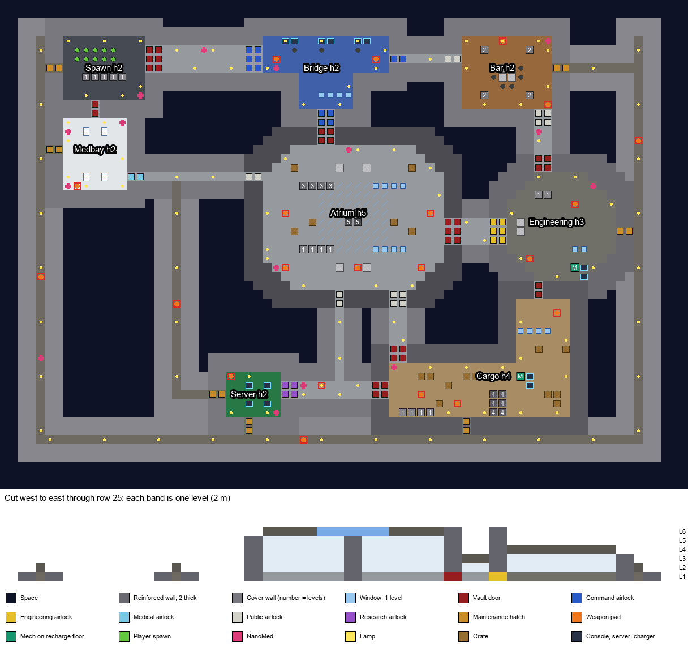

# The deathmatch arena

The owner (2026-11-21): a map for trying the combat mechanics, built for the map editor, with a deathmatch mode that is
optional and set per map (only this map turns it on for now). The owner approved the plan and then the tile design:



The first sketch, rooms and corridors only: [arena-plan.svg](arena-plan.svg). One square is one tile (2 m); north is up.
`h` is a room's height in levels (one level is one block, 2 m high).

## The owner's requirements (2026-11-21)

- Rooms and corridors are 2 levels high; some big rooms 3 to 5; maintenance tunnels 1 level high and 1 tile wide.
- Eight rooms, all of different shapes and sizes (small ones, and big ones of 10 to 20 tiles), with furniture, consoles,
  mech chargers. Rooms connect by corridors 1 to 3 tiles wide and 2 high, or straight through a door.
- Light from lamps, air, gravity, healing stations everywhere: "everything a normal map has".
- Walls are destructible: reinforced, two tiles thick; outside the station is space, so a broken wall vents the room.
- Cover inside rooms: walls and windows of different heights.
- Every room has its own floor and ceiling materials (to tell the rooms apart and to have something to break).
- Doors where rooms meet and where corridors leave rooms: reinforced (vault) doors, or ordinary airlocks of different colours.
- Players spawn at spawn points in one room, and respawn (the respawn already exists: the dev auto-respawn, DV580).
- Weapon pads: any melee or ranged weapon, ammunition or armour; when an item is taken, a new random one appears there
  5 seconds later.
- Two mech bays with armed mechs. The mechs do not come back once destroyed (the owner).
- **Scoreboard** (added by the owner): in this mode every player can see a panel with each player's kills and deaths.
- The mode is optional and set per map; for now only this map has it.

## What the map is

- **The station** stands in space, 76 x 54 tiles and 6 levels (`maps/map_files/deathmatch/arena.as3dmap`, the map json
  `maps/map_jsons/deathmatch_arena.json`, the server's `--map deathmatch_arena`). Its hull and every wall are reinforced
  walls two tiles thick (`/turf/closed/wall/r_wall`), so a blast that breaks one vents the room to space.
- **Heights.** A room or corridor is 2 levels high: its floor on level 1, open space (`/turf/open/openspace`) on level 2,
  the floor of level 3 its ceiling. The Atrium is 5 levels, Cargo 4 and Engineering 3. Maintenance is 1 level and 1 tile
  wide. The roof over a room is airless plating (reinforced glass over the Atrium's middle) in the near-station area.
  Above a door the wall goes up to the tallest floor beside it.
- **Eight rooms**, each with its own floor and ceiling (the ceiling is the `ceiling` var of the room's top turf, DV507):

  | Room | Size, height | Floor | Ceiling | In it |
  |---|---|---|---|---|
  | Spawn | 9 x 7, h2 | dark tile | white tile | 10 late-join spawns, the ghosts' start, a 1-level wall before the exits |
  | Bridge (T shape) | 14 x 8, h2 | blue carpet | dark tile | six consoles, office chairs, a window row, 2 pads |
  | Bar | 10 x 8, h2 | wood | dark tile | four 2-level pillars, a counter of tables with stools, 2 pads |
  | Medbay | 7 x 8, h2 | white tile | white tile | four beds, a window row, three NanoMeds, 1 pad |
  | Atrium (octagon) | 20 x 16, h5 | iron | iron, glass roof in the middle | a 3-level wall, a 1-level wall, two window rows, a 5-level pillar, crates, tables, 5 pads |
  | Engineering (round) | 12 x 12, h3 | engine floor | plating | a mech bay (marauder), racks, a 1-level wall, a window, 2 pads |
  | Cargo (L shape) | 20 x 13, h4 | large textured tile | iron | a mech bay (dark gygax), crates, an ore box, a 1-level and a 4-level wall, a window row, 3 pads |
  | Server | 6 x 5, h2 | green circuit | dark tile | four servers, 1 pad |

  Corridors are iron and 1 to 3 tiles wide; maintenance is plating with small lamps; 5 more pads lie in the corridors
  and maintenance (21 in all).
- **Doors.** In a two-tile wall a doorway has a door in each of its two tiles. Vault doors (`airlock/vault`): the Spawn's
  exits, the entrances of the three tall rooms, Spawn to Medbay and Engineering to Cargo. Coloured airlocks elsewhere:
  command (Bridge), engineering, medical, research (Server), public (Bar, the Atrium's other doors); maintenance hatches
  where maintenance meets a room.
- **Light, air and gravity**: the rooms are tg's `/area/deathmatch` (gravity on, lights with no APC); every floor has
  the normal air; lamps on the walls every 4 tiles (112 in all).
- **Mech bays**: the mech on `/turf/open/floor/iron/recharge_floor`, a `mech_bay_recharge_port` facing it and its power
  console beside the port. Not checked: the port charges through the power grid (`charge_cell(grid_only)`) and the map
  has none; if it does not charge, the map needs a small grid (an SMES and cable) or the chargers stay decoration.
- **Healing**: NanoMed wall vendors (`vending/wallmed/directional/*`) in every room, three in the Medbay, and on the
  corridors c1, c4, c10 and in the west maintenance.

## The deathmatch settings of a map (DV583)

A map json may have a `deathmatch` object, the port's own key, read by `datum_map_config.LoadConfig` into
`datum_map_config.deathmatch`. A map without one plays as before. Its keys:

```json
"deathmatch": { "autorespawn_seconds": 10, "scoreboard": 1 }
```

- `autorespawn_seconds`: in the first command phase of each world, `ServerHost.ReadMapDeathmatch` turns the dev
  auto-respawn (DV580, `src/Server/ServerHost.AutoRespawn.cs`) on with that delay (`ForgetRespawns` turns it off when a
  round ends, and the next world reads its map again). The dev command still turns it off or changes the delay. 10 seconds
  is the auto-respawn's default; the owner did not name a delay.
- `scoreboard`: the kills and deaths panel (below), started in the same place.

## The weapon pad (DV584)

`/obj/effect/spawner/random/deathmatch_item_pad` (`src/Core/Tg/modules/deathmatch/deathmatch_item_pad.cs`, written and
building): a random spawner of tg that stays. It spawns one item from its weighted list (tg's guns of the deathmatch
loadouts and the armory spawners, loaded; their magazines and shells; melee weapons; armour and helmets; frag and flash
grenades), watches it (`COMSIG_MOVABLE_MOVED`, `COMSIG_QDELETING`), and when it leaves the pad's tile or is deleted spawns
the next after `refill_delay` (5 seconds; a map may set it per pad), with `do_sparks` (the visual and the sound). It is
mapped on a red box decal (`/obj/effect/turf_decal/box/red`), which shows where it is; the spawner itself is not
replicated in a game. Every item path was checked against the generated types.

The type registry registers the Tg assembly's classes from the generated type table only, so a class of the port's own
there (its path is not tg's) needs `[assembly: DmPortType(typeof(...))]` next to it (`DmPortTypeAttribute`,
`DmTypeRegistry.Discover`); without it the map loader found no type for the pad's path and dropped it.

## The scoreboard (DV585)

The owner: every player in the mode can see a panel with each player's kills and deaths. tg's deathmatch has no
scoreboard (its lobby only lists the players), so this is the port's own:

- **Counting** (server, round-long, by ckey): a death of a player's mob (`COMSIG_LIVING_DEATH` on a mob with a client or a
  mind) adds a death to its player and a kill to the player who killed it. The killer is tg's `lastattackerckey` for
  melee and unarmed hits (`item_attack.dm:249`, `_species.dm:895`), but tg sets it for neither projectiles nor
  explosions: the port records the firer of the projectile that hit (`projectile.firer`, mech guns too) and the source
  of an explosion (the rocket's or grenade's firer or thrower) as the last attacker, within a time window (say 10 s), on
  this mode's maps only. A death with no attacker in the window, or by one's own hand, is a death without a kill.
  Survives a respawn (the new body has the same ckey).
- **Showing**: held, the scoreboard key (K: Tab is the cursor mode) sends keybinding code 19 (protocol version 93,
  `KeybindingCode.Scoreboard`), and the server puts three screen-text columns on that player's screen (names, kills,
  deaths; the players who play now and everyone who scored, by kills, then fewer deaths; the own row green; the
  countdown's Pixellari), redrawn on each death; released, they go. The server-made screen text is the replication (as
  DV580's countdown), so the client has no panel code of its own. Not done: showing it to everyone at the round's end.
- **Tests**: `DeathmatchArenaGameplayTests` (Server, loopback clients): Alice's laser kills Bob, Bob respawns and knifes
  Alice, a grenade Alice handled last kills Bob; the counts follow, survive the respawns, and Bob's held key shows the
  panel on the server and in his client's replica.

## State (2026-11-21)

Done and tested: the pads (Core `DeathmatchArenaTests`: 21 pads stocked, a refill at 5 s and not at 4; the editor's
`MapDocument` writes the map as it read it; no arena air is atmos-linked to space: a 1-high maintenance roof beside a taller
floor's open space is a wall, not airless plating), the map's respawn and the scoreboard (Server `DeathmatchArenaGameplayTests`).
A real client on a local server drew the arena (lamps, reinforced walls, a pad with its gun). Not checked yet, by hand in
the game: the heights and ceilings of every room, the doors, a mech and its charger (it may need a grid: an SMES and
cable), a wall breach venting a room, the panel's look on the screen; the server reports 6 turfs with an air difference
at round start (find them). Not done: the panel at the round's end.

## How the map was made

`tools/deathmatch/build_arena.py` writes the map and its json from the plan's coordinates, and with
`--preview <png>` draws the design picture above (level 1 from above and a west-to-east cut through row 25). From the
first commit on, the map is edited in the map editor (D337); running the script again writes the plan's version over
those edits.
